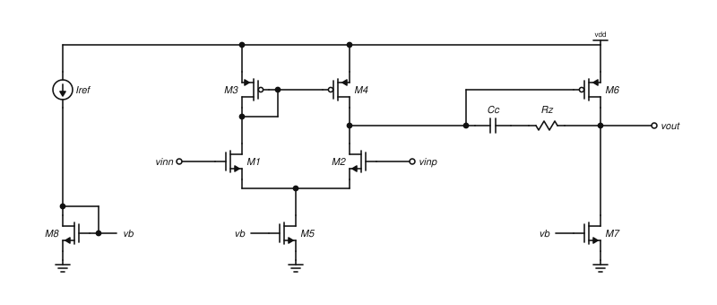
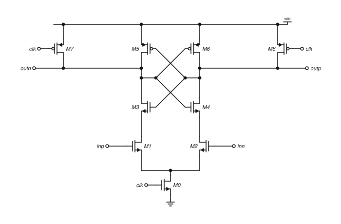
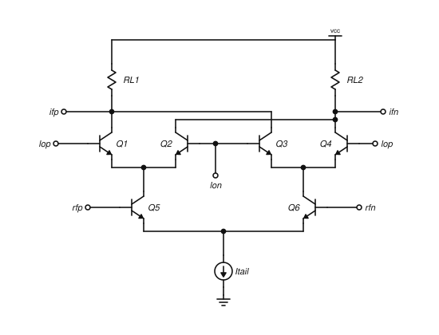
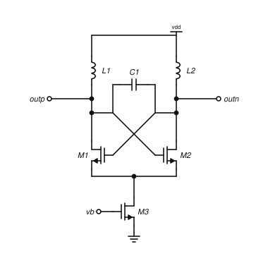
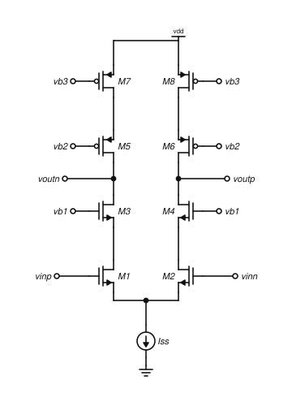
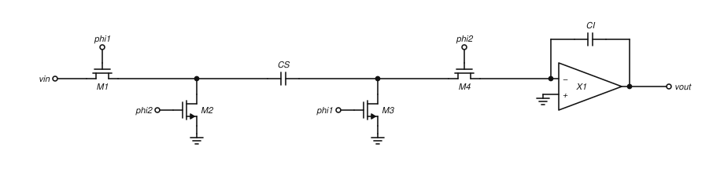
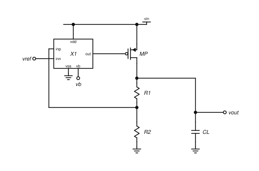

# cktintent

Draws a SPICE netlist as a schematic from what you say the circuit **is**. You state intent
in four kinds of line (what a net is, what belongs together, what is drawn as copies, which
way the signal goes); the tool places every device, routes every wire, and tells you in
circuit terms what the drawing shows. No statement takes a coordinate, a row, a rotation or
a wire path.

Python 3, standard library only (tested on 3.13).



The deck that drew it, `tests/decks/miller.sp`:

```spice
* two-stage Miller op-amp
*@ stage in  : m1 m2 m3 m4 m5
*@ stage out : m6 m7 cc rz
*@ stage ref : m8 iref
*@ match m1 m2
*@ match m3 m4
*@ match m8 m5 m7
*@ flow ref -> in
*@ flow vinn vinp -> in -> out -> vout
.model nch nmos
.model pch pmos
.subckt miller vdd vss vinp vinn vout
M1 n1 vinn tail vss nch
M2 n2 vinp tail vss nch
M3 n1 n1 vdd vdd pch
M4 n2 n1 vdd vdd pch
M5 tail vb vss vss nch
M6 vout n2 vdd vdd pch
M7 vout vb vss vss nch
M8 vb vb vss vss nch
Iref vdd vb 10u
Cc n2 nz 1p
Rz nz vout 1k
.ends
```

## Use

    python3 -m cktintent deck.sp [statements.ctl] [-o out.svg] [--json out.json] [-q]

Statements go in a file of their own or in the deck behind `*@`. With none you still get a
legal drawing. It prints the read-back and exits 0 for a legal drawing, 1 if the drawing
breaks a gate, 2 for input it cannot use.

```python
from cktintent import draw, render_svg, read_back

r = draw(deck_text, statements_text)     # never places by hand: the four statements only
r.findings                               # [] for a legal drawing
r.outcome                                # [(rule, shown, sentence)], one per relation asked for
svg = render_svg(r.schema, r.circuit)
print(read_back(r))
```

`r.schema` is the drawing as plain data (devices with pin positions, wires, rail symbols,
ports, names): what `--json` writes, and the place to start another output format.

## The four statements

| statement | says | does |
|---|---|---|
| `net <nets> : supply \| ground \| bias \| clock \| signal` | what a net is | rails at top and bottom; a bias or clock line is a name at each pin; a signal is one wire however far it runs |
| `stage <name> : <devices>` | what belongs together | one cluster, no stranger inside; a stage that stands alone is drawn in a box labelled with the name you gave it |
| `match <a> <b> [...]` | what is drawn as copies | one row, mirror images about an axis, their columns and the rest of their images with them, the tail on the axis |
| `flow <a> -> <b> -> ...` | which way the signal goes | left to right; inputs enter on the left, outputs leave on the right; a part named on the path lies flat in it |

[`CONTROLS.md`](CONTROLS.md) is the manual an agent works from: every statement, the
baseline you get with none, the defaults, and how to read what comes back.

## What comes back

    outcome: 29 of 29 relations shown
    drawn by name or symbol: vb vss
    in a box of its own: ref
    wire crossings: 0, corners: 6

Before that, a line for every relation the tool took from your statements, marked
`[NOT SHOWN]` when the finished drawing does not show it, and a `note` for every line it
refused and every terminal it had to join by name because no wire could reach it. A drawing
is **legal** when the nets read back from its geometry are the deck's nets, no two symbols
overlap, and no wire enters a symbol; three gates check that on every drawing, from the
finished picture alone.

## How well it draws

Measured on the hand-drawn corpus this was designed from (5,232 usable drawings; 1,025 of
them held out). Commands are in [`TESTING.md`](TESTING.md).

| circuits | statements | legal | relations the drawing shows | every relation shown | terminals joined by name for want of a path | crossings (people's) | corners (people's) |
|---|---|---|---|---|---|---|---|
| 14 fixture decks | inline in the deck (three have none) | 14 of 14 | 272 of 278 | 12 of 14 | 0 | 9 | 65 |
| 48 held-out circuits | written blind by four agents: deck only, no drawing; 280 lines in all | 48 of 48 | 1,431 of 1,452 (99%) | 37 of 48 | 36 of 1,295 terminals | 69 (87) | 573 (457) |
| all 1,025 held-out circuits | read off each drawing by a script (a stand-in for an agent) | 1,025 of 1,025 | 18,645 of 18,882 (99%) | 876 of 1,025 | 410, in 239 circuits | 1,024 (650) | 10,255 (6,390) |
| all 1,025 held-out circuits | none | 1,025 of 1,025 | 15,539 of 15,807 (98%) | 869 of 1,025 | 373, in 218 circuits | 988 (650) | 10,291 (6,390) |
| the other 4,207 circuits | none | 4,207 of 4,207 | 66,244 of 67,284 (98%) | 3,598 of 4,207 | 1,396, in 844 circuits | 3,997 (2,777) | 41,981 (26,081) |

The same contract, asked of the people's own drawings: with the blind statements they show
1,387 of 1,449 relations (96%); with the stand-in statements 17,111 of 18,572 held out and
73,408 of 79,403 in the rest (92% both). So the tool's drawings follow the conventions more
strictly than people do, which is what a tool should do, and says nothing yet about taste.

About 0.25 s a circuit; the largest take up to 10 s. While the placer was built its output
was looked at on the fixtures, the 48 blind circuits and the first 300 held-out circuits
only, so the first three rows say where the tool stands on circuits it was tuned near. The
other 4,900 or so were drawn once, at the end: their legality is untouched evidence.

What the numbers say, plainly:

- **Every drawing is legal**, on every deck of the corpus.
- **With an agent's statements the drawing shows what was asked** (1,431 of 1,452
  relations), and crosses wires less often than the people's drawings of the same circuits
  (69 against 87).
- **It still turns more corners than people do**, and it gives up on about 3 net terminals
  in a hundred (36 of 1,295 on the blind set), joining each by name where a person found a
  path for a wire.
- **With no statement it is tidy but not clever**: it does not guess pairs, stages or the
  direction of flow, and its crossings are about one and a half times the people's (988
  against 650).

`docs/gallery/` holds what it draws for each deck in `tests/decks/`.

| | | |
|---|---|---|
|  |  |  |
| StrongARM latch | Gilbert cell | LC oscillator |
|  |  |  |
| telescopic cascode | switched-capacitor sampler | LDO |

## What it does not do

- **Large circuits read worse than small ones.** Placement is constructive (rows, columns,
  mirrored groups, bands), not a search: thirty devices come out legal and ordered but
  spread out, and a net of many flat two-pin parts (an RF tank with its varactors) crowds
  into one level.
- **Two things the four statements cannot say**, both found in the study: that two flat
  chains are parallel lanes of one differential path, and that one particular transistor is
  a switch when its gate line also drives something else.
- **Some conflicts in the study's table are reported, not resolved**: a `match` whose gate
  line ends up a name keeps its row; a `flow` between two mirror images is not refused.
  The read-back marks any relation the drawing fails to show either way.
- **A subcircuit instance is one block**, not expanded.
- **SVG and the schema JSON are the only outputs.**

## Layout of this tree

| | |
|---|---|
| `cktintent/` | the tool: [`ARCHITECTURE.md`](ARCHITECTURE.md) walks the pipeline, who owns which table, and what three likely changes would touch |
| `tests/` | 43 tests, about 3 s, and the fixture decks: [`TESTING.md`](TESTING.md) maps each bug class to the oracle that catches it |
| `tools/corpus.py` | the corpus sweep: draws every deck, gates it, and compares with the person's drawing; `--people` judges the people's drawings instead |
| `tools/statements/` | the 48 statement files that four agents wrote blind (deck only, no drawing) in the study |
| `tools/gallery.py`, `tools/check.py` | regenerate `docs/gallery/`; check file size and docstrings |

## Where it came from

A study of 5,232 hand-drawn schematics asked which conventions people follow and which of
them an agent has to be told. Its answer is the contract in `cktintent/contract.py`: seven
baseline rules that hold with no statement and ten more that the four statements switch on,
each a relation a drawing either shows or does not, each counted on the people's drawings
(`python3 -I tools/corpus.py <corpus> --people --stand-in` prints the count per rule). The
placer's defaults that go beyond the contract carry their own counts in
`cktintent/defaults.py` and `cktintent/route.py`.

Two things in this tree differ from the study's contract, both measured before they were
kept: the symmetry finder tells parallel twins apart by their gate net (it finds 69 more
image pairs in the training drawings, of which people drew 65 in one row; all 9 new ones in
the held-out drawings hold), and a flow line that is refused no longer claims its end ports.
