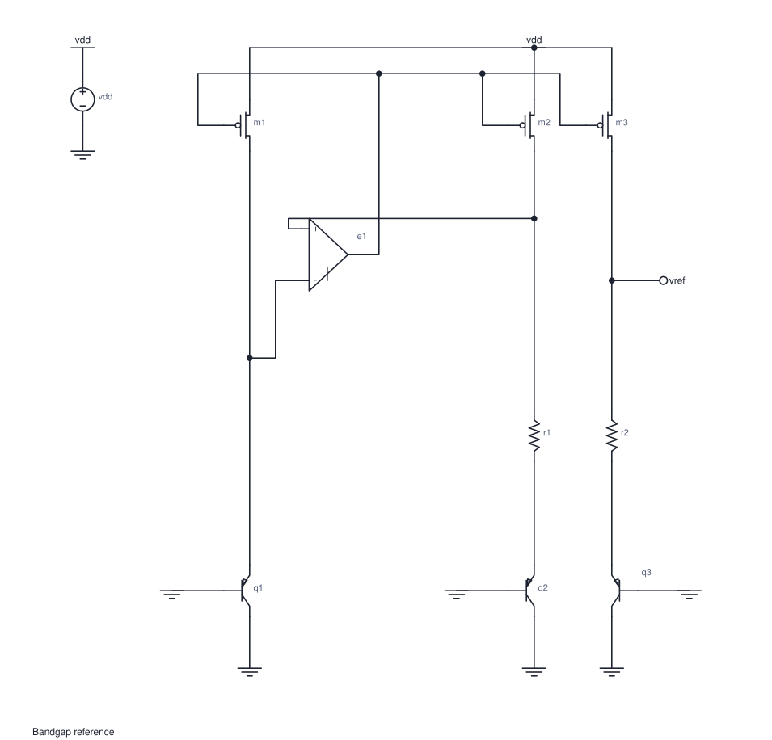
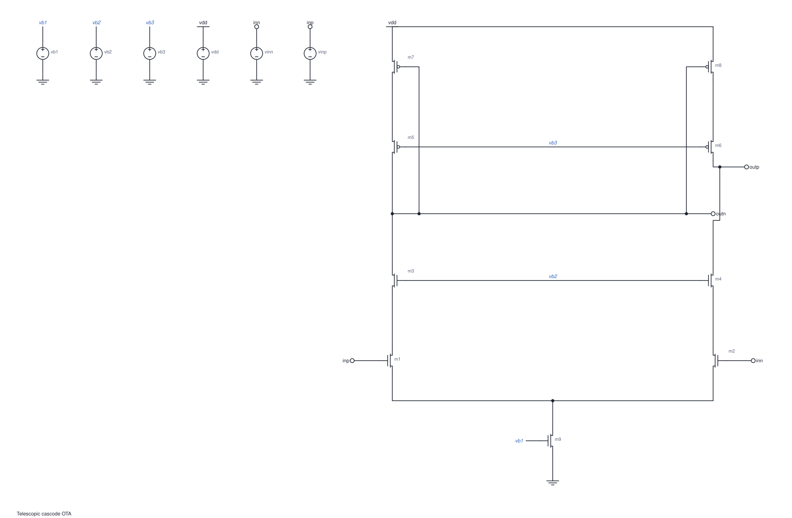
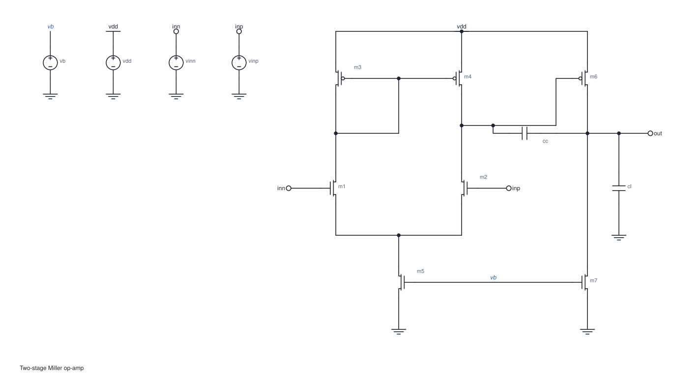
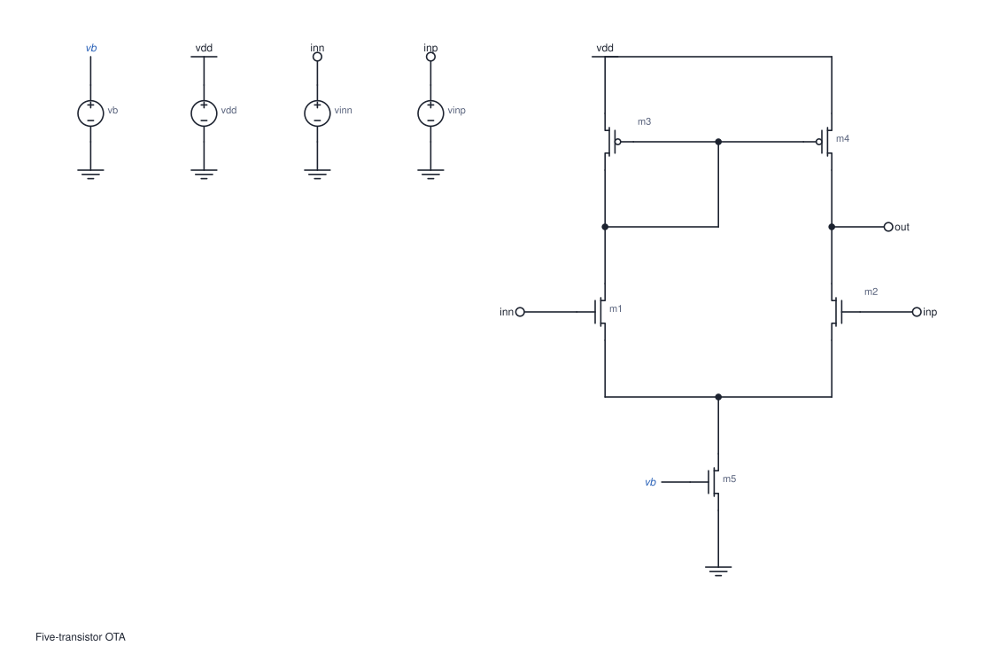
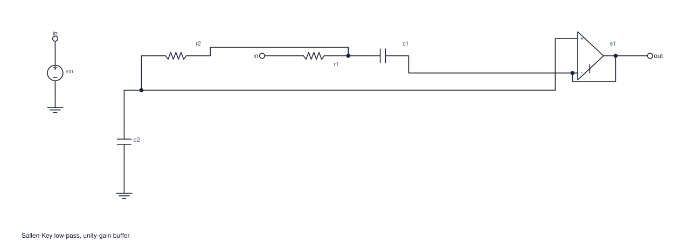
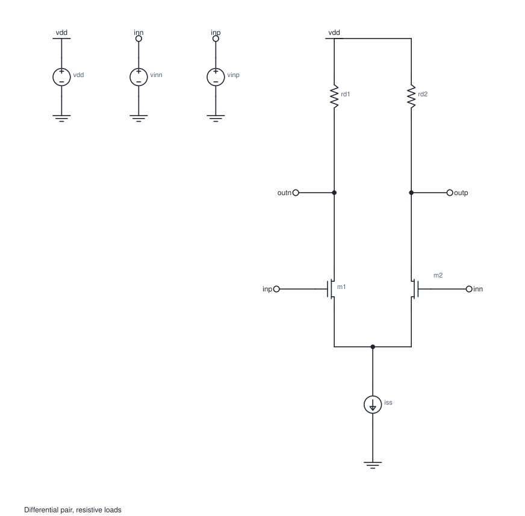
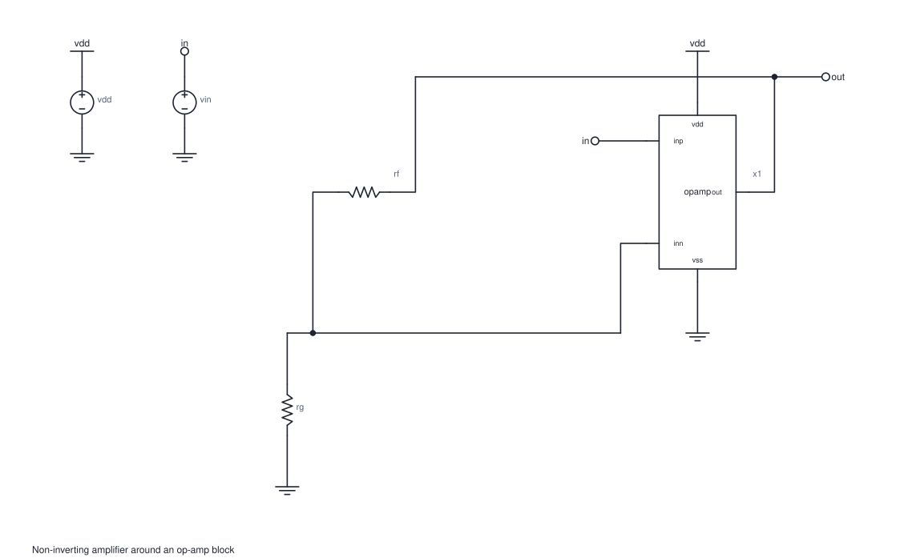

# cktImg

[](https://ziglang.org/download/)

**Automatic schematics from SPICE netlists.**

cktImg reads the netlist you already simulate and lays it out the way a
textbook would: supply at the top, ground at the bottom, signal flowing left
to right, and matched branches side by side. The same layout engine gives you
an editable schematic in [Schemify](https://github.com/Scouren/Schemify-Releases), a
LaTeX figure for your paper, or JSON placement data for your own tools.



- **No drawing.** Placement, wiring, junctions and net labels are all automatic.
- **Your symbols, not ours.** You decide what each device looks like and where
  its pins are, and wires land exactly on them. See [Defining devices](#defining-devices).
- **One engine, three front ends.** A Schemify plugin, a LaTeX package and a
  JSON/SVG command-line tool, plus a Zig package and a C library.

## Quick start

All three need nothing but the repository (or a release download). Building from
source needs [Zig 0.17.0](https://ziglang.org/download/) (`nix develop` pins it).

### 1. As a Schemify plugin

Import a netlist as editable Schemify cells: one `.shcomp` per `.subckt`, a
`.shbench` for the top level (named after `.title` when the deck has one), each
device mapped onto a Schemify `core` cell. An `X` of a subckt the deck does not
define becomes an instance of that cell in one of the project's `lib … path`
libraries (a PDK's devices) when one holds it.

In Schemify the plugin is called `netlist-import`. It is not in the Schemify
store yet, so you add it by hand, in one of two ways.

From this repository, in your Schemify config (`init.lua`) or a project's own
init file (fetching it needs read access to this repository):

```lua
schemify.pack.add({
  { src = "https://github.com/Scouren/cktImg", name = "netlist-import",
    grant = { "read_project", "write_project" }, fuel = 100000000000 },
})
```

Then run `schemify pack sync`. Or, from a checkout, point a spec at it
(a project's init file takes paths relative to the project):

```lua
schemify.pack.add({
  { path = "plugins/cktImg", name = "netlist-import",
    grant = { "read_project", "write_project" }, fuel = 100000000000 },
})
```

A project names its init file in its `schemify.project` header
(`init project.lua`), and Schemify asks you to trust it the first time the
project opens. `plugin` records in a project manifest are not loaded.

In the editor, use **File ▸ Import SPICE
netlist…** (`Ctrl+Shift+I`) and type a project-relative path such as
`n2s/opamp.sp`. In a development build of Schemify (the `dev-cli` feature, or the Nix package
`schemify-dev`; release builds leave the command stream out), the same import
is one command:

```sh
schemify cmd --trust <project-dir> netlist.import n2s/opamp.sp
```

Its command is `netlist.import`: Schemify's menus, logs and written files
never name the engine. The command's old name `cktimg.import` is
still accepted, for existing keymaps and scripts, but is not declared, so the
command palette does not list it.

The files are written next to the netlist and existing cells are never
overwritten. `fuel` raises the per-event budget from the default 10^8 so large
flat cells lay out; at most 200 element cards are imported per netlist.

The repository ships the module prebuilt as `netlist-import.wasm`; rebuild it with
`zig build -Dschemify_plugin=true` (sources in [`tools/schemify/`](tools/schemify)).

### 2. As a LaTeX package

```sh
zig build -Dlatex_renderer=true          # zig-out/bin/cktimg-tex
```

Put `latex/cktimg.sty` and your netlist next to your `.tex` file, put
`cktimg-tex` on your `PATH`, and write:

```latex
\usepackage{cktimg}
% ...
\cktimg{amp.cir}
```

Compile with `pdflatex -shell-escape`; the figure regenerates whenever the
netlist changes. No shell escape (Overleaf)? Run `cktimg-tex amp.cir
amp.cktimg.tex` locally and upload the result. Details:
[Figures for a paper](#figures-for-a-paper); a full example is in
[`examples/latex/`](examples/latex).

### 3. As a JSON interface

```sh
zig build                                # zig-out/bin/cktimg-json
cktimg-json amp.cir amp.json             # placement as JSON
cktimg-json --svg amp.svg amp.cir        # and an SVG drawing
```

`amp.json` holds each device's position, rotation and mirroring, every pin's
point, wires as polylines, junction dots and net labels, so another editor or
script only has to create them. Pass `--symbols` with your own symbol file and
`--target` with a class map to place for your editor's cells: see
[Your own schematic editor](#your-own-schematic-editor).

Prebuilt `cktimg-tex` and `cktimg-json` for Linux, macOS and Windows are on the
[releases page](https://github.com/Scouren/cktImg/releases/latest).

## Contents

- [Download](#download)
- [Figures for a paper](#figures-for-a-paper)
- [Your own schematic editor](#your-own-schematic-editor)
- [Defining devices](#defining-devices)
- [How the layout is made](#how-the-layout-is-made)
- [Gallery](#gallery)
- [For developers](#for-developers)
- [From an AI agent](#from-an-ai-agent)
- [Documentation](#documentation)

## Download

Every [release](https://github.com/Scouren/cktImg/releases/latest) includes
the tools prebuilt. Each one is a single file, so there's nothing to install.
Choose the file whose name ends with your platform:

| Platform | Suffix |
|---|---|
| Windows | `-x86_64-windows.exe` |
| macOS, Apple silicon (M1 and later) | `-aarch64-macos` |
| macOS, Intel | `-x86_64-macos` |
| Linux, x86-64 | `-x86_64-linux` |
| Linux, ARM64 | `-aarch64-linux` |

| Tool | Use it for |
|---|---|
| `cktimg-tex` | Figures in LaTeX (also in `cktimg-latex.zip`, with the LaTeX package) |
| `cktimg-json` | SVG images, and JSON for other editors |

On macOS and Linux, mark the file executable once with `chmod +x <file>`. On
macOS, the first time you open it you may need to right-click it and choose
**Open**.

## Figures for a paper

### LaTeX

1. Download **`cktimg-latex.zip`** and unzip it.
2. Put `cktimg.sty` and your netlist (for example `amp.cir`) next to your `.tex` file.
3. Add the figure:

   ```latex
   \usepackage{cktimg}
   % ...
   \begin{figure}
     \centering
     \cktimg{amp.cir}
     \caption{Two-stage amplifier.}
   \end{figure}
   ```

4. Compile with `pdflatex -shell-escape paper.tex`. Whenever the netlist
   changes, the figure is regenerated.

**Overleaf, and other setups without `-shell-escape`:** generate the figure
on your own computer and upload the result alongside the netlist.

```sh
cktimg-tex amp.cir amp.cktimg.tex
```

When a netlist contains only subcircuit definitions, both native CLIs draw the selected top cell using its declared interface and matching source geometry. Flat netlists retain their ordinary layout.

`\cktimg{amp.cir}` will then input `amp.cktimg.tex`. The figure is
[CircuiTikZ](https://ctan.org/pkg/circuitikz), so it uses your document's
fonts and can be edited by hand. A complete example is in
`cktimg-latex.zip` under `examples/`.

### Word, PowerPoint, or the web

```sh
cktimg-json --svg amp.svg amp.cir > /dev/null
```

`amp.svg` opens in any browser and can be inserted directly into Word or
PowerPoint. To get a PDF or PNG, export it from a vector editor such as
Inkscape.

## Your own schematic editor

cktImg decides where every device, pin, wire and label goes; your editor only
has to create them. That works for KiCad, an in-house tool, or
anything else that can read a file or call C.

1. **Describe your editor's symbols** in a symbol file, giving each pin's
   position in your editor's coordinates (see [Defining devices](#defining-devices)).
   Wires are then guaranteed to land on your symbols' pins.
2. **Map device classes to your library's cells** in a small target manifest:

   ```json
   {
     "target": "myeditor", "version": 1,
     "unmapped": { "mode": "box", "sym": "basic/generic" },
     "classes": {
       "nmos": { "sym": "devices/nmos4" },
       "res":  { "sym": "devices/res", "pins": ["a", "b"] }
     }
   }
   ```

   `pins` lists the terminal names from your symbol file, in the order your
   cell numbers its pins. The full format is in [`docs/TARGETS.md`](docs/TARGETS.md).
3. **Place:**

   ```sh
   cktimg-json --symbols myeditor.zon --target myeditor.json amp.cir amp.json
   ```

   `amp.json` gives each device's cell, position, rotation and mirroring,
   every pin's point, wires as polylines, junction dots and net labels.
4. **Import** it with a short script in your editor's own language: one call
   per instance, one per wire.

The Schemify plugin ([`tools/schemify/`](tools/schemify)) is a complete working
example of steps 1 to 4: its symbols are Schemify's `core` cells and it writes
Schemify records.

To link cktImg directly instead of reading a file, use the C library; see
[From C](#from-c).

## Defining devices

cktImg works out *how a circuit is connected* from the netlist, but it never
assumes *what a device looks like*. That comes from a **symbol set**: a
`.zon` file that lists, for each kind of device, where its pins are and how
its body is drawn. The layout reads pin directions and body sizes from that
file, so the same netlist can be placed for the bundled textbook symbols,
for an editor's symbols, or for your own. In every case each wire ends exactly
on a pin.

```zig
.{
    .unit = 40, // grid spacing: pin-to-pin length of a two-pin device
    .classes = .{
        .{
            .name = "res",
            .terminals = .{
                .{ .name = "a", .at = .{ .x = -20, .y = 0 } },
                .{ .name = "b", .at = .{ .x = 20, .y = 0 } },
            },
            .draw = .{
                .{ .line = .{ .a = .{ .x = -20, .y = 0 }, .b = .{ .x = -12, .y = 0 } } },
                .{ .polyline = .{ .{ .x = -12, .y = 0 }, .{ .x = -6, .y = -4 }, .{ .x = 0, .y = 4 }, .{ .x = 6, .y = -4 }, .{ .x = 12, .y = 0 } } },
                .{ .line = .{ .a = .{ .x = 12, .y = 0 }, .b = .{ .x = 20, .y = 0 } } },
            },
        },
        // .{ .name = "nmos", ... }, .{ .name = "vdd", .role = .power_rail, ... }, ...
    },
}
```

| Field | Meaning |
|---|---|
| `name` | The device class: `res`, `cap`, `ind`, `diode`, `vsource`, `isource`, `nmos`, `pmos`, `npn`, `pnp`, `njfet`, `pjfet`, `switch`, …, plus the rails and ports `vdd`, `gnd`, `ipin` and `opin` |
| `terminals` | The pins, **in SPICE node order** (an M line lists d, g, s, b), each with its position `at` |
| `.hidden = true` | A pin that is connected but gets no wire, such as a MOSFET bulk |
| `.ground_ref = true` | A pin that gets no wire when its net is ground, such as an op-amp reference |
| `draw` | The body, as `line`, `polyline`, hollow `circle`, `text`, and solid `filled_circle` strokes; it sets how much room the device takes |
| `role` | Only for rails and ports: `power_rail`, `ground_rail`, `input_port`, `output_port` |
| `unit` | The grid spacing that the layout's wire lengths are measured in |

**Coordinates.** Integers, with the origin at the device's centre and y
pointing down. A symbol is described lying **horizontally**, main pins on
the x axis and a control pin (gate, base) off to the side. The layout stands
a device upright by turning it a quarter turn to the left, which puts a
MOSFET's drain at the top and its source at the bottom. If your editor draws
symbols upright, turn each pin a quarter right, `(x, y) → (-y, x)`.

**Missing classes.** Any device whose class your file leaves out is drawn as
a generic box. A subcircuit instance is drawn with a class named after the
subcircuit if you define one, and as a generated box otherwise; see
[Subcircuits](#subcircuits).

**Bundled sets.**
[`tests/symbols.zon`](tests/symbols.zon) holds generic textbook symbols. The
tools use it by default, and it is the easiest file to copy and edit.

## How the layout is made

cktImg uses the netlist’s device roles and connections to select local layouts. The comparison gallery tracks which arrangements match published circuits, including cases where closer grouping adds a crossing. [Production drawings beside their original figures](docs/research/production-patterns/README.md)

| The book | cktImg |
|---|---|
| Supply on top, ground below, current flowing down | Each branch from the supply to ground is a column, its devices in current order. The supply is a rail across the top; each branch ends in its own ground symbol. |
| Matched devices side by side | A differential pair, a current mirror, a cross-coupled pair, and every pair of devices the symmetry maps onto each other share a row wherever the circuit allows. |
| Symmetric circuits drawn symmetric | A left-right symmetry found from the connectivity (not the names) is drawn as an exact mirror image about a vertical axis. What the symmetry maps to itself (a tail, a common-mode node) sits on the axis. |
| Signal left to right | Inputs enter as ports from the outside and outputs leave at the edge. A stage with no mirror image sits right of the core when it reaches an output, left of it otherwise. |
| Wires, not labels | Folds, gate lines, feedback, common-mode loops and cross-couplings normally use wires. A verified comparator output can join its two drains locally and name the remote gate. An external bias can use a named wire between two facing gates in one row or an input port at each gate. Other nets use labels where a wire would run through a device or touch another net. |
| One picture per circuit | The drawing depends on the circuit, not on the order of its cards. |

It is made in the order a person draws: find the structure (pairs, mirrors,
stacks, and the circuit's symmetry, by colour refinement of the netlist
graph), place the devices by it (rows by current order with matched groups
level, columns ordered for the shortest wires, the symmetric half mirrored),
then wire the placement (the book's patterns for rails, gate lines and
trunks, and a maze router for the rest). Placement never moves to make room
for a wire. The core stages are described in [the layout algorithm](docs/ALGORITHM.md). The [comparison gallery](docs/research/production-patterns/README.md) covers the source-qualified patterns.

**Steering lines.** A deck can override what the engine decides, one `*@`
line per decision, at the top level of the deck drawn:

```spice
*@ group pair M1 M2        what belongs together (also mirror, bank, stack, cross)
*@ symmetric M3 M4         the left-right mates; axis M5; symmetry off
*@ role vb1 bias           a net's role; driver, class, kind, expand
*@ above M9 Iss M7         rows top down; row M1 Rc Cc holds them level
*@ order RD1 M1 M5 M2      columns left to right
*@ face M3 g left          a gate's side, which end is up, or a flat part's left end
*@ label vb1               names, not a wire; wire, port, rail, first
*@ cell M5 2 4             a lattice cell
*@ at M5 6 4.5 R90         exact coordinates and turn; refdes M5 left
*@ route n1 2,0 2,3 5,3    a net's exact wire; via n1 4,1 passes a point
*@ weak row M5 M6          a stay: kept unless a strong line needs the room
```

Every line is honoured or reported: `cktimg-json --report` lists each as
honoured, relaxed, dropped (with the stronger lines that blocked it) or
rejected, and checks every honoured line against the finished drawing. Lines
never break the drawing's guarantees: a line that would is refused. A
later line beats an earlier one, a strong one a `weak` one, and every line
beats what the engine would decide. `--decisions 4` prints the engine's own
decisions as these lines (cells and places as `weak` stays); a deck plus
them draws the same picture.

**Relaying a drawing.** `cktimg-json --from last.json deck.spice out.json`
lays a deck out from its last drawing (the tool's own JSON, as written or
with things moved in it) instead of from nothing. The engine reads the
deck's structure as it is now and keeps every column and row that drawing
still agrees with; only the radius of change is laid again: a device new
to the deck, one the structure now puts elsewhere (a tail that a second
half moves onto the mirror axis), and the lines pushed along to make room.
A deck that did not change relays to the same bytes. A `weak at` line is
such a stay; a strong `at` still puts a device exactly where it says.
[`docs/research/vocabulary.md`](docs/research/vocabulary.md) has every
verb. In a
`.subckt`, the lines are that cell's for the Schemify import, which logs
each one the engine does not honour.

## Gallery

Each drawing below comes straight from its netlist, with no hand edits
(`zig build gallery -- --svgs out/` regenerates them).

**Beside a person's drawing.** The comparison site (not published yet; it
returns 404 at `https://scouren.github.io/cktImg/`) shows all 5,274 reference
circuits of the [Analog Canvas](https://analog-canvas.tokenzhang.com) gallery,
the drawing a person made beside the one cktImg makes from the same netlist,
with both drawings' crossings, corners, wire length and written names, and the
textbook circuits below. `.github/workflows/site.yml` rebuilds it on every push
to `main` from the cached drawings in [`external/examples`](external/examples)
(`python3 -I tools/site/build.py external/examples zig-out/bin site` locally).

**Telescopic cascode OTA.** Two columns of four transistors, mirrored about
the tail. The bias lines `vb2` and `vb3` are named wires between their gates;
`vb1`, on the tail's one gate, is a label.



**Two-stage Miller op-amp.** Mirror load on top, the pair mirrored about its
tail, the second stage on the right with its current source beside the tail
on the bias line `vb`, and the compensation capacitor across it.



**Five-transistor OTA.** The pair mirrored about the tail, the mirror load
above it.



**Sallen-Key low-pass with a unity-gain buffer.** Every net is a wire, the
feedback capacitor's included.



**Differential pair with resistive loads.**



**A `.subckt` as a block.** This is the op-amp from above, with its ports
placed where the `*@` comments ask.



The bandgap reference at the top has three PMOS branches on one gate line,
driven by the op-amp between the first two branches; the line is wired over
the branches.

## For developers

The core is a Zig library that produces geometry only: device positions and
orientations, pin points, wires as polylines per net, junctions, net labels
and no-connect marks. Rendering is up to the caller. The tools in `tools/`
are thin layers on top of it.

### Zig

```sh
# The repository root is the package (build.zig.zon):
zig fetch --save git+https://github.com/Scouren/cktImg#<tag-or-commit>
# or a release tarball, the same files:
zig fetch --save https://github.com/Scouren/cktImg/releases/download/<tag>/NetlistParser-<tag>.tar.gz
```

```zig
// build.zig
const np = b.dependency("NetlistParser", .{ .target = target, .optimize = optimize });
exe.root_module.addImport("NetlistParser", np.module("NetlistParser"));
```

```zig
const np = @import("NetlistParser");

var lib = np.Library.init(gpa);                 // your symbol set
defer lib.deinit();
try lib.loadZon(arena, symbols_zon, &diags);    // e.g. tests/symbols.zon

var placed = try np.place(gpa, &np.Config.default, &lib, &.{spice_text}, &diag);
defer placed.deinit();
// placed.dev_pos, .dev_orient, .pin_xy, .segments(net), .junctions, .labels, …
```

The package and module are named `NetlistParser`. Requires Zig 0.17.0.

### From C

Running `zig build lib` produces `zig-out/lib/libcktimg.a` and
`zig-out/include/cktimg.h`, a plain C99 interface with no dependencies.
Prebuilt archives for each platform are attached to every release. Symbols
can be registered directly in code with `cktimg_lib_add` or loaded from a
`.zon` file with `cktimg_lib_load_zon`. See [`docs/API.md`](docs/API.md#8-from-c).

### Subcircuits

An `X` instance of a `.subckt` becomes a single block, drawn with your class
of the same name or with a generated box. Comments inside the definition
control where its ports go:

```spice
.subckt opamp inp inn out vdd vss
*@ left inp inn        (also right / top / bottom)
*@ right out
...
.ends
```

Without a directive a port goes by its name: supplies on top, grounds and
bias lines (`vb1`) at the bottom, an output (`out`, `vout`, `vo`) on the
right, the rest on the left.

With `*@ expand`, the body is drawn instead of a block, flattened using
ngspice names (`r.x1.r1`).

A circuit of amplifier blocks and two-pin parts (an inverting amplifier, a
filter, an integrator) is drawn along its signal, as people draw one: the
inverting input on top, the feedback part over the block, the input's part
level with its pin, the load upright at the right. The amplifier is known by
its port names (`inp`/`vip`/`in+`, `inn`/`in-`, `in`/`vin`, `out`/`vout`,
rails); a line that places a device (`row`, `order`, `at`, ...) takes the
whole placement back to the lattice.

An `X` whose master isn't defined in the deck is drawn too. A PDK primitive
(`XM1 d g s b sky130_fd_pr__nfet_01v8`, or a `…res…` or `…cap…` cell) is
drawn as that device; anything else becomes a block with ports `p1`..`pN`.

### Command line

```sh
cktimg-json   [--config lint.zon] [--symbols set.zon] [--target manifest.json] [--svg out.svg] [--report r.json] [--decisions 1-4] [--from last.json] deck.spice [out.json]
cktimg-tex    [--config lint.zon] [--symbols set.zon] [--standalone] [--lint] deck.spice [out.tex]
```

`src/config.zig` lists every setting with its default: the layout's lengths
and the router's costs (`.layout`, in units of the symbol set's `unit`), the
lint rules, and the TikZ style. A settings file (`--config`) sets any of
them, as the lint rules are set:

```zon
.{ .layout = .{ .stack = 1.5, .terminal = 2 }, .rules = .{ .no_ground = .err } }
```

The drawing is closed up to those lengths, as a person draws it: columns
`series` apart, stacked devices `stack` apart (half a unit, a person's
pitch; `.stack = 1, .rail = 1, .terminal = 1, .tap = 1` is roomier). `.layout = .{ .compact = false }`
keeps the roomier lattice instead. A supply bar is a named rail, no symbol
on it, running half a unit past its outer pins, its name at its right end;
`.rail_past = false` draws the bar with its supply symbol, ended on them.
A rail symbol on a two-pin part's end stands on the pin itself. A net whose wire would cross more than
`cross_max` other wires (3) is joined by name, its pins that stand near
each other still wired; `.cross_max = 2`
is how sparingly a person crosses wires, at the price of more names, and
`.cross_max = 6` wires more and names less.
A row of more than eight device columns wraps into rows, as people draw a
large circuit, the nets between two rows joined by name; `.layout = .{ .shelf = 12 }`
sets the width (`0`: one row), and `*@ shelf <columns>` or `*@ shelf off` in a
deck says so for that deck.
A file containing only `.subckt` definitions draws its last one, its
voltage sources in the circuit (`*@ driver <src> apart` sets one apart), and
`examples/blocks.spice` is a hierarchical deck to try. The JSON format is
described in `src/json.zig`.

### Build

```sh
zig build                             # libcktimg.a, cktimg.h, cktimg-json, gallery
zig build lib                         # only libcktimg.a + cktimg.h (-Dtarget=wasm32-freestanding works; -Dpic=true for a PIE host)
zig build lib -Dzon_config=false      # C ABI without the ZON parser (smaller wasm)
zig build -Dlatex_renderer=true       # also cktimg-tex and the TikZ emitter
zig build -Dschemify_plugin=true      # also netlist-import.wasm, the Schemify plugin (written to the repository root)
zig build test                        # library, algorithm, API, C ABI and Schemify-import tests (add -Dlatex_renderer=true for the TikZ code too)
zig fmt --check src tools tests build.zig
zig build gallery -- --svgs out/      # the gallery as SVG
zig build fuzz                        # 4000 random netlists through the pipeline
python3 tests/roundtrip.py <dir>      # every fixture imported, netlisted back and compared by a Schemify build in <dir>
```

Run them inside `nix develop`, which pins Zig 0.17.0 and the Binaryen optimizer
used for the Schemify plugin. The module is byte-reproducible there. CI fails when it differs from
its rebuild or reaches 550 KB. `tests/roundtrip.py` needs `schemify` and
`spicecmp` from a Schemify development build (`dev-cli`) in `<dir>`:

```sh
cargo build --features schemify-cli/dev-cli,schemify-app/dev-cli \
  -p schemify-cli -p schemify-app --bin schemify --bin schemify-gui
cargo build -p schemify-spicecmp --bin spicecmp
```

### Repository layout

| Path | Contents |
|---|---|
| `src/` | The library: parser (`netlist.zig`, `hints.zig`), layout (`schematic.zig`, then `structure.zig`, `skeleton.zig`, `sketch.zig` and the files they name), result (`placed.zig`), symbol sets (`library.zig`), lint and render settings (`config.zig`), C ABI (`abi.zig`) |
| `include/cktimg.h` | The C header |
| `tools/` | `cktimg-json` and `cktimg-tex` |
| `tools/site/` | The public site: `build.py` (static pages), `fetch.py` and `convert.py` (fill `external/examples`) |
| `external/examples/` | The Analog Canvas reference circuits, cached: deck, drawing and preview of each |
| `tools/schemify/` | The Schemify plugin: SPICE reader, cell mapping, layout through the engine, file writer, wasm glue, and Schemify's plugin ABI (`abi.zig`, vendored) |
| `netlist-import.wasm`, `schemify.project` | The built plugin and its package manifest (what `schemify pack` installs) |
| `latex/cktimg.sty` | The LaTeX package |
| `tests/` | Tests, the bundled symbol set, the SVG renderer and the gallery |
| `docs/` | API, target manifests, and the layout algorithm |
| `skills/cktimg/` | The agent skill for drawing schematics with cktImg |

## From an AI agent

[`skills/cktimg/`](skills/cktimg) is a skill for coding agents that draw
schematics with cktImg: write the deck so its names carry its meaning, draw,
review the drawing against the book's look, and fix each complaint on the
highest rung that can (names, then what the circuit means, then where
things stand to each other, then the `lint.zon` lengths). Link the folder into `~/.claude/skills/` (Claude Code) or your
agent's skills directory. [`HINTING.md`](skills/cktimg/HINTING.md) in it is the procedure for
hinting a drawing to hand-drawn quality with `*@` lines.

## Documentation

- [`docs/API.md`](docs/API.md): the Zig and C API
- [`docs/TARGETS.md`](docs/TARGETS.md): target manifests for other editors
- [`docs/ALGORITHM.md`](docs/ALGORITHM.md): how the structure, placement and wiring work, stage by stage
- [`CHANGELOG.md`](CHANGELOG.md): what changed in each release

## License

MIT, see [LICENSE](LICENSE).
