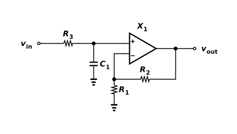
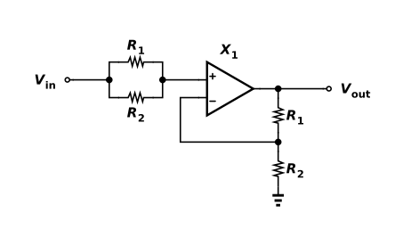

# Which parts of a human schematic should the layout preserve?

In the AG1080 comparator, a reader should be able to find each input pair, its tail and the latch it feeds. Both the published figure and the gallery redraw make those stages legible. They disagree on the left-to-right order of two stages, how the latch gates cross, and where to break the output wires. A netlist supplies strong evidence for the first decision. It leaves several good answers to the others. [Published AG1080, panels (a)–(c)][book1080] · [gallery redraw](../../external/examples/analoggenie/ag-1080.svg) · [earlier placement experiments](image-rules/ag1080-global-symmetry.md)

The [follow-up comparison](more-human-layout-patterns.md) extends this review to mirror loads, bias and rail wiring, passive filters and bridges. The [coverage ledger](rule-coverage.md) records the remaining limits on generalization.

For the proposed ruleset, describe each pattern by the **terminal relationship a reader needs to follow**, the **arrangements that have been observed**, and the **information that can select between them**. A divider tap with exactly three device terminals, for example, warrants a stronger alignment preference than a mere shared net. If two pictures of the same stage use different arrangements, retain the alternatives. An explicit input side or a neighboring stage may settle the choice. Without that information, a tidy default is an editorial choice. [Existing conditional rules](image-rules/round-2/proposed-human-rules.md) · [prior study of ambiguous arrangements](image-rules/round-2/tenth-arrangement-plan.md)

## Stage membership, input sides and latch wiring

**Keep symmetry local to the matched branches. Give the stage's input connections their own placement decision.** In 24 selected tail-fed pairs, 23 upstream pairs sit level with their gates facing outward. Of those 23, eighteen take their inputs on opposite sides of the pair and five take both inputs from the left. The remaining pair, AG1028, also takes both inputs from the left. It staggers the transistors and faces both gates left so each input can enter on a straight wire. This narrows how to use the gate-facing and level-row preferences in `skeleton.10`, `skeleton.14` and `mates.2`. [AG928, opposite sides][book928] · [AG333, both left][book333] · [AG1028, staggered][book1028]

The left-entry cases show what to leave free. AG329, AG333, AG978 and AG1041 bring the far input below the level pair. AG986 takes it above. The gallery redraws of AG329, AG986 and AG1041 move the far input to the other side of the pair while preserving the two outward gates. Count the two **external wire ends** as well as the two gate directions when judging whether a drawing keeps the intended interface. [AG986 original, leftmost input pair][book986] · [AG986 redraw](../../external/examples/analoggenie/ag-986.svg) · [AG978 original][book978]

**Keep the latch recognizable while leaving the crossover style open.** In AG1080, follow OUTP from the drains of M20/M24 to the gates of M21/M25, and OUTN from the opposite drains to the gates of M20/M24. The original uses two short horizontal returns at different heights. Each wire jumps the other gate column and meets its own gate column at a dot. The redraw uses two diagonal Xs. The original also wires the outer M29/M31 drains into their respective outputs. The redraw uses detached, named output connections there. Both drawings keep four upper local groups and one lower latch, and they exchange the middle-left and middle-right groups. AG1080 supports grouping, but requiring diagonal Xs, detached outer outputs or a particular middle-row order would reject the published figure. This comparison traces the named local terminals. Two clocked devices in panel (c) lack printed instance numbers. [Original][book1080] · [redraw](../../external/examples/analoggenie/ag-1080.svg) · [DUT cards](../../external/examples/analoggenie/ag-1080.cir) · [earlier redraw partition study](image-rules/round-2/eighth-partitions.md)

## A divider that drives a MOS gate

**Align the gate with the wire tap. Leave the resistor spacing and the side of the divider free.** The earlier study identified AG100. Across the four cached collections, twelve redraws have exactly two resistor pins and one MOS gate on the tap, with the other resistor ends on opposite rails. All twelve use an upright divider and one straight horizontal tap-to-gate wire. Only seven put the tap halfway between the resistor centers. In AR1190 the divider is on the **right** of the transistor, leaving the source-side input network room on the left. In the AR3726 and AR5873 redraws an external port adds a fourth wire arm at the tap. The originals also show the fourth arm. AR3726 marks the input-resistance measurement there, while AR5873 labels the terminal VG. All eleven AnalogRetriever originals and the AG100 original show the straight tap-to-gate wire. The exact center counts come from the redraws. [AR3726 original](https://huggingface.co/datasets/eulermaxwell/AnalogRetriever-data/resolve/0c053b6580315d8a89c629d67994a6da4575a17f/iccad2026/images/img3726.jpg) · [AR5873 original](https://huggingface.co/datasets/eulermaxwell/AnalogRetriever-data/resolve/0c053b6580315d8a89c629d67994a6da4575a17f/iccad2026/images/img5873.jpg)

This gives `levels.2` a measurable preference for this particular circuit. [Prior AG100 observation](analoggenie.md) · [AG100 original][book100] · [AR1190](../../external/examples/analogretriever/ar-1190.svg) · [AR3726](../../external/examples/analogretriever/ar-3726.svg)

AR1190 has resistor centers at y=140 and 260. The tap and the gate are at y=220, twenty drawing units below the halfway point. Centering the gate at y=200 while holding the tap fixed would introduce a needless bend. Preserve the single straight wire. In AMS-Net 764 the apparent upper divider resistor also models a transistor's output resistance. It sits next to that device, displaced from the lower resistor's column. Its midpoint net has an additional transistor drain. Two resistor connections to rails alone cannot claim a divider column. [AR1190 coordinates](../../external/examples/analogretriever/ar-1190.human.json) · [AMS-Net 764 drawing](../../external/examples/amsnet/amsnet-764.svg) · [AMS-Net 764 deck](../../external/examples/amsnet/amsnet-764.cir)

## A feedback wire and the component it carries

**Keep the signed input binding fixed. Choose its position on the symbol, the path of the return wire and the leg carrying the feedback resistor separately.** Thirteen selected AnalogRetriever drawings have a right-facing amplifier, lower minus input and private two-resistor feedback tap. Ten put the feedback resistor across the lower horizontal run. Three put it upright beside the output and carry the tap back under the triangle on plain wire. The two pictures below meet the same local wiring requirement. In AR1316, follow the right-hand R1/R2 pair. [AR5143 deck](../../external/examples/analogretriever/ar-5143.cir) · [AR1316 deck](../../external/examples/analogretriever/ar-1316.cir)

| AR5143 · R2 on the return | AR1316 · R1 on the output leg |
|---|---|
|  |  |

For `opamp_grow.2–4`, keep a return on the input's side as one possible arrangement and admit the output-side divider. Even the grounded partner may lie flat, as in AR4540. Inspection of all thirteen originals confirms the selected stages’ lower minus inputs and the ten horizontal and three upright feedback resistors. In AG731, two branches to opposite signed inputs share a conductor above the amplifier. [AR4540 original](https://huggingface.co/datasets/eulermaxwell/AnalogRetriever-data/resolve/0c053b6580315d8a89c629d67994a6da4575a17f/iccad2026/images/img4540.jpg) · [AG731 original][book731]

**Correction to the AR5097 example.** Only the gallery redraw places minus above plus. Its return from minus crosses the plus-input wire on its way below the triangle. The original puts minus below plus and draws the return underneath without that crossing. Its series capacitor in the ground leg keeps it outside the thirteen-case count. [AR5097 original](https://huggingface.co/datasets/eulermaxwell/AnalogRetriever-data/resolve/0c053b6580315d8a89c629d67994a6da4575a17f/iccad2026/images/img5097.jpg) · [gallery redraw](../../external/examples/analogretriever/ar-5097.svg)

## A capacitor in a regulator output branch

**Drop direct rail contact as a prerequisite for an upright capacitor.** In a regulator with a pass device, feedback divider and series C–R load, the capacitor can stand above its resistor in a column beside the divider. Its ends are the output and the private C–R node. Three distinct upstream images show this arrangement. AG652 also places its internal compensation capacitor horizontally. AG2288 places another load beyond the C–R column. The evidence supports the order *within* the branch and leaves the row alignment *between* branches flexible. This replaces the “only with an end on a rail” interpretation of `forms.10` in the planning ruleset. [AG652 original][book652] · [AG2187 panel A.1][book2187] · [AG2288 panel A][book2288] · [existing form rule](../../src/forms.zig)

The series connection alone cannot choose a capacitor's pose. AR4423 has two paths from the **same** node Vr through a capacitor and then a resistor to ground. CC1 lies horizontally to the left of Vr. CC2 stands vertically below it. A layout preference needs the surrounding branch role. Likewise, in the 40 regulator redraws discussed below, the capacitor always stands above its series resistor, but only 31 capacitors share the upper divider resistor's center row and only 25 series resistors share the lower resistor's row. [AR4423 original](https://huggingface.co/datasets/eulermaxwell/AnalogRetriever-data/resolve/0c053b6580315d8a89c629d67994a6da4575a17f/iccad2026/images/img4423.jpg) · [gallery redraw](../../external/examples/analogretriever/ar-4423.svg) · [AR4423 deck](../../external/examples/analogretriever/ar-4423.cir) · [AG2181, both rows offset](../../external/examples/analoggenie/ag-2181.svg)

## How much independent drawing evidence is there?

The 2,202 cached AnalogGenie IDs resolve to **1,047 distinct upstream PNG files**. Each ID has a file. Seventeen files recur under multiple IDs. Distinct files can still share a publication, drawing convention, or panel. One file can also contain several panels. Count the panel that demonstrates the particular layout choice. Keep the larger deck and redraw counts when describing electrical coverage or variation among redraws. [Cached ID list](../../external/examples/analoggenie/index.json) · [pinned upstream file tree][tree]

| Earlier study | What the comparison establishes |
|---|---|
| Regulator signed-input order (P03) | The 39 original cases and the expanded set of 40 reference one byte-identical PNG, with the reference above feedback in panel A.1. The decks still exercise multiple port contracts. The reference-above-feedback arrangement is a documented option with **one upstream example in this cohort**. Its prevalence across independently drawn regulators remains open. [40-deck inventory](image-rules/round-2/interaction_candidates.json) · [panel A.1][book2187] |
| Flying-capacitor output order | All 145 selected loops point to one PNG. Its Fig. 8 places the divider first, then the floating capacitor, then the grounded capacitor. Fig. 9 details other circuitry. The cached redraws use four branch orders with counts of 114, 17, 13 and 1. Keep these as gallery alternatives. The paper illustrates the first order once. Its Fig. 8 divider has three resistor sections, where the AG1191 deck has two. The branch-order observation survives this difference in topology. [Branch-order census](converter-branches.md) · [AG1191 deck](../../external/examples/analoggenie/ag-1191.cir) · [Figs. 8 and 9][book1191] |

Two figures outside the gallery help interpret P03. Wang’s regulator diagram shows the error amplifier driving an NMOS gate directly, with VREF at the upper positive input and the output divider at the lower negative input. Texas Instruments’ *LDO Basics* draws the same feedback relationship with the NMOS horizontal and the amplifier pointing up. VREF is on the left and feedback is on the right, at the same height. Both figures support the same input order relative to the amplifier body. “Reference above feedback on the page” would reject the second. Neither establishes how often an author reverses the local order. [Wang, US 7,446,515 B2, Fig. 1A](https://patentimages.storage.googleapis.com/f9/3f/00/1a7115fae3947b/US7446515B2.pdf#page=2) · [Texas Instruments, Fig. 4, p. 3](https://www.ti.com/lit/ta/ssztac2/ssztac2.pdf#page=3)

### Reproducing the comparisons

- **Source identity.** Join the numeric suffix of each local `ag-N` to the exact path `Dataset/N/BookN.png` in the complete Git tree at revision `efc25358939c6bedd247f28d3df61066964f3a90`. Count distinct Git blob IDs. Repeat for the keys of `full_corpus_four_bias_extension.regulator` and for the converter inventory's `loop_inventory.selected`. The two cohorts each have one blob, respectively `6109eb339533a724f853429464e4ffb3e8f8f232` and `e5e45948772b518a2ab08c774c41032afbfc00a8`. [Tree][tree] · [regulator set](image-rules/round-2/interaction_candidates.json) · [converter set](figures/converter_branches_cases.json)
- **Input pairs.** Screen the 2,202 AnalogGenie DUTs. In the 104 nonempty all-MOS DUTs using only the converted nch/pch models, require a private node with exactly two sources and one tail drain across all D/G/S/B occurrences. The input devices have equal model and parameter tokens, distinct drains and distinct formal gate nets used only at those gates. Their bodies share the tail source/body rail, and the tail has their model. Check pin bindings in each redraw and visually follow each input to its visible end in the original. The 24 pairs occur in 22 distinct upstream files, with two pairs each in AG1073 and AG1078. The five level, both-left cases are AG329/333/978/986/1041. AG1028 is the staggered case. This sample excludes AG1080's reused inputs. [Deck reader](figures/mos_forms.py) · [prior AG1028 study](image-rules/round-2/twelfth-organization-gate.md)
- **MOS divider taps.** Screen all 5,274 cached terminal tables for one NMOS/PMOS G and one pin of each of two distinct ordinary resistors as the only device occurrences on a nonrail net. Their other ends must be VDD and VSS or 0. Allow external port markers. Check the DUT cards, the visible junction and the actual gate-to-junction stroke in the SVG. The twelve matches are AG100 and AR1154/1190/1210/1217/2098/3679/3680/3717/3726/3788/5873. The first five AR cases all have off-center taps. The fixed rail spellings limit this count. [Collection and conversion notes](../../external/examples/README.md)
- **Amplifier feedback.** Screen the 2,238 AnalogRetriever redraws for built-in five-terminal op-amps (two signed inputs, output, VDD and VSS) with the output to the right and minus below plus. The minus net must have just the input and two distinct resistor incidences, one joining output and the other VSS, with no port marker. Confirm the formal bindings in the decks and trace all thirteen SVGs. The three upright cases are AR1316/3201/5111. The horizontal cases are AR1916/1933/2003/4540/5106/5143/5146/5160/5167/5567. Conditioning on pin position prevents using these counts to choose the pin position itself. [Collection index](../../external/examples/analogretriever/index.json)

The next evidence that would distinguish these choices is a *different published drawing* of the same functional stage with its parent connections visible. For an input pair, record which side the preceding stage approaches and where each input wire actually ends. For a feedback branch, record which leg carries the component and what occupies the competing route. For a regulator, compare reference and feedback positions across distinct source panels. Until those observations distinguish the alternatives, retain both layouts where both permit the reader to trace the circuit.

[tree]: https://api.github.com/repos/xz-group/AnalogGenie/git/trees/efc25358939c6bedd247f28d3df61066964f3a90?recursive=1
[book100]: https://raw.githubusercontent.com/xz-group/AnalogGenie/efc25358939c6bedd247f28d3df61066964f3a90/Dataset/100/Book100.png
[book333]: https://raw.githubusercontent.com/xz-group/AnalogGenie/efc25358939c6bedd247f28d3df61066964f3a90/Dataset/333/Book333.png
[book652]: https://raw.githubusercontent.com/xz-group/AnalogGenie/efc25358939c6bedd247f28d3df61066964f3a90/Dataset/652/Book652.png
[book731]: https://raw.githubusercontent.com/xz-group/AnalogGenie/efc25358939c6bedd247f28d3df61066964f3a90/Dataset/731/Book731.png
[book928]: https://raw.githubusercontent.com/xz-group/AnalogGenie/efc25358939c6bedd247f28d3df61066964f3a90/Dataset/928/Book928.png
[book978]: https://raw.githubusercontent.com/xz-group/AnalogGenie/efc25358939c6bedd247f28d3df61066964f3a90/Dataset/978/Book978.png
[book986]: https://raw.githubusercontent.com/xz-group/AnalogGenie/efc25358939c6bedd247f28d3df61066964f3a90/Dataset/986/Book986.png
[book1028]: https://raw.githubusercontent.com/xz-group/AnalogGenie/efc25358939c6bedd247f28d3df61066964f3a90/Dataset/1028/Book1028.png
[book1080]: https://raw.githubusercontent.com/xz-group/AnalogGenie/efc25358939c6bedd247f28d3df61066964f3a90/Dataset/1080/Book1080.png
[book1191]: https://raw.githubusercontent.com/xz-group/AnalogGenie/efc25358939c6bedd247f28d3df61066964f3a90/Dataset/1191/Book1191.png
[book2187]: https://raw.githubusercontent.com/xz-group/AnalogGenie/efc25358939c6bedd247f28d3df61066964f3a90/Dataset/2187/Book2187.png
[book2288]: https://raw.githubusercontent.com/xz-group/AnalogGenie/efc25358939c6bedd247f28d3df61066964f3a90/Dataset/2288/Book2288.png
