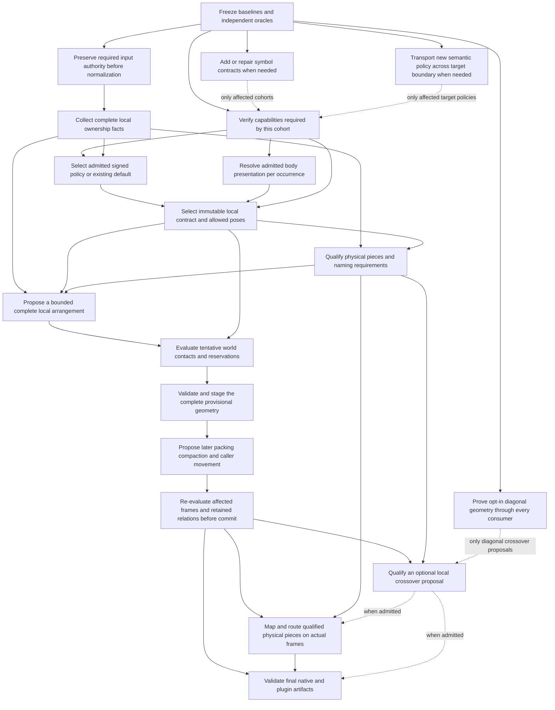

# Implementation packages and independent acceptance gates

This is an execution plan derived from the completed corpus review and its
focused counterexamples. None of the packages below is declared implemented.
The research scripts prove bounded observations and expose bad assumptions;
they do not replace production regressions or the Schemify round trip.

Read the [27 conditional rules](proposed-human-rules.md) for the proposed
behavior and [pipeline plan](planning.md) for current owners. This file makes
the dependencies and stopping conditions explicit. A package finishes only
when its named positive, decline, contrary and caller cases pass on the final
artifact, including the appropriate exporter.

## Dependency order

These nodes name decisions and proof boundaries for a cohort; they do not
require a rewrite of every existing stage. Existing classes and default
policies can satisfy K, P and B for a bounded MOS experiment. Adding the seven
new contracts or repairing the rounded-gate stroke does not block AG1080/928
group research. S and T supply capabilities only when that cohort needs them.
Likewise, N can supply the explicitly retained ordinary-routing contract when
no new physical-part policy is admitted. N→G does not require completing every
new partition rule before any arrangement experiment. Once a candidate promises
a specific partition, however, that obligation becomes a hard gate through W.

The first organization experiment should collect complete local candidates,
retain the one-core control, then test bounded stage arrangements against
the user's global-core problem. The [ninth census](ninth-local-groups.md)
supports collection, but does not yet justify choosing one automatic
arrangement for all eleven raw candidates. Symbol and side-policy improvements can
proceed independently. Diagonal capability remains a separate, wider change;
it cannot repair flattened grouping. An independently established electrical
defect takes priority if one is found.

The [ninth frame review](ninth-frame-plan.md) corrects the former F-before-G
wording. C fixes local geometry and allowed poses; G supplies tentative poses;
F evaluates their world frames. Later coordinate writers reuse that evaluator
before their own commits. A frame is final only after the last coordinate
writer. This finite proposal sequence does not require an iterative solver
or a second authoritative coordinate table.

## R — Freeze what a result means

Keep the exact 2,202-name source/native inventory, the frozen executable hash,
the 84 current rule headers and their difference from the frozen 81 headers.
For each behavior package, create four literal expected sets: admitted,
declined with reason, supported alternatives, and unresolved. Names are test
identities, never runtime selectors. Every former positive remains in one of
those sets after a change; a total count cannot conceal replacement cases.

Use the unchanged engine to demonstrate the new regression first. Record
final ordered electrical terminals, actual glyph/lead contacts, required
relative organization, caller geometry and physical partitions separately.
The source's cached coordinates can be stale. A raw netlist and a pretty SVG
are not sufficient independent evidence of the target's electrical result.

The [actual target study](eighth-target.md) additionally shows why a
successful equivalence comparator does not replace ordered-interface proof:
swapping A/B or QA/QB on its empty PFD still returns equivalent. The original
exports retain the correct order. Require both target comparison and explicit
original-to-exported ordered card/formal correspondence, with wrong-binding
controls for opaque definitions as well as active devices.

The first research oracle repair already illustrates this requirement: the
body census serialized tuple rows as JSON lists, so its exact replay failed
despite matching substantive counts. The repair uses JSON-native rows and
preserves the named results. Keep such proof failures visible; never solve
them by weakening exact comparison to counts.

Declare each source-ink checker's supported SVG transform, visibility and
numeric domain. Validate ancestor and primitive authority before using raw
coordinates. The [hidden-body peer review](seventh-review-bodies.md) preserved
three real false positives: a translated lead, a hidden lead and a decimal
endpoint truncated into the expected contact. Their repaired certificates
decline unsupported ink instead of silently treating it as the original
renderer subset. A frozen hash binds a positive example; it does not prove
that a parser handles arbitrary edited SVG correctly.

Likewise, re-read the artifact that supplies a derived witness. The
[independent group review](seventh-review-groups.md) changed an actual report
verdict and an actual raw MOS body while retaining stale manifest rows.
The old proof accepted both despite checking the updated file hashes; the
repaired proof rejects both. Hashes bind bytes, not a cached interpretation.

[The sixth caller study](sixth-groups.md) makes this an immediate prerequisite
for new local placement: four named quad variants report `axis I2` honored
while the final I2 is off the common axis. `pair-stack` is separately RED
against published written top-to-bottom order, while `skeleton.choose`
explicitly treats that hint as unordered. Resolve that contract conflict
before a new path claims that stack-order behavior; it does not block unrelated
O0 analysis or an N0 path that retains the existing caller fallback. Two strong-position controls correctly preserve
the requested pose but leave a superseded symmetry reported as honored.
Preserve the pose priority and fix the final relation's meaning; do not move
it back merely to satisfy the symmetry oracle. Unknown geometry validation
must not silently stand in for proof of a retained relation.

## K — Verify the capabilities needed by the admitted cohort

Name the actual classes, complete ordered roles, own contacts, caller
constraints and presentation capabilities that this experiment consumes.
Check the selected class rather than an earlier variant or just its family.
An unsupported required capability declines the affected candidate; an
unrelated missing family does not veto it. Collection still counts every raw
electrical occurrence regardless of geometric capability.

For the first MOS group experiment, verify existing D/G/S contact frames and
the admitted body convention. New nine-port glyphs are a separate cohort.
An existing three-terminal MOS class can support that bounded arrangement
while retaining every raw D/G/S/B binding and its existing rail-body policy.
It does not acquire a visible B contact or caller-hidden authority. A proposal
that requires a visible B escape declines until the selected class supplies
that contact.
For a new plugin policy, verify the actual semantic/geometry authority across
that target boundary. A native prototype may proceed with its plugin gate
explicitly unfinished; it may not claim target completion from native output.

## S — Complete additional symbol contracts for cohorts that need them

**Proposed behavior:** support the three exact four-bias amplifier contracts
and four exact clocked contracts in [third-ports.md](third-ports.md), retaining
all 50 ordered formals. Forty-three source leads are visible; seven VSS pins
are declared but undrawn. Source omission cannot delete a pin from the result.

The producer is the shared complete role reader and glyph generator. The
native library and plugin recognition/emission must consume the same ordered
role/frame result. Audit `ports_max`, `Role`, `analogOutput`,
`bias_neighbors.Pair.pins`, `find`, `turn`, and `tip` together. The output may
occupy index eight, and the [private-bias fixture](third-ports-width.cir)
puts VB1 there with a valid peer. Output-only width testing is insufficient.

Independent gates:

- Every declared role appears exactly once with its original formal index
  and node. Permute declaration order and retain semantic marks and contacts.
- Duplicate/unknown roles, extra IB/TAIL, missing declared roles, contradictory
  arity and incomplete controls fail the exact contract or retain an explicit
  generic/custom result. AG808's three-VB-plus-IB amplifier stays outside the
  four-VB extension even though its other block has a supported clock role.
- All generated own leads attach to the intended body and remain outside it
  after exit. Use actual integer frames over supported pitch/pose ranges;
  source AG1242 VDD and AG3492 CLK are known exceptions to a stronger support
  plane, not ready-made production frames.
- Existing custom classes, side directives and unsupported families retain
  their current authority. Native/plugin complete bindings and rendered
  marks agree; the target netlists the same original subcircuit call.
- Rescan downstream admission independently. The strengthened research
  composition changes regulators from 39 to 40 only by AG2212 and leaves 36
  sampling cases. Those are composition observations, not blanket permission
  for the whole-circuit placer to accept the larger circuit.

Input/output and capacity: borrowed ordered formal strings produce at most
nine terminal rows and a bounded cold drawing. Use an explicit port bound,
bounded role enum and the narrowest index that covers it; no per-device hot
flag or dynamic dispatch is required. The library owns persistent class
geometry, the caller owns allocation and lifetime. Independent definitions
can be read separately; registration order and resulting IDs remain stable.

### Separate small glyph/box experiments revealed by the sixth study

[The complete digital census](sixth-symbols.md) finds 56 conventional digital
instances already recognized. Preserve their exact names and complete bindings;
adding aliases is not the missing work for this cohort. Six named XOR/XNOR
supply/ground strokes overshoot their actual slanted body boundary. A bounded
`block_symbols.draw` change can make outline and attachment share an exact
integer point, with independent first-intersection checks at small/odd and
maximum supported pitches, every pose and the extra XOR curve. Keep terminal
coordinates and net order unchanged. This is separate from new family support.

The [independent symbol review](seventh-review-symbols.md) reproduces the
same exact 5/19-unit default-pitch overshoot in literal OR/NOR controls,
which have zero corpus occurrences. Include the shared rounded-outline
branch and the passing supply-less XOR in the repair's scope. This is an
inward endpoint overshoot with no open gap, not a disconnected electrical
terminal; label the geometric claim accordingly.

Four intentional boxes provide another bounded cold policy: exact PFD
A/B/QA/QB has A/B left and QA/QB right; exact DAC O1/O2 or OUT1/OUT2 has both
contacts right. The certificate grants graphical side defaults, not electrical
direction or truth-table inference. Native and plugin box fallback must use
the same exact reader before original-family translation. Preserve caller
classes, sides and PININFO authority. Native ignores PININFO comments in the
executed controls. The [older-plugin target execution](eighth-target.md)
now proves that its explicit PININFO changes PFD directions and sides while
preserving the complete ordered export. Repeat that gate on the eventual
same-build release artifact; no cross-version geometry equality is inferred.
Do not add a global QA/O-name rule.

Keep DAC515 as a canonical-right control whose automatic world pose mirrors
it. The other three observed canonical-side mismatches are separate targets.
Eleven concrete caller/permutation/fixed-pose/extra-control fixtures preserve
all ordered pins; they do not certify a new whole-circuit arrangement.

AG1146's four B bits have one source bus-display contact. Supporting that
display is a different editor/exporter capability: preserve an explicit
ordered scalar-to-bundle relation and prove expansion through the actual
target round trip. Sharing one ordinary electrical coordinate across four
different scalar nets is forbidden. Keep the current eight scalar terminals
until such a contract exists; source resemblance alone cannot erase them.

## T — Carry semantic identity and geometry authority across the plugin

The plugin preserves `Symbols.shape` locally while translating generated
definitions to names such as `b17`. Recognized glyphs retain named formals;
generic boxes and caller library stubs may expose `p1` through `pN`. Some
existing readers use ports alone and can still work. A new exact-family
reader cannot recover the original contract from the generated name.

The [fourth ports study](fourth-ports.md) contains an executed CLI proxy with
the same five ordered bindings and triangle geometry but no exact-family
candidate. Its zero pixel difference establishes visual similarity, not
plugin execution. This must become an actual plugin boundary regression.

Choose the cheapest shared transport only after writing both callers: native
original-definition input and plugin verified generated-symbol input. A
bounded verified role map plus generated-geometry authority is one candidate;
a shared pretranslation request producer is another. Neither a `b` prefix
nor a triangle outline proves semantics or grants authority to modify it.
Use actual `Origin.sub` plus a verified generated shape and compatible admitted
sides/PININFO versus `Origin.lib`/caller geometry. `.sub` alone also includes
deliberately directed boxes; it grants no automatic rewrite authority.
`Origin.blk` does not exist. Do not enlarge the shipped C ABI merely to solve
an internal plugin/native seam if an existing typed input can carry it.

The same admitted semantic contract must survive `layout.library`,
`cellDeck`, `names.cardOf`, engine placement and `layout.translate`. If a
later policy changes one instance's geometry, `Parts.sym` and `emit.graphics`
must use that variant too. Test the actual host round trip against the
original definition, including caller-owned classes and opaque generated
names. Success in native JSON is not completion of this package.

## O — Collect and resolve local ownership without moving devices

First preserve the required input authority at the existing parser/selected
cell boundary. The current model map keeps name→type and overwrites duplicate
definitions; the native front end selects a cell and synthesizes port-role
hints. `Netlist` plus inferred roles alone cannot reconstruct all of the ninth
collector's strict model/declaration/formal/original-request evidence. A cold
validated context must supply it, or this new cohort declines. Keep the broad
parser's current supported behavior and one parsing spine; do not duplicate
the parser inside structure analysis or infer provenance from final names.
The [first acceptance plan](tenth-acceptance-plan.md) specifies the producer
boundary and caller-first native/plugin uses. Existing raw pin/token tables
are borrowed, not copied merely to imitate research JSON.

Start with concrete collectors, not a rule language. Raw candidates include
every ordered device terminal and outer DUT formal before drawn/fixed/model
eligibility filtering. A collector emits member references, typed attachment
witnesses, protected interfaces and a named anchor. One owner resolves
competition and caller compatibility. No stage changes coordinates yet.

The small literal acceptance set already has several independent witnesses:

| Input | Required decision |
|---|---|
| One amplifier, two complete private BIAS peers, second peer fixed | Both remain raw competitors; do not manufacture a unique automatic peer. |
| One unique private BIAS peer, unrelated resistor fixed | Keep the valid local pair; a global fixed-device filter is too broad. Fixing its amplifier anchor is a separate decline control. |
| Two disjoint regulators, second amplifier fixed | Preserve both raw tuples; a future local admission policy may accept the first independently. |
| Feedback node has an extra capacitor or a MOS body consumer | Decline the affected private-boundary candidate. |
| Optional fourth BJT substrate touches a protected node | Count it or explicitly reject unsupported card grammar; never omit it. |
| AG459 attachment rows, current sources or degeneration resistors swapped between owners | Reject despite unchanged component partition. |
| Two qualifying quads share two members | Preserve both competing embeddings until an explicit supported resolution exists. |

The [group review](cross-review-bodies-to-groups.md),
[quad review](groups_review_quads.json), and
[materialized local fixtures](fourth-ports-fixtures.json) retain exact names
and tuples. A production collector should walk bounded anchor incidences;
the research subset enumerator is an oracle/tool, not a runtime design.

Capacities derive from raw candidate and member-reference populations, not
the 26 observed quads or 787 pending source regions. Collection borrows the
immutable netlist; scratch lasts until admission; the resolver alone owns
accepted ownership. Typed handles and CSR slices fit the existing design.
Independent collections can be parallel, but conflicts and commit order must
be deterministic. Explicit overflow/unsupported outcomes are part of the API.

The [search-contract study](tenth-search-contract.md) proves why the existing
bounded best-map renderer cannot certify unique ownership. Its small literal
and actual AG1078 controls expose one valid witness before later alternatives;
AG1080 exposes no useful witness before the final search entry. Use a closed
outcome for complete-none, complete-unique, witnessed ambiguity, unsupported
input and exhausted search. Two distinct valid witnesses can decide ambiguity
early; one witness needs a complete uniqueness proof. A separate local owner
may have its own complete certificate despite global ambiguity. Check storage
capacity before appending, and bound validation/refinement/candidate work as
well as recursive search. The Python census counters are not plugin fuel.

The first concrete all-MOS trial now has a full-corpus reference in
[ninth-local-groups.md](ninth-local-groups.md). It admits only its declared
rail/body/model/formal boundary, preserves 138 complete returned involutions,
and records eleven raw multigroup candidates plus every named keep/decline.
AG1080's five parents and AG928's one core follow from raw ordered cards;
native coordinates and source geometry do not seed the collector. The
[independent review](ninth-review-groups.md) checks complete raw data for all
2,202 decks and separately enumerates all device permutations in 43 small
cases. Continued formals, conflicting duplicate models and unowned
conventional rail names are retained input-boundary regressions.

Finish this collection-only step with unchanged rendering and inspectable
parent/interface facts. It is a prerequisite experiment, not the user-visible
layout finish line. Parent handles grant no new coordinate, glyph or wiring
authority. A dependency DAG is a partial order, not physical page direction.

## P — Select immutable signed variants for admitted instances

After O and T, select a generated class variant for an admitted local policy
before room reservation, peer placement or compaction reads its geometry.
Retain ordered formals and nets. Move the signed input contacts and their
marks within the frame, then apply the caller's whole-symbol pose separately.
One instance's policy cannot mutate a shared cached class.

The [shared-definition fixture](fourth-ports-shared-definition.cir) gives
XREG positive-reference-above and XSAMPLE negative-signal-above from their
different local contexts. The current frozen default fails XREG's proposed
policy. A complete caller class demonstrates that both orders can coexist
with unchanged bindings. This is a working expression control, not automatic
selection already implemented.

Required production regressions include both instances, class reuse,
declaration/card permutations, exact transformed final coordinates,
per-instance custom class, family custom class, side directives, strong and
weak requests, mirror/rotation, unrelated fixed devices and overlapping
ownership. Cross-check final pin coordinates against class/pose instead of
trusting a cached canonical summary. Swapping electrical inputs or reflecting
the entire symbol is not an implementation of signed-slot policy.

Reuse the existing device `ClassId` for a selected immutable class. A bounded
cold request list has at most the number of candidate blocks; the library
owns deduplicated variants keyed by the complete geometry contract and
policy. Fallible variant construction and caller checks precede assignment.
The plugin's per-instance symbol record must match the selected class and
preserve the original electrical definition when netlisted back.

Select C's compatible local contract from the chosen class, signed-slot
policy, body presentation, allowed poses and admitted caller constraints.
The signed-policy and body-policy producers may collect independently;
neither may mutate an already-consumed class. G supplies a complete tentative
arrangement to F, and all geometry-dependent reservations use that same
evaluated candidate. Raw ownership still counts every electrical pin.
Validate capability on the selected variant itself; capability from the
original class cannot certify changed geometry. This is a proposed boundary,
not a claim that the current pipeline already implements it.

## B — Resolve body presentation without rewriting identity

Preserve all D/G/S/B occurrences and simultaneous ties first. Presentation
belongs to a terminal occurrence: local B=S, rail convention, visible body,
or certified named attachment. Mixed presentations on the same net are
valid. A missing geometric body contact is a capability result, not a reason
to attach the pin at an arbitrary origin or change it to the source node.
Missing geometry also does not establish an explicit caller request to hide
the terminal. Preserve that authority distinction in the resolved request.

The [full 23-case actual source proof](fourth-bodies.md) establishes 22 dashed
shared-well bridges and one omission. AG1236 is an explicit source exception;
the proof cannot infer its author's intention. Caller-hidden routing remains
a separate authority: `Terminal.hidden` means the pin gets no wire, not that
the caller's glyph strokes disappear. Specify the default complete-presentation policy and
the explicit source-convention policy before choosing new storage.

Production gates must distinguish supported glyph landing, logical pin,
physical path, named contact and target connectivity. Keep the wrong-glyph,
remote-cached-body, wrong-role, duplicate-glyph, cached-D/S-swap and deleted
actual-bridge counterexamples. External marker identity is its own gate; a
correct geometric path to text is insufficient if that text names another
formal. Test renderer, no-connect marks, labels and plugin netlisting together.
Keep electrical occurrence, geometric terminal, glyph ink and routing
participation distinct. Zero body routes or labels does not prove absence
of a visible relationship when caller glyph leads themselves meet.

The input is immutable ordered pins, admitted caller policy and class contact
capabilities. Output is a bounded per-occurrence presentation request plus
ordinary routing/naming requests. Pin count bounds population; retain typed
pin/net handles. Resolve before geometry consumers; do not hide an entire net
through a flag to save a per-terminal decision.

The [three executed target body fixtures](eighth-target.md) now prove that
the older plugin's emitted names preserve these private body nets. Removing
the resistor-side body name and netlisting the isolated project again changes
its electrical connection and fails comparison. These cases therefore
support retaining the naming mechanism while improving presentation; they
do not establish an electrical defect in that tested path. The native
custom-class modes and target default classes are distinct controls.

This policy needs selected-class capability and plugin presentation transport.
Current plugin class construction and translation each recompute hidden-pin
behavior from family/index; both must consume the same resolved per-instance
policy if this package changes it. Current `sketch.hiddenPins` and `Placed`
can fall back to an origin for a pin absent from the class. Candidate-frame
evaluation must reject that fallback as evidence of a visible body contact
before it reaches reservation, group extents, escape or crossover stubs.

## C, F and A — Evaluate a complete candidate before committing it

C owns the immutable selected local contract and cold presentation/interface
requirements. G alone proposes member poses. F borrows those inputs to derive
actual tips, sides, bounds and required clearances; it cannot silently select
another class or move a child. A validates the whole proposal and commits its
owned poses/reservations together. A failed second child or allocation leaves
the previous valid state intact.

N supplies pin partition and naming obligations before G, not already realized
world contacts or successful routes. F instantiates their required contacts
and reservations on the candidate. A proves only the checks actually run:
route feasibility needs an explicit scratch routing trial or remains pending
until W. If W cannot satisfy a mandatory obligation, restore the complete
affected arrangement and take its declared fallback; do not keep a partially
successful layout. Later H checks must preserve N's naming/separation
reservations as well as member geometry.
The A-stage pose/reservation commit is provisional until the required later
gates pass. Publication of an accepted drawing belongs after V; a scratch
geometry result must not be mistaken for a completed routed proposal.

The [ten prospective literals](ninth-frame-fixtures.json) supply independent
expected coordinates and decline outcomes for this boundary. They are
unexecuted production gates. A quarter turn can change every terminal while
leaving a square box unchanged. Toggling only B.hidden leaves the current
class's geometry and box unchanged, while adding a body contact or lead can
expand them. A name or inter-member bridge can need clearance outside either
device's body box; `DrawOp.text`'s anchor alone is not text extent.

Whole-group translation must also translate contacts and reservations.
Compaction that changes internal spacing rechecks retained relations and
clearances. Every later coordinate owner prepares and evaluates its candidate
before commit, and V checks the actual exported result. Cheap derived frames
should be recomputed unless a measured need justifies a cache with a complete
invalidation key. These boundaries can use existing concrete functions and
typed handles; a new general intermediate representation is not required.

## G — Compose groups, then choose and preserve arrangements

Use [the composition literals](planning.md#group-composition-the-smallest-shared-mechanism-worth-testing)
with the source-region and quad cases. Two pair member sets can be disjoint
while their geometric boxes overlap inside a certified parent. A shared
drain, gate control, compensation or body net is an interface until a parent
has its own topology proof. It is not automatic union permission.

First collect alternative relations while leaving the current global mate
table/axis contract intact. Then test one bounded parent arrangement owner.
The broader stage/quad path must preserve AG517's input pair left of the
complete switching group and the nested/adjacent alternatives in the 26-case
study. A narrower all-MOS experiment records passive-containing cases as
explicit declines rather than claiming to solve them. Both need caller
group/axis controls and an intentionally colliding second child. Commit no
child alone on failure.

Group relation checks must run on final terminal frames after compaction,
caller placement, rerouting and thinning. A hint report or group count is
not a geometry oracle. Name-inferred roles distinguish AG80 and AG82 even
though their complete topology is transportable; no circuit-ID arrangement
table is allowed. Keep underdetermined choices explicit.
The [23 executed caller fixtures](sixth-groups.md) are now the entry set:
complete mirrored terminal frames, one common axis, admitted/dropped request
priority, compatible and incompatible weak poses, and exact fixed geometry.
Its mutation that translates one locally symmetric pair by +40 must fail
the global-axis oracle even though both local pairs remain symmetric.

The ninth source review makes the arrangement boundary concrete. All eleven
raw candidates remain in the set: AG1016 interleaves proposed parent extents,
AG364 nests outer outputs around an inner core, and AG1047/1051/1075/1077
place stages vertically. Nine nonoverlapping channel-stub-box examples do
not justify a universal separate-box policy. A finite candidate set must
preserve compatible nested arrangements, and its selection rule needs
contrary cases before automatic admission. Source
channel-stub extents are observations, not full occupied glyph/wire bounds.

The [tenth arrangement study](tenth-arrangement-plan.md) supplies the first
concrete grammar: retain the complete ordinary incumbent and propose ordered
horizontal/vertical compositions of all admitted parent leaves. Its 53,851
expressions across eleven cases are syntax, not executed or feasible drawings.
Stream a bounded subset in production, charging frame and route work as well
as generation. Keep only the incumbent and best complete proposal. Exhaustion
limits the optimality claim; it does not forbid choosing a proved feasible
candidate under an explicit heuristic. This differs from O0's completeness
requirement when claiming unique ownership.

G1 must create local chains, rows and columns before the existing global
column/wrap decisions. Translating already stretched parents cannot establish
the promised compact organization. The global device/net mate relation stays
intact; new local axes have a separate owner and cannot replace the meaning
of `Skeleton.axis2` or an admitted caller axis. A later writer either preserves
the complete local contract or rejects the experimental arrangement.

The unchanged incumbent is always the rollback baseline, but it is not an
automatic G1 success. The [twelfth local trial](twelfth-organization-gate.md)
supplies a first operational postcondition: five common-control five-MOS
parents in four of the eleven acyclic multigroup cases have source-supported
branch columns, input/load rows, polarity order, tail-between relation and
actual directed D/S roles. AG1028's staggered inputs are a contrary to the
broader family; AG1080's tail is not exactly at its channel midpoint.
The other 2,191 corpus cases keep their O0 dispositions and were not searched
for this local shape. No absence or universal alignment claim follows.

Six isolated reference runs fix a default-class 140×150 channel-center bound
for this narrow trial. This is a chosen diagnostic obligation, not an
independent human scale, occupied-ink box or feasibility oracle. Two full-DUT
AG1080 pose controls distinguish translated wide parents from compact local
reconstruction while retaining all ordered bindings. A retained rotated-input
control exposed the missing direction check and now fails it. A compressed
candidate still passes the partial local gate while different-net own leads
overlap, so its complete proposal must fail independent clearance.
The actual reconstructed AG1080 likewise passes its two local gates while
RN/RP/FP1 remain three-pin continuous pieces and FN1 remains three singles.
All four required AG1080 N0 partitions still fail. Raw identity and a local
shape pass therefore cannot substitute for final routing acceptance.
The first local milestone is all five declared parents passing their final
relations, fixed bound and the complete hard gates, with original caller
authority and every contrary/keep preserved. That automatic result is still
unexecuted. A still-flattened incumbent that fails the organization
postcondition means no accepted improvement.
Electrical identity, caller constraints, retained organization, contact/
clearance and required physical pieces are hard gates before optional scoring
by crossings, introduced names, bends, length and area. The eight actual
caller-pose witnesses prove expression and bindings only. Their reported
crossings/bends select vertical AG1028 even though its source is horizontal;
none is an accepted G1 improvement.

Matching boundary stars cannot select an arrangement by themselves:
AG1028 and AG364 have transportable complete two-net interfaces but separated
and nested source drawings. Their full DUTs differ. The minimal H/V grammar
preserves existing nesting through the incumbent; it does not construct new
nested arrangements. Record that missing alternative explicitly instead of
claiming complete human-layout coverage. The
[independent review](tenth-review-arrangement.md) also limits the source
coordinate certificate to its viewed, hash-bound originals; it does not prove
visibility for arbitrary edited SVG.

## N — Resolve physical pieces separately from electrical nets and groups

An admitted group does not imply one wire tree for each of its nets. The
[AG1080 ink certificate](../grouping-and-distribution.md) retains both lost
local joins and extra physical joins in the native drawing. Its lower group
itself contains source-separated output and supply pieces. AG928 is a
continuous one-core control. The proposed selector therefore needs explicit
local continuity, supported separate named pieces and protected interfaces;
membership or wire cost alone cannot decide them.

[The eighth partition study](eighth-partitions.md) tests that rejected
hypothesis directly: owner-only wiring still adds 45 source-forbidden joins
in AG1080. AG921 preserves distinct main/CMFB membership yet adds nine
physical joins. Neither whole-net `wire` nor `label` expresses AG1080 FN1's
two-plus-one partition; neither `rail each` nor `rail bar` expresses its
four-pin rail plus nine single pieces. Eleven frozen caller controls retain
941 ordered terminal occurrences. AG1479 has nine proved Q/R pairs and nine
explicitly unresolved source pairs involving X1.

The [eleventh raw census](eleventh-partition-candidates.md) narrows a first
N0 experiment to complete reflected, rail-ended complementary stacks with
two private outputs, each containing exactly the local P/N drains and one
outside gate. All 2,202 prior dispositions remain visible. Four parent tuples
in three circuits match before cycle eligibility: the three acyclic tuples
have six source 2+1 nets; the cyclic AG1053 tuple has two continuously wired
three-pin nets. All 24 source pair relations are checked. The common gate
control occurs on either polarity, so FN1 spelling or a shared PMOS control
cannot choose the rule.

Propose 2+1 only as a trial within the already declared complete acyclic
parent cohort. Preserve AG1053 as a raw contrary; the evidence does not prove
that a cycle causes continuous wiring or that breaking it causes naming.
Explicit whole-net wire/label requests also retain their contrary partitions.
This trial has no current-pose routing result yet. Record raw candidate,
admission, route feasibility and final validation separately. Six matching
source nets are the expected test set, not six proved production successes.

The existing two-part seam can express these nets after complete actual
pin mapping. Preserve the local drain tree and forbid contact to the named
gate piece through earlier or later same-net ink. Check the exact final
partition and reachable names after thinning and export; electrical equality
alone cannot establish this physical result. If N0 is mandatory for a moved
group and routing fails, roll back that whole group proposal. A per-net append
checkpoint is insufficient to certify the wider arrangement transaction.

The [concrete N0 contract](n0-implementation-contract.md) keeps that draw API
and adds one cold consumer. Its first trial leaves compaction unchanged,
realizes requests on final poses after rails, and includes N0 in the existing
seeded-routing dispatch. It defers publication of both sibling nets until both
routes pass. Ordinary thinning may withdraw a tuple; a bounded full rewire
from original effective styles prevents stale success or trial-induced style
changes surviving withdrawal. This is a proposed caller contract, not a
crossing-budget exemption or an already executed routing result.

Use immutable pin/net identities and complete owner/interface witnesses as
inputs. Produce cold physical-part requests with complete original terminal
sets, naming obligations and continuity/allowed-cut policy. N qualifies these
requirements without claiming a world frame or realized route. F maps their
actual candidate contacts; W realizes them; V validates final names and pieces
against the target's connectivity rules. Count every endpoint once in the
selected presentation and reject unsupported identity or contact capability.
Required local connections and forbidden cross-piece joins need separate
positive and negative oracles on final ink.

Build conductor components before associating names. The
[independent label-crossing review](ninth-partition-review.md) reproduced a
research-checker bug in which a label at an undotted crossing falsely joined
two pieces. A name that touches multiple unjoined components must decline as
ambiguous; adding that name cannot alter the physical partition. An actual
junction dot, endpoint T or overlap has its own contact semantics.

Retain existing specific routing owners and the `wire_parts` seam where its
contract fits; do not infer a new universal router from the research. A caller
request to wire a net, label a net or distribute a rail remains an independent
admitted constraint. Thinning must preserve the proposal's promised physical
meaning or perform only an explicitly allowed named cut. Geometry changes
must keep physical-part ownership and labels consistent. No source object ID,
cached coordinate or unresolved annotation label is a runtime selector.

Qualification reads original admitted intent before temporary scaffold
styles are changed. A caller `rail bar` can normalize to the default-looking
style yet still constrain the automatic proposal. After final candidate
frames exist, map qualified pins and route rail pieces before the ordinary
global bar reserves that net; route signal pieces at the existing after-rails
boundary. These are scheduling points for one accepted contract, not separate
selectors that can disagree. Default routing remains an explicit alternative
when no new partition is admitted.

Use cold net rows with CSR ranges for physical parts and original pin
references, bounded by the participating visible terminal population and
complete contextual candidate set. One resolver composes proposals for a
shared net and checks full coverage before any consumer marks it handled.
The caller owns memory; fallible mapping and preparation precede atomic
route/name commit. CT/linked-load parts currently allow ordinary named
thinning, while the seven converter-loop trees have a different retention
contract. Preserve those distinctions rather than adding one universal
protection flag. A general N-part API needs admitted consumers beyond the
existing fixed two-part seam.

This is a separate implementation package. A local-group placement experiment
can improve its own organization while N remains unfinished; it must report
that limit rather than claim the complete source drawing has been reproduced.
Likewise, source-separated pieces are not evidence that the electrical net
should be split into distinct circuit nets.

## D and X — Separate geometry capability from crossover selection

The [diagonal plan](third-diagonals-plan.md) is the full consumer and numeric
audit. Its independent corpus census finds diagonal primitive ink in 187
diagrams, all observed directions 45 degrees at the declared precision.
The 799 primitives are not 799 nets or routes. AG493 additionally needs
rotated glyph capability and remains outside a wire-only first experiment.

D first proves exact contact, distance, intersection, ray degree, same-net
splits, label anchors, coordinate transport/range and atomic rollback. This
includes consumers that only inspect old ink: maze targets and `nearTree`
cannot treat a diagonal's bounding rectangle as its wire. Existing C callers
retain Manhattan output; the opt-in domain needs explicit caller semantics.
The C test oracle itself must stop using rectangle membership for diagonals.

X is a later implementation experiment using admitted members, physical-part
obligations and actual cardinal stubs. It qualifies a bounded route alternative
before W consumes those nets; W tests both routes together against actual ink
and commits once. It is not a patch over already committed ordinary routes.
A failed trial retains the declared orthogonal/ordinary fallback or rejects
the complete affected proposal. Half-grid distinct-net crossings can be exact
events; a required nonintegral same-net junction declines under the initial
integer-output contract. AG404 and AG647 retain orthogonal alternatives.
Neither lower crossing counts nor a recognizable X is ownership evidence.

## V — Finish lines that cannot be traded against each other

Every completed package supplies four independent results: unchanged
electrical identity through the actual target round trip; valid visible
contacts and role marks; its specified human organization; and retained
caller/pipeline/failure behavior. Unknown results stay unknown. Improvements
in one result cannot pay for a regression in another.

After those targeted gates, run the repository merge checks: both renderer
configurations, style/formatting, native/ABI/plugin contracts, required
gallery inspection, reproducible committed WASM and its 550 KB cap. The
current experimental module is oversized and existing physical failures
remain; this research does not remove either release gate. Land green bounded
packages through the required PR flow. Whole-corpus equivalence remains a
separate objective requiring all unresolved named cases to be addressed.
