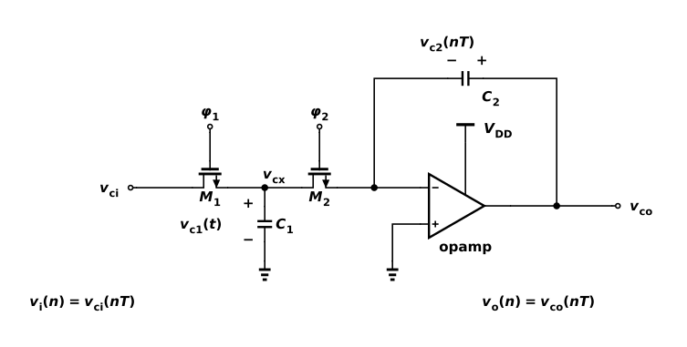
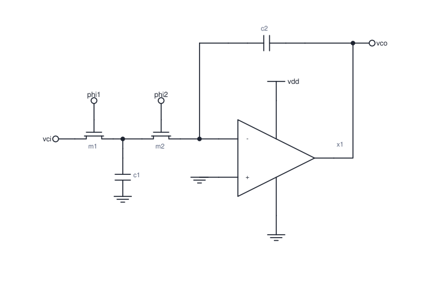

# Rules must be checked in combination

A recognizer change can enlarge another rule's candidate set even when that
second rule's code is unchanged. The first measured interaction is the proposed
four-bias symbol contract and the regulator input-order proposal.

## Complete corpus versus the converter assignment

The [first converter study](../converters-and-symbols.md) correctly scoped its
39 regulator and 35 sampling candidates to its 734-image assignment. Replaying
the same predicates over all 2,202 AnalogGenie decks produces these exact sets:

| Contract used by the research topology predicate | Regulator candidates | Sampling candidates | New names |
|---|---:|---:|---|
| Prior contract, original converter assignment | 39 | 35 | Baseline |
| Prior contract, complete AnalogGenie corpus | 39 | 36 | Sampling AG789 |
| Prior contract plus complete nine-port, four-bias signed contract | 40 | 36 | Regulator AG2212 |

These are candidate sets from the Python research predicates, **not measured
engine layout changes**. The proposed stricter incidence checks in the ports
study require a separate comparison. The old script and its prior evidence
remain unchanged. Every old candidate's record remains identical under this
one hypothetical contract extension; both additions have exact raw witnesses.

Reproduce the named sets, 2,202 deck hashes and six contract controls:

```sh
python3 -B docs/research/image-rules/round-2/interaction_candidates.py \
  --check docs/research/image-rules/round-2/interaction_candidates.json \
  --output /tmp/cktimg-interaction-replay.json
```

The [script](interaction_candidates.py) substitutes only the complete signed
port mapping within its own Python process, then restores it. It does not
edit the prior selector or production engine. [Recorded views](interaction_views.json)
bind the root's fresh observations to the same source/generated artifacts.

## AG789 is an additional keep control





The source and native both retain the flat two-switch path, shunt at its
junction, and upper feedback capacitor. This case lies in the early image
assignment, outside the converter review's original 734. Its ordered DUT
cards bind `M1=(vci,phi1,vcx,vss)`, `M2=(vcx,phi2,net0,vss)`,
`C1=(vcx,vss)`, `C2=(net0,vco)` and
`X1=(vdd,vss,vss,net0,vco)` in `VDD,VSS,INP,INN,OUT` order.
Use these literal relations when broadening the biased sampling admission.
The source's mathematical voltage annotations and differing glyph sizes are
not guaranteed by the netlist-only proposal.

## AG2212 combines two proposed changes


The source has a known amplifier with nine declared ports. Its positive
reference input is above the negative feedback input; four independent bias
leads leave below it. VSS remains a declared binding even though this source
draws no VSS lead. The [port certificate](ports_contracts.json) separately
records raw bindings, visible leads and the absent source VSS geometry.

The old complete-contract reader rejects VB4, so AG2212 is absent from the
original 39. Once the exact four-bias contract is recognized, the same raw
pass/divider predicate admits it: the output drives the pass gate, R1/R2
return the output to the negative input and VSS, and the load is a separate
capacitor/resistor branch. Thus the symbol extension and input-order rule
need a **combined AG2212 test**, not only isolated tests for each change.

No whole-symbol reflection should be inferred merely to move the signed
inputs: that would also relocate the four bias leads and supply. Every
formal must retain its original SPICE index through the chosen actual frame.

## Implementation implications

- Keep the contract reader, candidate selector and geometry transaction
  independently testable. After any contract change, rerun all downstream
  candidate censuses and compare names, including newly admitted cases.
- Add AG789 to the global sampling keep set; preserve the original 35-case
  shard record as historical evidence rather than silently renaming its scope.
- Require isolated four-bias, isolated signed-order, and combined AG2212
  assertions. Report which predicate admitted a new case.
- AG1674 also gains a four-bias triangle but contains BJTs. That symbol
  recognition does not grant the whole circuit `opamp.place` admission.
- Clocked comparator recognition does not certify a two-switch sampling
  stage: AG3492/3493/3495 contain four switches and two blocks. Their clock
  pins are additional signal interfaces, not rails or ignorable bias pins.

The next interaction studies should apply this same exact-set comparison to
local group admission versus body visibility, and local axes versus explicit
caller symmetry. A count alone would miss both an unintended new case and a
lost keep case.
