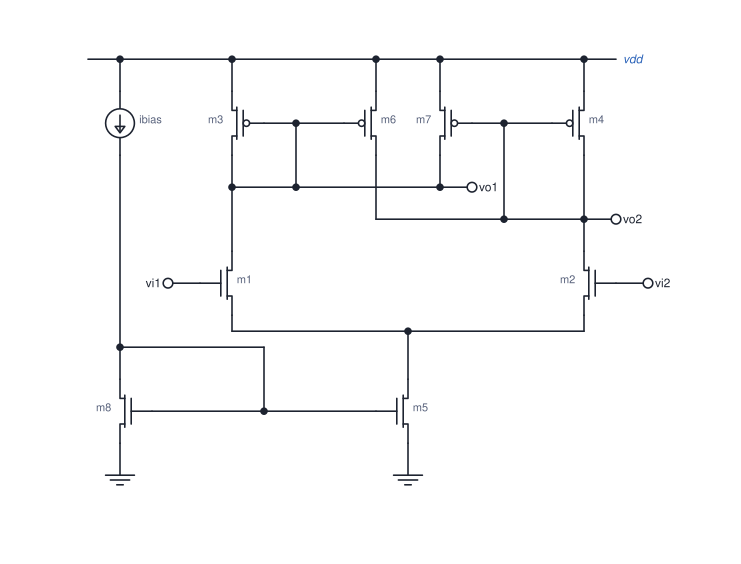
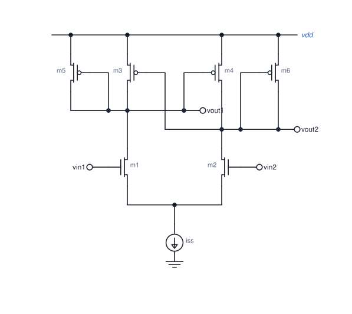
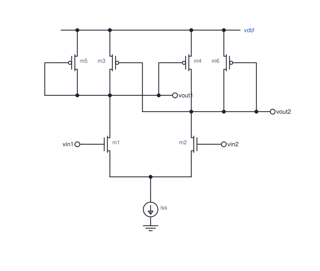
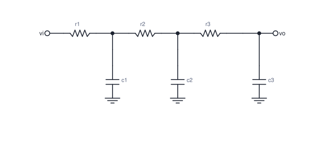
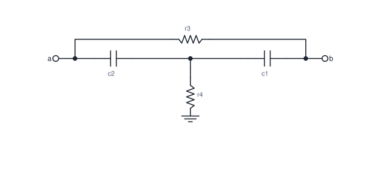

# Production layouts beside the published drawings

The first column uses upstream production commit `4c7c3a12`. The middle column uses the layout change for that row. Both use the same converted DUT and the default symbols. Click a drawing to inspect individual pins and wires. The last column links the pinned upstream figures.

## Differential stages with reciprocal MOS loads

Follow each input transistor's drain to the four load terminals on its output net. Both published circuits put the diode-connected loads on the outside. In AG1034 the inner drains cross to the other branch. In AG215 the inner gates cross instead.

| Production before | Production after | Hand layout |
|---|---|---|
| [](ag-1034.before.svg) | [](ag-1034.after.svg) | [![AG1034 published figure][ag1034]][ag1034] |
| [](ag-215.before.svg) | [](ag-215.after.svg) | [![AG215 published figure][ag215]][ag215] |

In AG1034 the outer loads now share columns with the input drains. Reported crossings fell from 4 to 1 and bends from 9 to 4. AG215 keeps one crossing and eight bends. Its outer diode straps now face away from the inner devices. Pin-to-pin wire tests trace both five-terminal outputs. Sixteen controls, including two-tier cascodes and single mirrors, retained byte-identical SVGs and reports.

To reproduce a row, build with `nix develop -c zig build`, then run the command below at the desired commit. Substitute the corresponding deck for other rows.

```sh
zig-out/bin/cktimg-json --svg ag-1034.svg --report ag-1034.report.json external/examples/analoggenie/ag-1034.cir ag-1034.json
```

[ag1034]: https://raw.githubusercontent.com/xz-group/AnalogGenie/efc25358939c6bedd247f28d3df61066964f3a90/Dataset/1034/Book1034.png
[ag215]: https://raw.githubusercontent.com/xz-group/AnalogGenie/efc25358939c6bedd247f28d3df61066964f3a90/Dataset/215/Book215.png

## A visible bias feed between two gates

AG725's Q8 and Q10 share VB3. In the production drawing the Vcntrl wire crosses the gate line at its midpoint. The router now tests an adjacent interior takeoff for the port when the midpoint is occupied. Trace the one port to both gates. In the source, the letter Q designates the devices called M8 and M10 in the converted deck.

| Production before | Production after | Hand layout |
|---|---|---|
| [](ag-725.before.svg) | [](ag-725.after.svg) | [![AG725 Fig. P6.57][ag725]][ag725] |

Across 132 reviewed bias and divider decks, eight gained a visible bias port. The device terminals and the sets of pins joined by each physical wire were preserved in all 132. In particular, all twelve MOS gate dividers already had a straight tap-to-gate wire, including the two taps with a fourth wire arm.

[ag725]: https://raw.githubusercontent.com/xz-group/AnalogGenie/efc25358939c6bedd247f28d3df61066964f3a90/Dataset/725/Book725.png

## Passive ladders and bridged T filters

The reference row is the tapped path between the ports. AR6308 places three resistors on this row with a capacitor dropping from each tap. In AR6363 and its R/C dual AR6364, the two tapped arms share the port row, the untapped arm bridges over them and the return drops from the central junction.

| Production before | Production after | Hand layout |
|---|---|---|
| [](ar-6308.before.svg) | [](ar-6308.after.svg) | [![AR6308 source][ar6308]][ar6308] |
| [](ar-6363.before.svg) | [](ar-6363.after.svg) | [![AR6363 source][ar6363]][ar6363] |
| [](ar-6364.before.svg) | [](ar-6364.after.svg) | [![AR6364 source][ar6364]][ar6364] |

The through-path and port checks went from three of four to four of four ladders, and from zero of two to two of two bridged Ts. The drawings of AR1910, AR5431 and AR5432 already had the observed layout. Their placement JSON is byte-identical.

[ar6308]: https://huggingface.co/datasets/eulermaxwell/AnalogRetriever-data/resolve/0c053b6580315d8a89c629d67994a6da4575a17f/iccad2026/images/img6308.jpg
[ar6363]: https://huggingface.co/datasets/eulermaxwell/AnalogRetriever-data/resolve/0c053b6580315d8a89c629d67994a6da4575a17f/iccad2026/images/img6363.jpg
[ar6364]: https://huggingface.co/datasets/eulermaxwell/AnalogRetriever-data/resolve/0c053b6580315d8a89c629d67994a6da4575a17f/iccad2026/images/img6364.jpg
