# Production layouts beside the published drawings

Each row compares the same converted circuit before and after the indicated change. Native panels use the default symbols. The common-control and source-degeneration studies also show actual Schemify editor exports. Click a drawing to trace individual pins, wires and labels.

Start with the AG1080 comparison to see a generated stage beside its published circuit, or use the checkpoint index to reproduce a specific change. [AG1080 and the three other compact-stage cases](common-control/README.md) · [PFD and amplifier symbols in the actual editor](editor-symbols/README.md) · [All implementation commits and corpus results](checkpoints.md) · [Initial coverage of the 27 rules](rule-coverage.md) · [Latest implementation handoff and remaining work](HANDOFF.md)

The next comparator checkpoint places two preamplifiers above their latch in AG1079 and AG1080. The drawings show the previous local-stage layout, the new arrangement and the corresponding original. [Comparator panel placement](comparator-panels/README.md)

The private-well study compares actual fourth-terminal wires and named connections, including the routing cost in the wider corpus. [Shared MOS well in AG1294](mos-bodies/README.md)

Published panels are linked to the pinned upstream sources. The repository also contains the converted input decks and cached redraws. [AnalogGenie](../../../external/examples/analoggenie) · [AnalogRetriever](../../../external/examples/analogretriever) · [AMS-Net](../../../external/examples/amsnet) · [CircuitThink](../../../external/examples/circuitthink)

The comparator studies trace the same output connections through the native SVG and Schemify, then measure the physical placement of the five-device input stages. The second study includes actual editor exports alongside the native drawings. [Intermediate output wires](parent-outputs.md) · [Common-control input stages](common-control/README.md)

## Differential stages with reciprocal MOS loads

Follow each input transistor's drain to the four load terminals on its output net. Both published circuits put the diode-connected loads on the outside. In AG1034 the inner drains cross to the other branch. In AG215 the inner gates cross instead.

| Production before | Production after | Hand layout |
|---|---|---|
| [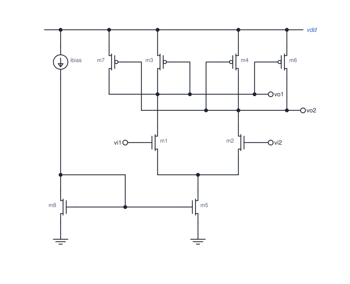](ag-1034.before.svg) | [](ag-1034.after.svg) | [![AG1034 published figure][ag1034]][ag1034] |
| [](ag-215.before.svg) | [](ag-215.after.svg) | [![AG215 published figure][ag215]][ag215] |

In AG1034 the outer loads now share columns with the input drains. Reported crossings fell from 4 to 1 and bends from 9 to 4. AG215 keeps one crossing and eight bends. Its outer diode straps now face away from the inner devices. Pin-to-pin wire tests trace both five-terminal outputs. Sixteen controls, including two-tier cascodes and single mirrors, retained byte-identical SVGs and reports. Five matching decks in the other collections (AMS-Net 245/525 and CT032/050/093) retained their crossing and bend counts and had no report findings.

To reproduce a row, build with `nix develop -c zig build`, then run the command below at the desired commit. Substitute the corresponding deck for other rows.

```sh
zig-out/bin/cktimg-json --svg ag-1034.svg --report ag-1034.report.json external/examples/analoggenie/ag-1034.cir ag-1034.json
```

[ag1034]: https://raw.githubusercontent.com/xz-group/AnalogGenie/efc25358939c6bedd247f28d3df61066964f3a90/Dataset/1034/Book1034.png
[ag215]: https://raw.githubusercontent.com/xz-group/AnalogGenie/efc25358939c6bedd247f28d3df61066964f3a90/Dataset/215/Book215.png

## A visible bias feed between two gates

AG725's Q8 and Q10 share VB3. In the production drawing the Vcntrl wire crosses the gate line at its midpoint. When the midpoint is occupied, the router tests an adjacent interior tap after all ordinary routes have claimed their space. The tap must be clear of foreign wires. Trace the one port to both gates. In the source, the letter Q designates the devices called M8 and M10 in the converted deck.

| Production before | Production after | Hand layout |
|---|---|---|
| [](ag-725.before.svg) | [](ag-725.after.svg) | [![AG725 Fig. P6.57][ag725]][ag725] |

On AG1652, an early trial of the tap lost one of seven VB3 port markers and split the four-pin net0 wire. The final pass preserves both. Across 132 reviewed bias and divider decks, eight gained a visible bias port. Scanning all 5,274 production decks found 57 that gained this bias tap. Removing its single new stub from each output recovers the exact original wire geometry on every net in those 57. All prior port markers kept their coordinates. In particular, all twelve MOS gate dividers already had a straight tap-to-gate wire, including the two taps with a fourth wire arm.

[ag725]: https://raw.githubusercontent.com/xz-group/AnalogGenie/efc25358939c6bedd247f28d3df61066964f3a90/Dataset/725/Book725.png

## Passive ladders and bridged T filters

The reference row is the tapped path between the ports. AR6308 places three resistors on this row with a capacitor dropping from each tap. In AR6363 and its R/C dual AR6364, the two tapped arms share the port row, the untapped arm bridges over them and the return drops from the central junction.

| Production before | Production after | Hand layout |
|---|---|---|
| [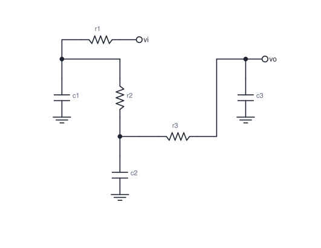](ar-6308.before.svg) | [](ar-6308.after.svg) | [![AR6308 source][ar6308]][ar6308] |
| [](ar-6363.before.svg) | [](ar-6363.after.svg) | [![AR6363 source][ar6363]][ar6363] |
| [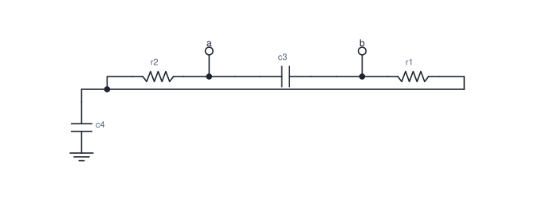](ar-6364.before.svg) | [](ar-6364.after.svg) | [![AR6364 source][ar6364]][ar6364] |

The through-path and port checks went from three of four to four of four ladders, and from zero of two to two of two bridged Ts. The drawings of AR1910, AR5431 and AR5432 already had the observed layout. Their placement JSON is byte-identical.

[ar6308]: https://huggingface.co/datasets/eulermaxwell/AnalogRetriever-data/resolve/0c053b6580315d8a89c629d67994a6da4575a17f/iccad2026/images/img6308.jpg
[ar6363]: https://huggingface.co/datasets/eulermaxwell/AnalogRetriever-data/resolve/0c053b6580315d8a89c629d67994a6da4575a17f/iccad2026/images/img6363.jpg
[ar6364]: https://huggingface.co/datasets/eulermaxwell/AnalogRetriever-data/resolve/0c053b6580315d8a89c629d67994a6da4575a17f/iccad2026/images/img6364.jpg

## Diode bridges in sample-and-hold circuits

In AG763 and AG1042 the input and the held voltage sit at the middle contacts of two upright diode columns. The hold capacitor and buffer share the right contact. Trace the two additional feedback diodes to the output. The rule checks their anode and cathode connections as well.

| Production before | Production after | Hand layout |
|---|---|---|
| [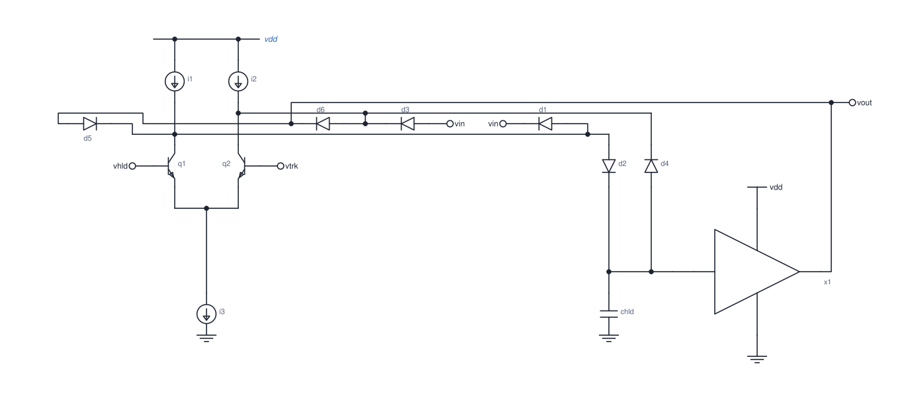](ag-763.before.svg) | [](ag-763.after.svg) | [![AG763 published][ag763]][ag763] |
| [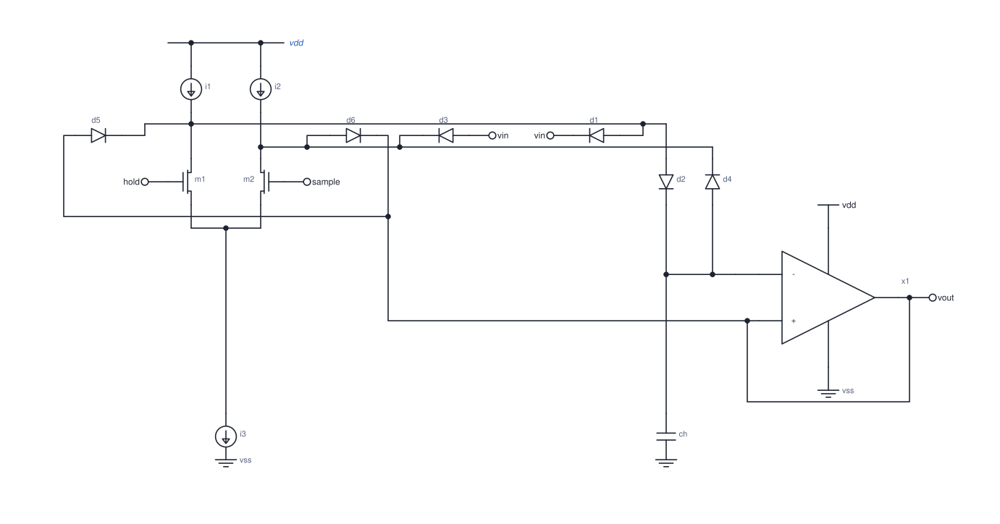](ag-1042.before.svg) | [](ag-1042.after.svg) | [![AG1042 published][ag1042]][ag1042] |

Each sampler now has four upright diodes in the two observed columns. The two formerly separate Vin markers become one port on the joined input conductor. Crossings went from 4 to 2 in AG763 and from 6 to 4 in AG1042. The vertical spacing and the positions of the current sources still differ from the figures. Twelve controls, including six rectifier or bias diamonds and the AG1142 tuning network, retained identical SVGs.

[ag763]: https://raw.githubusercontent.com/xz-group/AnalogGenie/efc25358939c6bedd247f28d3df61066964f3a90/Dataset/763/Book763.png
[ag1042]: https://raw.githubusercontent.com/xz-group/AnalogGenie/efc25358939c6bedd247f28d3df61066964f3a90/Dataset/1042/Book1042.png

## Driven parallel LC filters

AR6358 and AR6360 put a parallel L and C between the drive and output. The inductor occupies the upper path and the capacitor the lower path. Two separate load branches descend from the output. AR6361 uses its parallel pair in a differential readout branch and retains its upright orientation.

| Production before | Production after | Hand layout |
|---|---|---|
| [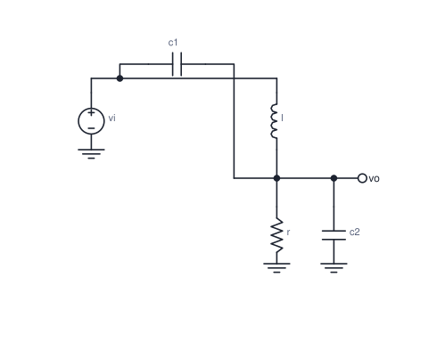](ar-6358.before.svg) | [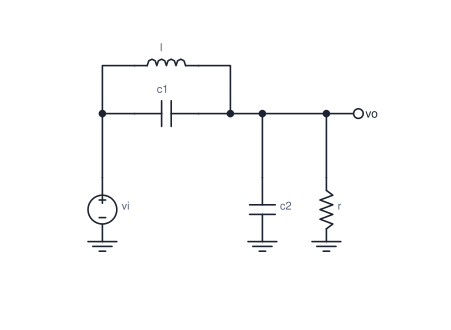](ar-6358.after.svg) | [![AR6358 published][ar6358]][ar6358] |
| [](ar-6360.before.svg) | [](ar-6360.after.svg) | [![AR6360 published][ar6360]][ar6360] |

Both driven filters now meet the terminal-axis and load-branch checks. The output ports and source polarity come from the deck. The upstream open measurement terminals are only present where the converted deck declares them.

[ar6358]: https://huggingface.co/datasets/eulermaxwell/AnalogRetriever-data/resolve/0c053b6580315d8a89c629d67994a6da4575a17f/iccad2026/images/img6358.jpg
[ar6360]: https://huggingface.co/datasets/eulermaxwell/AnalogRetriever-data/resolve/0c053b6580315d8a89c629d67994a6da4575a17f/iccad2026/images/img6360.jpg

## Signed inputs on a regulator's error amplifier

In AG2187, the amplifier output drives an NMOS pass gate. The positive input receives the reference and the negative input receives the output-divider tap. The right-facing symbol now puts the reference above the feedback lead. The Schemify importer puts the signs and the original ordered terminals on the corresponding rows of the generated symbol.

| Production before | Production after | Hand layout |
|---|---|---|
| [](ag-2187.before.svg) | [](ag-2187.after.svg) | [![AG2187 panel A.1][ag2187]][ag2187] |

At this checkpoint 39 of the 40 related decks accepted the signed frame. AG2212 gained its signed nine-port symbol at the later amplifier checkpoint. Across all 39, the physical wire components, port and rail marker counts, crossings and bends were preserved. The 40 decks share the same published image. Wang's Fig. 1A independently illustrates the right-facing arrangement. TI's Fig. 4 shows the corresponding input order on a rotated amplifier. [Wang, Fig. 1A](https://patentimages.storage.googleapis.com/f9/3f/00/1a7115fae3947b/US7446515B2.pdf#page=2) · [Texas Instruments, Fig. 4](https://www.ti.com/lit/ta/ssztac2/ssztac2.pdf#page=3)

The baseline already places the output capacitor above its series resistance in all 40 regulator decks, as well as in AG652 and AG2288. Their capacitor has no direct ground connection. AG652's internal compensation capacitor has a different role.

[ag2187]: https://raw.githubusercontent.com/xz-group/AnalogGenie/efc25358939c6bedd247f28d3df61066964f3a90/Dataset/2187/Book2187.png

A regulator and sampler that share a definition can now use different signed frames in native drawings. The editor can change its single shared symbol when every instance qualifies. [Shared-frame comparisons](shared-frames/README.md)

## Identifying local stages from a netlist

The native parent census recovers five local groups in AG1080 and one group in AG928. It reads ordered device terminals, model declarations, declared cell ports and device parameters before testing symmetry. A bounded search distinguishes a unique reflection from multiple witnesses or exhaustion. All 2,202 production placement JSON files compared byte-for-byte equal to the preceding commit.

| AG1080 group | Device members |
|---|---|
| First input stage | M1–M5 |
| First complementary stage | M6–M9 |
| Second input stage | M10–M14 |
| Second complementary stage | M15–M18 |
| Latch and output branches | M19–M32 |

The independent corpus test checks the exact dispositions and reasons for 2,202 named decks, the device memberships and typed gate interfaces on 96 eligible records, and all 29 uniquely witnessed reflections. AG1053 retains its raw facts and declines the automatic policy because its groups form a gate-dependency cycle. Use the diagnostic to inspect another deck or run the complete comparison.

```sh
nix develop -c zig build parent-census -- external/examples/analoggenie/ag-1080.cir
nix develop -c python3 tests/parent_corpus.py
```

## A hidden body still connects to its resistor

The native three-terminal MOS symbol hides its body. A resistor terminal that connects only to that body now carries the shared net name. In AG1167 follow R1's first terminal to M1's body on net0. Both corresponding terminals carry net0 in the generated Schemify drawing, which exposes the body. The hand figure shows the substrate resistor circuit directly.

| Production before | Production after | Hand layout |
|---|---|---|
| [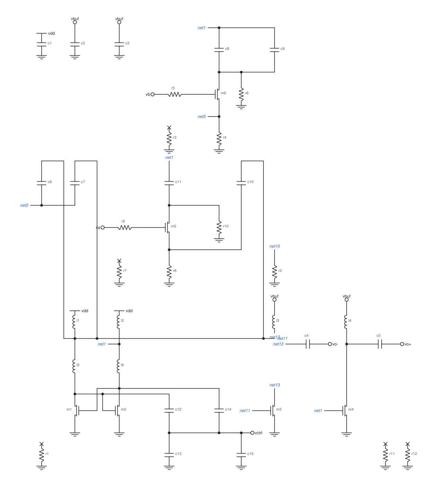](ag-1167.before.svg) | [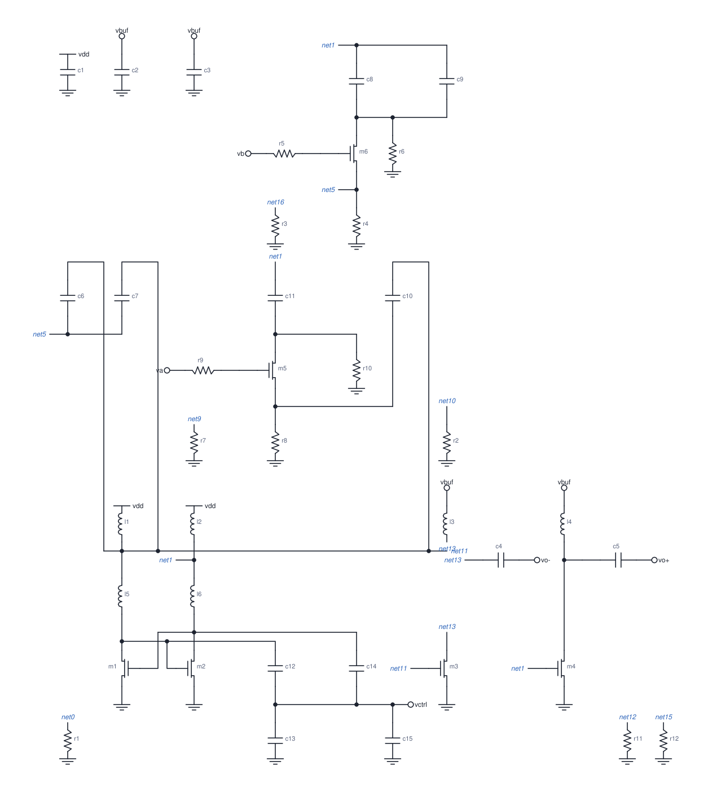](ag-1167.after.svg) | [![AG1167 published][ag1167]][ag1167] |
| [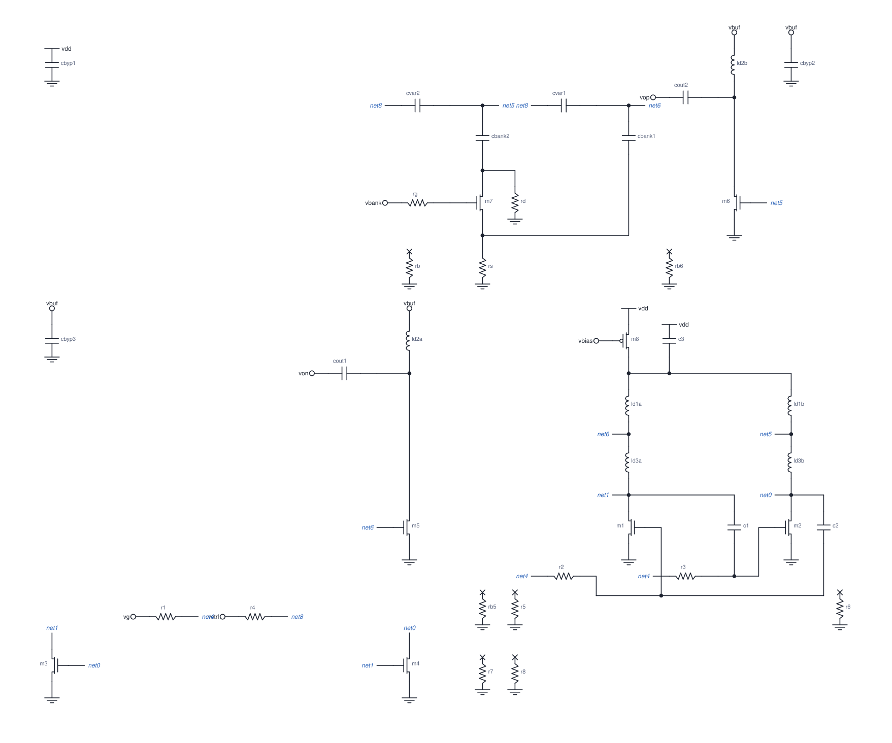](ag-1169.before.svg) | [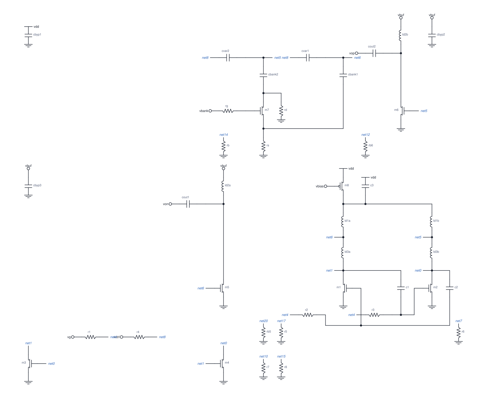](ag-1169.after.svg) | [![AG1169 published][ag1169]][ag1169] |

Five AG1167 resistor ends and all seven in AG1169 previously carried false no-connect crosses. The sixth body-connected resistor in AG1167 already had a named lead. All 13 connections survived independent Schemify netlisting and comparison. Across 5,274 decks the change replaced 26 crosses with 26 names in 14 drawings. All device poses, wires, junctions and earlier names stayed in place. A truly isolated resistor terminal retains its cross.

[ag1167]: https://raw.githubusercontent.com/xz-group/AnalogGenie/efc25358939c6bedd247f28d3df61066964f3a90/Dataset/1167/Book1167.png
[ag1169]: https://raw.githubusercontent.com/xz-group/AnalogGenie/efc25358939c6bedd247f28d3df61066964f3a90/Dataset/1169/Book1169.png

## Four-bias amplifiers and clocked comparators

The three four-bias amplifiers in AG1242, AG1674 and AG2212 now get signed triangles with nine distinct leads. The four comparators in AG808, AG3492, AG3493 and AG3495 get triangles with a separate clock. Across the seven instances both renderers expose all 50 declared ordered terminals. The gallery redraws show 43 of these leads and omit VSS on all seven. The published diagrams can be more abstract still. In AG808, for example, the book omits the comparator's clock and supply contacts.

| Production before | Production after | Published drawing |
|---|---|---|
| [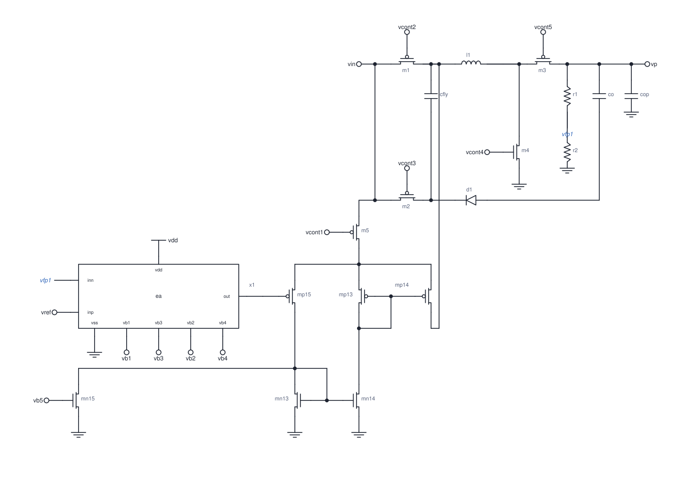](ag-1242.before.svg) | [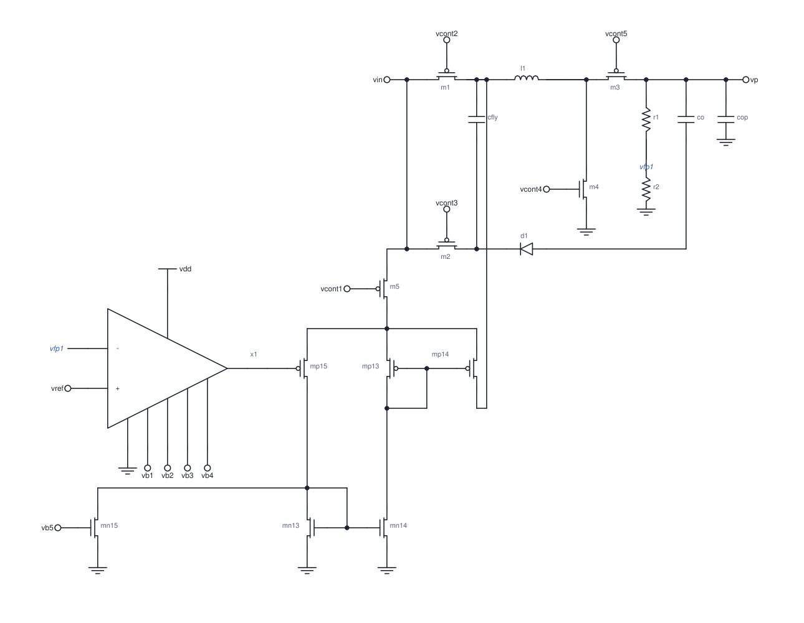](ag-1242.after.svg) | [![AG1242 book figure][ag1242]][ag1242] |
| [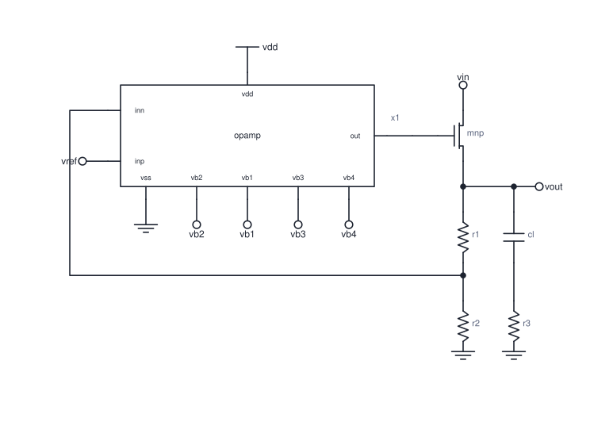](ag-2212.before.svg) | [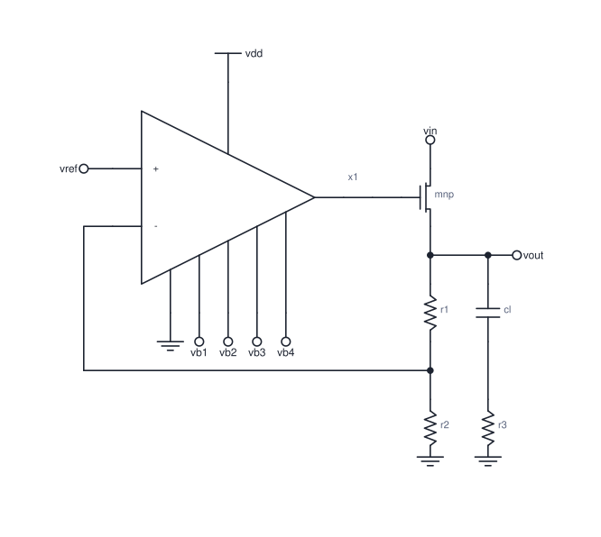](ag-2212.after.svg) | [![AG2212 book figure][ag2212]][ag2212] |
| [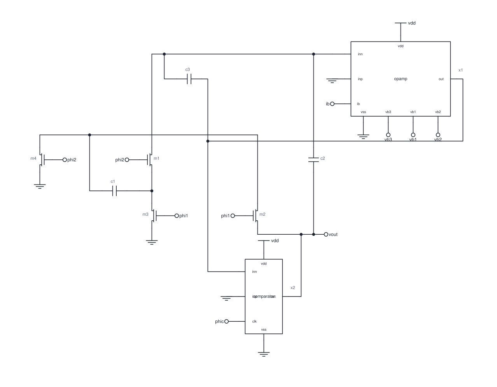](ag-808.before.svg) | [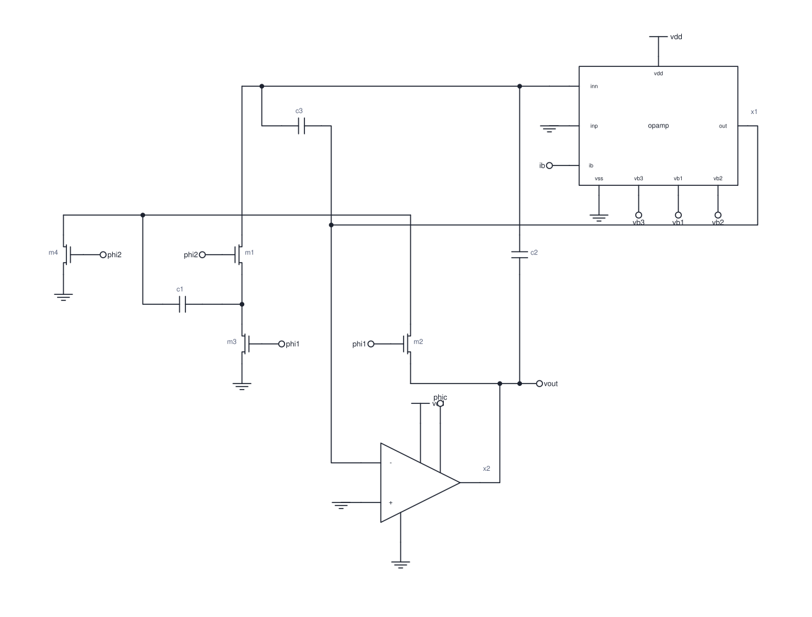](ag-808.after.svg) | [![AG808 book figure][ag808]][ag808] |
| [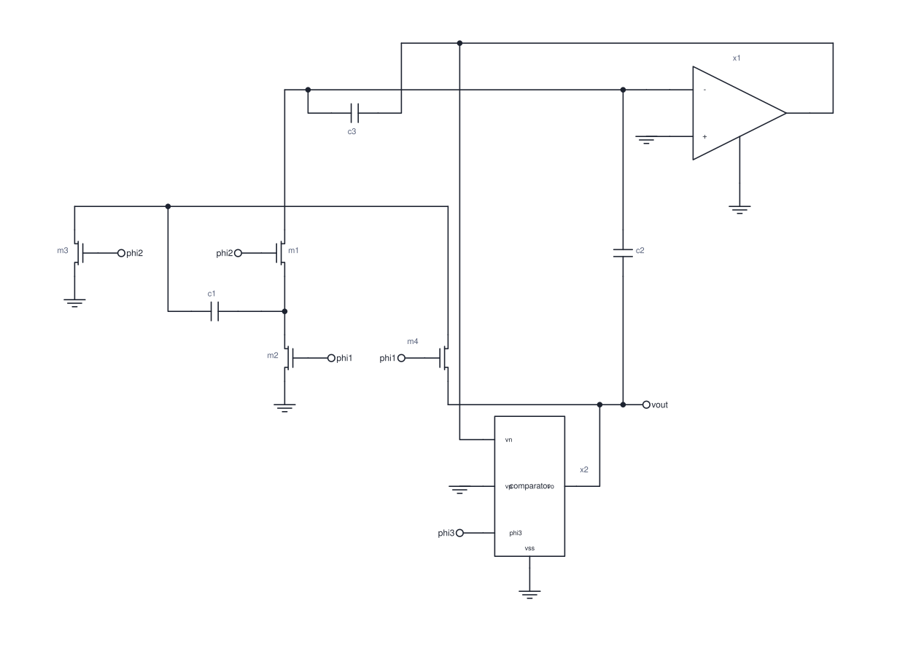](ag-3495.before.svg) | [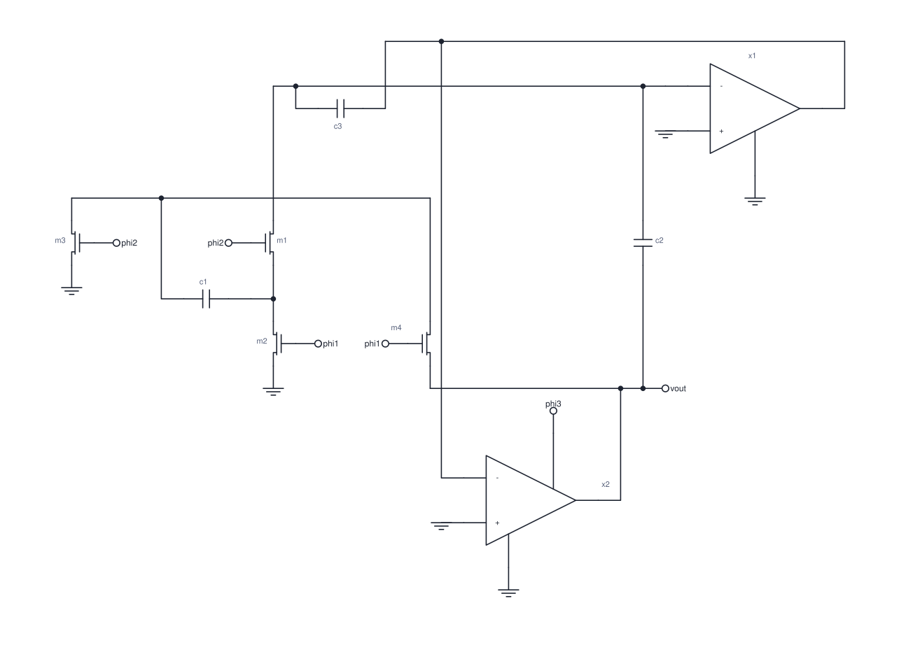](ag-3495.after.svg) | [![AG3495 book figure][ag3495]][ag3495] |

AG2212 now also qualifies for the regulator input-order rule, bringing that cohort to 40 of 40 deck variants of the same figure. AG3495 declares a global positive supply and five formals, so its symbol has five pins. AG808's other amplifier has an IB control and retains its box. The source redraws include top and bottom clock leads. Putting the canonical clock above the body kept crossings and bends at their previous counts across all seven. A lower-clock trial added a crossing in AG3492 and AG3493. The large converter in AG1242 still faces differently on the production page. [AG3492 reference redraw](../../../external/examples/analoggenie/ag-3492.svg) · [AG3493 reference redraw](../../../external/examples/analoggenie/ag-3493.svg)

[ag1242]: https://raw.githubusercontent.com/xz-group/AnalogGenie/efc25358939c6bedd247f28d3df61066964f3a90/Dataset/1242/Book1242.png
[ag2212]: https://raw.githubusercontent.com/xz-group/AnalogGenie/efc25358939c6bedd247f28d3df61066964f3a90/Dataset/2212/Book2212.png
[ag808]: https://raw.githubusercontent.com/xz-group/AnalogGenie/efc25358939c6bedd247f28d3df61066964f3a90/Dataset/808/Book808.png
[ag3495]: https://raw.githubusercontent.com/xz-group/AnalogGenie/efc25358939c6bedd247f28d3df61066964f3a90/Dataset/3495/Book3495.png

## Where a rail lead meets a rounded gate

The two external supply leads on the XOR-family gates in AG438, AG545 and AG1076 each extended 5/19 of a drawing unit into the gate at nominal pitch 20. The quantized outline now includes each attachment point. An independent ray–polygon test compares the actual line to the first outline intersection at six symbol pitches, including the minimum. The original book omits these power leads. The comparison shows a graphical correction to the generated symbol while preserving the declared supplies and their external tips.

| Native before | Native after | Published drawing |
|---|---|---|
| [](ag-438.before.svg) | [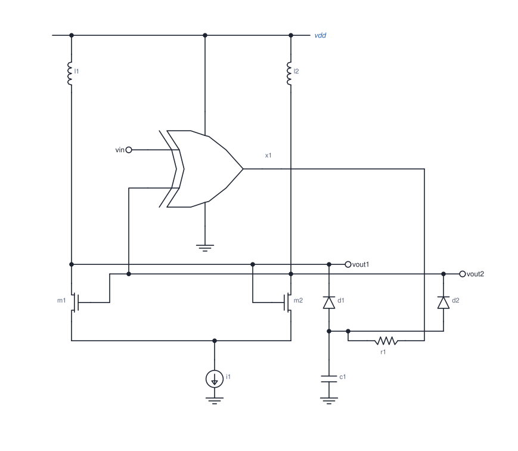](ag-438.after.svg) | [![AG438 published][ag438]][ag438] |

[ag438]: https://raw.githubusercontent.com/xz-group/AnalogGenie/efc25358939c6bedd247f28d3df61066964f3a90/Dataset/438/Book438.png

## Named contacts on PFD and DAC boxes

The PFD in AG439 and AG440 has A and B on the left and QA and QB on the right. All four pins previously appeared on the native left side. The Schemify box previously put all four on the right. Both renderers now use the two observed sides and retain each declared pin and its electrical direction. The rule also recognizes the two complete DAC spellings, OUT1/OUT2 and O1/O2. It places both outputs on the canonical right of the box. Explicit graphical side directives still determine each requested pin.

| Native before | Native after | Published drawing |
|---|---|---|
| [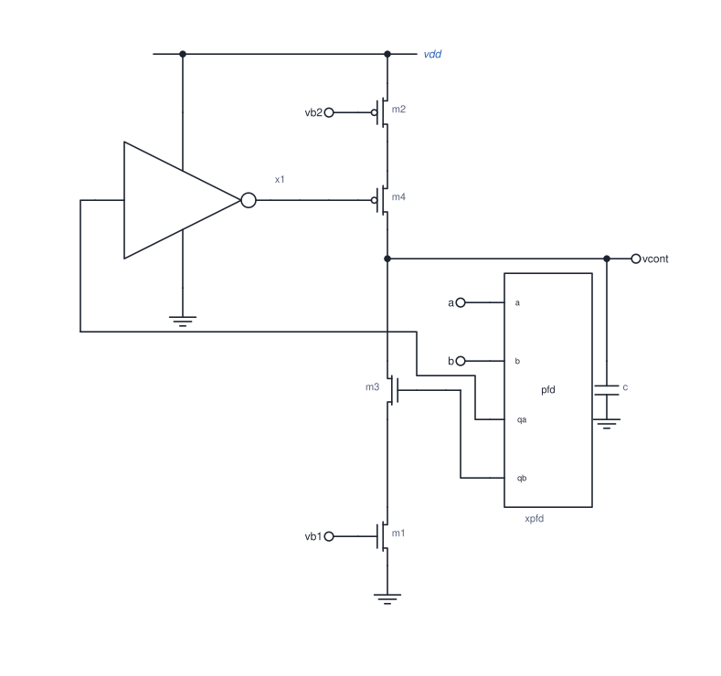](ag-439.before.svg) | [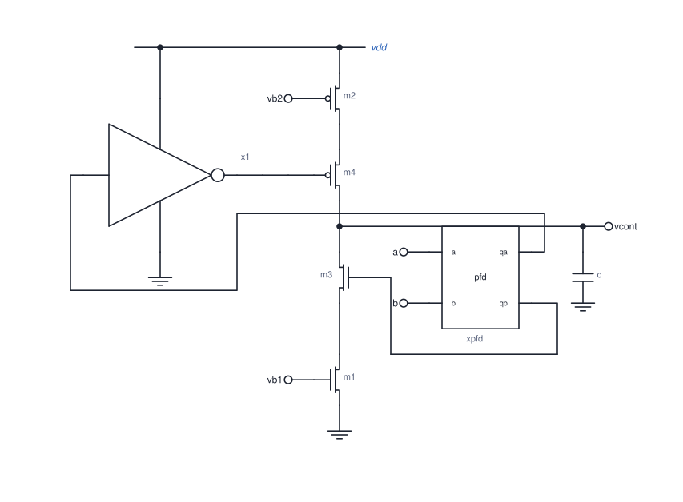](ag-439.after.svg) | [![AG439 published][ag439]][ag439] |
| [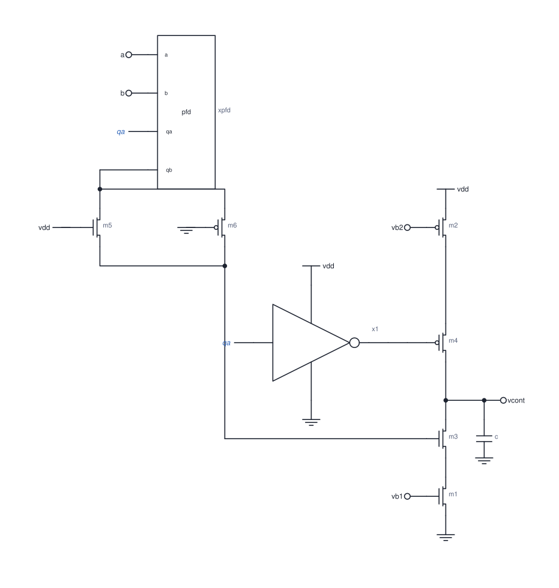](ag-440.before.svg) | [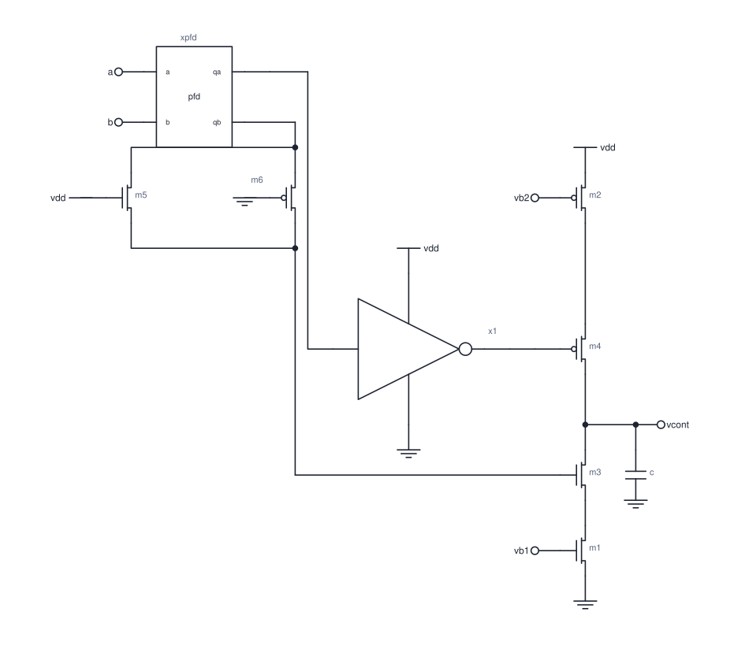](ag-440.after.svg) | [![AG440 published][ag440]][ag440] |
| [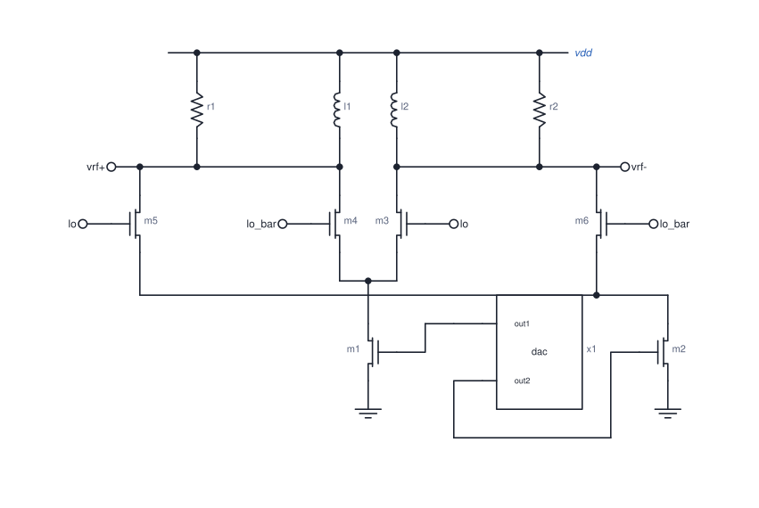](ag-515.before.svg) | [](ag-515.after.svg) | [![AG515 published][ag515]][ag515] |
| [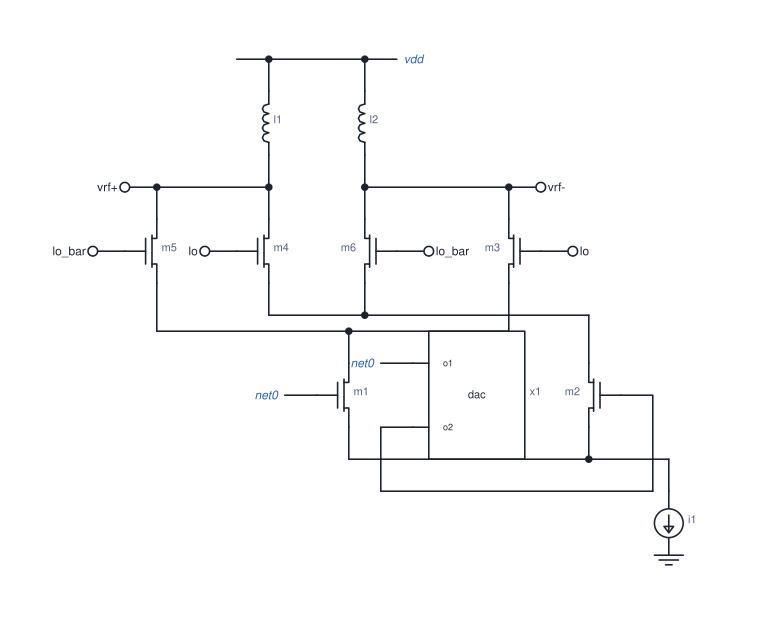](ag-516.before.svg) | [](ag-516.after.svg) | [![AG516 published][ag516]][ag516] |

The canonical PFD sides cost one crossing in the complete AG439 native drawing (1 → 2) and two bends (8 → 10). AG440 keeps zero crossings and moves from four to six bends. An explicit Schemify PININFO direction keeps its existing side unless the caller assigns a graphical side. The actual editor import preserves PFD A/B/QA/QB as inout. It preserves AG515 OUT1/OUT2 as out and AG516 O1/O2 as inout. The canonical side tests also permute formal order, while the terminal array remains in SPICE order. AG515 already had the intended canonical sides. The placement engine mirrors both DACs, leaving the contacts on the left of the finished sheet. The published drawings put the DAC to the left of the mixer with its contacts on the right. That whole-stage orientation remains a visible difference.

[ag439]: https://raw.githubusercontent.com/xz-group/AnalogGenie/efc25358939c6bedd247f28d3df61066964f3a90/Dataset/439/Book439.png
[ag440]: https://raw.githubusercontent.com/xz-group/AnalogGenie/efc25358939c6bedd247f28d3df61066964f3a90/Dataset/440/Book440.png
[ag515]: https://raw.githubusercontent.com/xz-group/AnalogGenie/efc25358939c6bedd247f28d3df61066964f3a90/Dataset/515/Book515.png
[ag516]: https://raw.githubusercontent.com/xz-group/AnalogGenie/efc25358939c6bedd247f28d3df61066964f3a90/Dataset/516/Book516.png

A requested axis through two independent tail sources is checked on the final device and its terminals. The comparison also shows how a fixed pose affects the report on a requested mirror. [Caller symmetry examples](caller-symmetry/README.md)

The degeneration census checks which source resistors and current sources belong to each branch. [Source regions and their attachments](source-regions/README.md)

In AG220, the two equal source resistors meet at a horizontal T above the tail. Both renderers preserve each branch’s electrical identity. [Source-degeneration bridge](two-arm-bridge/README.md)
