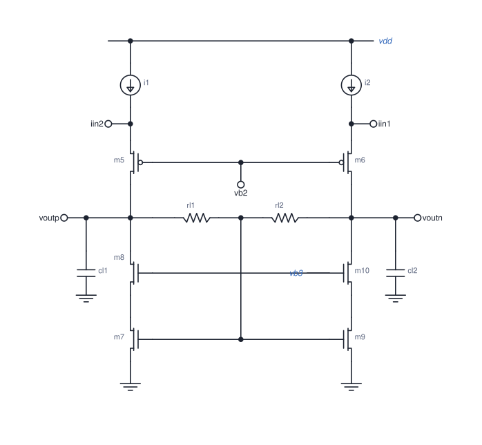
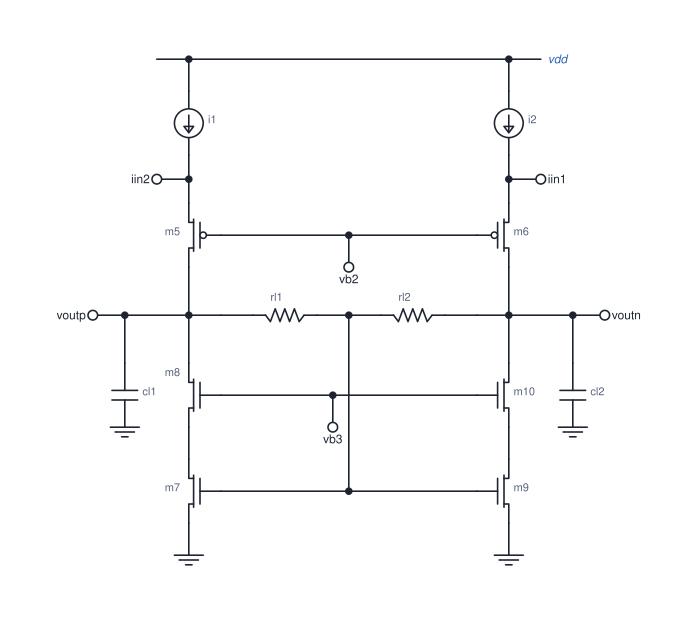
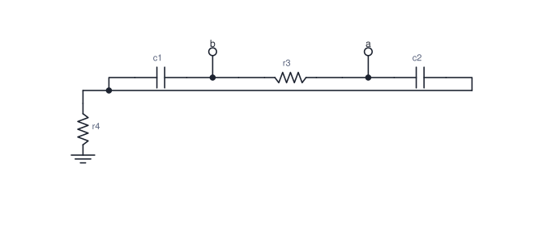
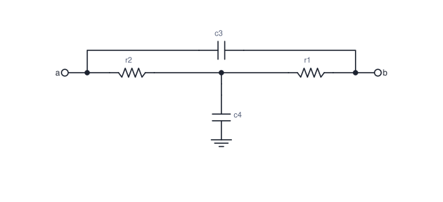
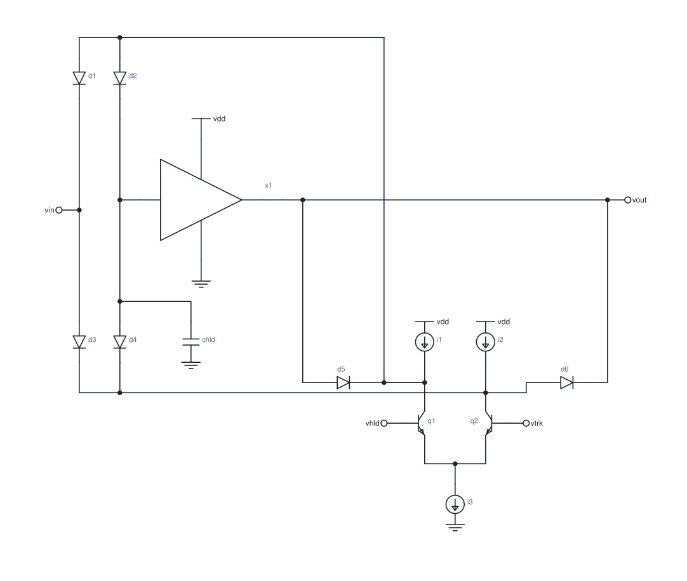
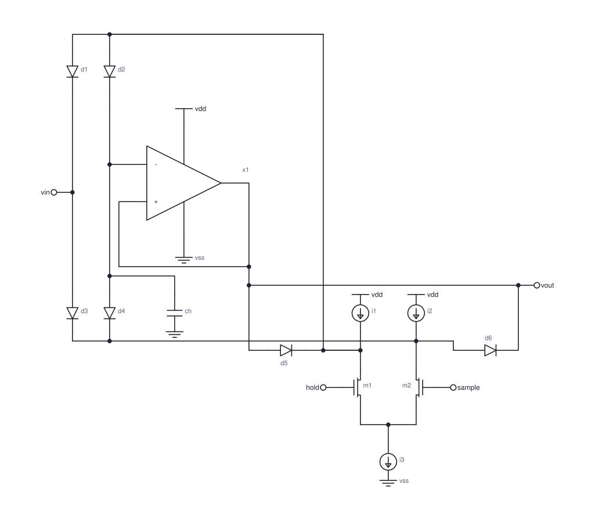
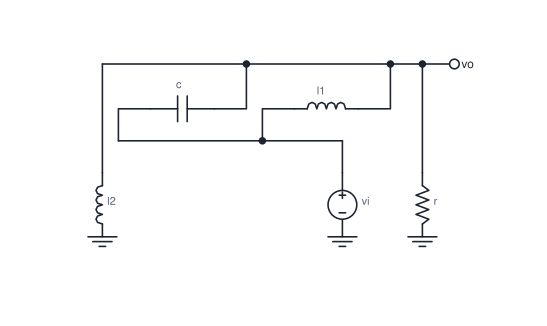
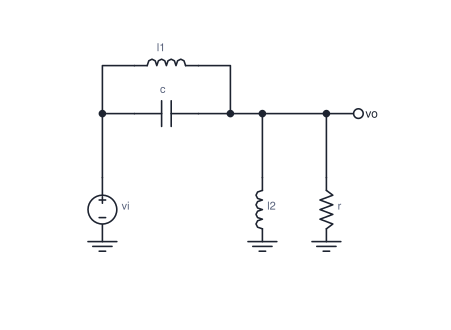
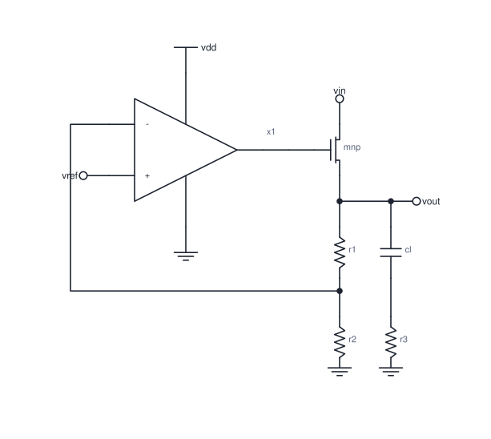
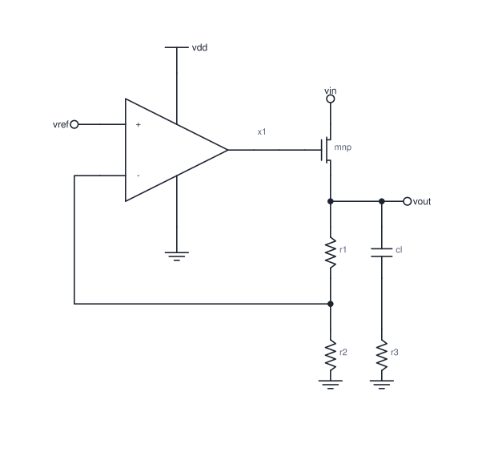

# Production layouts beside the published drawings

The first column uses upstream production commit `4c7c3a12`. The middle column uses the layout change for that row. Both use the same converted DUT and the default symbols. Click a drawing to inspect individual pins and wires. The last column links the pinned upstream figures.

## Differential stages with reciprocal MOS loads

Follow each input transistor's drain to the four load terminals on its output net. Both published circuits put the diode-connected loads on the outside. In AG1034 the inner drains cross to the other branch. In AG215 the inner gates cross instead.

| Production before | Production after | Hand layout |
|---|---|---|
| [](ag-1034.before.svg) | [](ag-1034.after.svg) | [![AG1034 published figure][ag1034]][ag1034] |
| [](ag-215.before.svg) | [](ag-215.after.svg) | [![AG215 published figure][ag215]][ag215] |

In AG1034 the outer loads now share columns with the input drains. Reported crossings fell from 4 to 1 and bends from 9 to 4. AG215 keeps one crossing and eight bends. Its outer diode straps now face away from the inner devices. Pin-to-pin wire tests trace both five-terminal outputs. Sixteen controls, including two-tier cascodes and single mirrors, retained byte-identical SVGs and reports. Five matching decks in the other collections (AMS-Net 245/525 and CT032/050/093) retained their crossing and bend counts and had no report findings.

To reproduce a row, build with `nix develop -c zig build`, then run the command below at the desired commit. Substitute the corresponding deck for other rows.

```sh
zig-out/bin/cktimg-json --svg ag-1034.svg --report ag-1034.report.json external/examples/analoggenie/ag-1034.cir ag-1034.json
```

[ag1034]: https://raw.githubusercontent.com/xz-group/AnalogGenie/efc25358939c6bedd247f28d3df61066964f3a90/Dataset/1034/Book1034.png
[ag215]: https://raw.githubusercontent.com/xz-group/AnalogGenie/efc25358939c6bedd247f28d3df61066964f3a90/Dataset/215/Book215.png

## A visible bias feed between two gates

AG725's Q8 and Q10 share VB3. In the production drawing the Vcntrl wire crosses the gate line at its midpoint. When the midpoint is occupied, the router tests an adjacent interior tap after all ordinary routes have claimed their space. The tap must be clear of foreign wires. Trace the one port to both gates. In the source, the letter Q designates the devices called M8 and M10 in the converted deck.

| Production before | Production after | Hand layout |
|---|---|---|
| [](ag-725.before.svg) | [](ag-725.after.svg) | [![AG725 Fig. P6.57][ag725]][ag725] |

On AG1652, an early trial of the tap lost one of seven VB3 port markers and split the four-pin net0 wire. The final pass preserves both. Across 132 reviewed bias and divider decks, eight gained a visible bias port. Scanning all 5,274 production decks found 57 that gained this bias tap. Removing its single new stub from each output recovers the exact original wire geometry on every net in those 57. All prior port markers kept their coordinates. In particular, all twelve MOS gate dividers already had a straight tap-to-gate wire, including the two taps with a fourth wire arm.

[ag725]: https://raw.githubusercontent.com/xz-group/AnalogGenie/efc25358939c6bedd247f28d3df61066964f3a90/Dataset/725/Book725.png

## Passive ladders and bridged T filters

The reference row is the tapped path between the ports. AR6308 places three resistors on this row with a capacitor dropping from each tap. In AR6363 and its R/C dual AR6364, the two tapped arms share the port row, the untapped arm bridges over them and the return drops from the central junction.

| Production before | Production after | Hand layout |
|---|---|---|
| [](ar-6308.before.svg) | [](ar-6308.after.svg) | [![AR6308 source][ar6308]][ar6308] |
| [](ar-6363.before.svg) | [](ar-6363.after.svg) | [![AR6363 source][ar6363]][ar6363] |
| [](ar-6364.before.svg) | [](ar-6364.after.svg) | [![AR6364 source][ar6364]][ar6364] |

The through-path and port checks went from three of four to four of four ladders, and from zero of two to two of two bridged Ts. The drawings of AR1910, AR5431 and AR5432 already had the observed layout. Their placement JSON is byte-identical.

[ar6308]: https://huggingface.co/datasets/eulermaxwell/AnalogRetriever-data/resolve/0c053b6580315d8a89c629d67994a6da4575a17f/iccad2026/images/img6308.jpg
[ar6363]: https://huggingface.co/datasets/eulermaxwell/AnalogRetriever-data/resolve/0c053b6580315d8a89c629d67994a6da4575a17f/iccad2026/images/img6363.jpg
[ar6364]: https://huggingface.co/datasets/eulermaxwell/AnalogRetriever-data/resolve/0c053b6580315d8a89c629d67994a6da4575a17f/iccad2026/images/img6364.jpg

## Diode bridges in sample-and-hold circuits

In AG763 and AG1042 the input and the held voltage sit at the middle contacts of two upright diode columns. The hold capacitor and buffer share the right contact. Trace the two additional feedback diodes to the output. The rule checks their anode and cathode connections as well.

| Production before | Production after | Hand layout |
|---|---|---|
| [](ag-763.before.svg) | [](ag-763.after.svg) | [![AG763 published][ag763]][ag763] |
| [](ag-1042.before.svg) | [](ag-1042.after.svg) | [![AG1042 published][ag1042]][ag1042] |

Each sampler now has four upright diodes in the two observed columns. The two formerly separate Vin markers become one port on the joined input conductor. Crossings went from 4 to 2 in AG763 and from 6 to 4 in AG1042. The vertical spacing and the positions of the current sources still differ from the figures. Twelve controls, including six rectifier or bias diamonds and the AG1142 tuning network, retained identical SVGs.

[ag763]: https://raw.githubusercontent.com/xz-group/AnalogGenie/efc25358939c6bedd247f28d3df61066964f3a90/Dataset/763/Book763.png
[ag1042]: https://raw.githubusercontent.com/xz-group/AnalogGenie/efc25358939c6bedd247f28d3df61066964f3a90/Dataset/1042/Book1042.png

## Driven parallel LC filters

AR6358 and AR6360 put a parallel L and C between the drive and output. The inductor occupies the upper path and the capacitor the lower path. Two separate load branches descend from the output. AR6361 uses its parallel pair in a differential readout branch and retains its upright orientation.

| Production before | Production after | Hand layout |
|---|---|---|
| [](ar-6358.before.svg) | [](ar-6358.after.svg) | [![AR6358 published][ar6358]][ar6358] |
| [](ar-6360.before.svg) | [](ar-6360.after.svg) | [![AR6360 published][ar6360]][ar6360] |

Both driven filters now meet the terminal-axis and load-branch checks. The output ports and source polarity come from the deck. The upstream open measurement terminals are only present where the converted deck declares them.

[ar6358]: https://huggingface.co/datasets/eulermaxwell/AnalogRetriever-data/resolve/0c053b6580315d8a89c629d67994a6da4575a17f/iccad2026/images/img6358.jpg
[ar6360]: https://huggingface.co/datasets/eulermaxwell/AnalogRetriever-data/resolve/0c053b6580315d8a89c629d67994a6da4575a17f/iccad2026/images/img6360.jpg

## Signed inputs on a regulator's error amplifier

In AG2187, the amplifier output drives an NMOS pass gate. The positive input receives the reference and the negative input receives the output-divider tap. The right-facing symbol now puts the reference above the feedback lead. The Schemify importer puts the signs and the original ordered terminals on the corresponding rows of the generated symbol.

| Production before | Production after | Hand layout |
|---|---|---|
| [](ag-2187.before.svg) | [](ag-2187.after.svg) | [![AG2187 panel A.1][ag2187]][ag2187] |

Of the 40 related decks, 39 accepted the signed frame. AG2212 retains its nine-port box. Across all 39, the physical wire components, port and rail marker counts, crossings and bends were preserved. The 40 decks share the same published image. Wang's Fig. 1A independently illustrates the right-facing arrangement. TI's Fig. 4 shows the corresponding input order on a rotated amplifier. [Wang, Fig. 1A](https://patentimages.storage.googleapis.com/f9/3f/00/1a7115fae3947b/US7446515B2.pdf#page=2) · [Texas Instruments, Fig. 4](https://www.ti.com/lit/ta/ssztac2/ssztac2.pdf#page=3)

The baseline already places the output capacitor above its series resistance in all 40 regulator decks, as well as in AG652 and AG2288. Their capacitor has no direct ground connection. AG652's internal compensation capacitor has a different role.

[ag2187]: https://raw.githubusercontent.com/xz-group/AnalogGenie/efc25358939c6bedd247f28d3df61066964f3a90/Dataset/2187/Book2187.png
