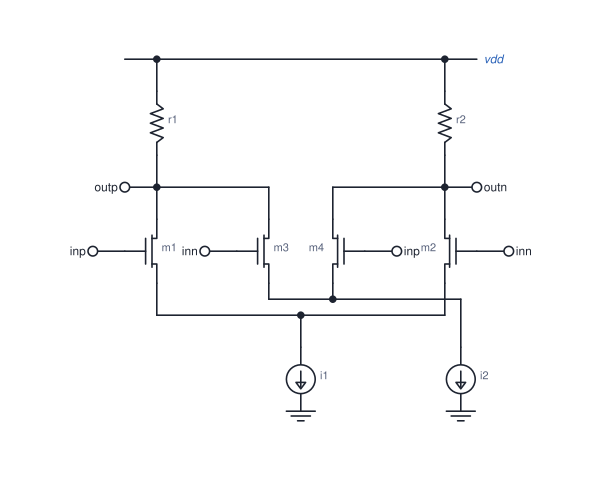
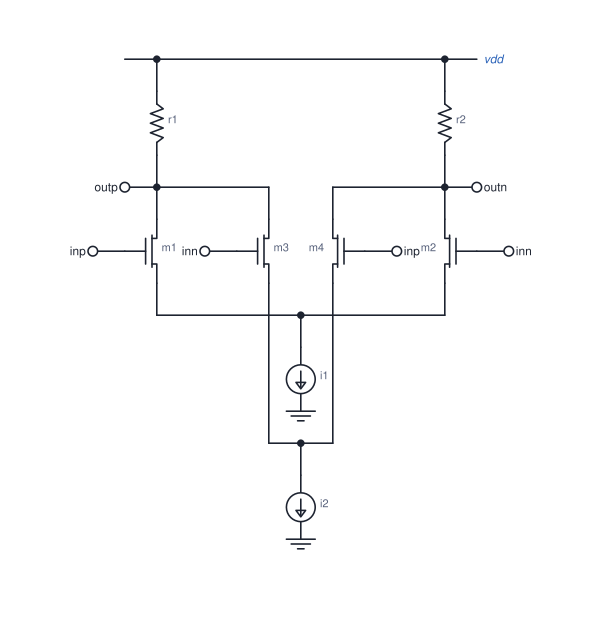
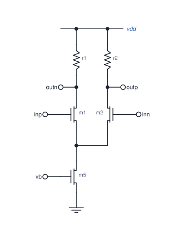

# Two tail sources on a requested symmetry axis

These synthetic controls exercise the caller's layout directives. In the crossed-gate quad, the three reflected pairs M1/M2, M3/M4 and R1/R2 establish the same vertical mirror at x=240. The caller asks to put both independent tail current sources on it. Their source nets are distinct.

| Production before | Production after |
|---|---|
|  |  |

The baseline is commit `2ba366fd`. I1 stays at (240,180). I2 moves from (340,180) to (240,260), and its terminals remain connected to its own nets. In all four ordinary variants, including reversed card order and the single request `axis I2`, every requested axis now agrees with the final drawing. The three mirrored pair frames retain their y coordinates and common x-sum for every corresponding terminal. This extra row changes crossings from one to two and keeps six bends. Both drawings pass all layout gates.

A fixed placement can break a mirror. The exact `at M1 -20 -20 r0` in the pair and `at M3 -20 -20 r0` in the quad draw the specified origins at (−800,−800). The report now marks just the affected symmetry request `dropped/conflict` and identifies that explicit placement line. Remaining pair and axis requests stay honoured. The fixed pair's drawing is unchanged. The fixed quad drops from two crossings to one and keeps eight bends.

A compatible weak pose translates the pair while preserving its physical mirror. An incompatible weak rotation yields to the drawing. A later incompatible mate request retains its existing priority in either order. An explicit row or column order can hold the two tails apart, in which case the missing axis is reported `relaxed/not_drawn`. An honoured exact pose or cell that directly displaces the tail is identified as the blocker.

To reproduce these cases from the repository root, run:

```sh
nix develop -c zig build
python3 tests/caller_symmetry.py zig-out/bin/cktimg-json /tmp/caller-symmetry
```

The [fixture verifier](../../../../tests/caller_symmetry.py) reads the public CLI's drawing and report independently. The [report tests](../../../../tests/report.zig) also move a single gate endpoint and translate a complete pair after placement. Each mutation invalidates the affected request while the load pair and common tail retain their own certificates.

## Written order of a series stack

Both calls below select the same branch of the resistor-loaded pair. M1's source and M5's drain share the tail net. Both terminals remain at x=80, with M1 at y=90 and M5 at y=170.

| Request | Previous report | Final report | Exported physical decision |
|---|---|---|---|
| `group stack M1 M5` | honoured | honoured | `group stack M1 M5` |
| `group stack M5 M1` | honoured | relaxed / not_drawn | `group stack M1 M5` |



The two requests produce identical drawings. Reversing the member names still selects M3 as M1's lower neighbour in the existing three-MOS fork. Opaque blocks have declared port anchors and no defined conduction path. For AG2436, X2 at (350,30) remains above X1 at (120,210) under `group stack X2 X1`. Those different horizontal positions satisfy the vertical order of the block members. Structural queries made before placement retain declared membership. With a drawing, a stack which neither written direction can reproduce is omitted from the exported physical decisions. An honoured exact pose that moves one member out of the stack appears in the failed request's blocker list.

The [public CLI verifier](../../../../tests/caller_stack.py) captures both directions for the pair and the fork. The [report regression](../../../../tests/report.zig) displaces just one terminal on the shared series net, leaving the origins fixed, and checks the resulting failure. Run `python3 tests/caller_stack.py zig-out/bin/cktimg-json /tmp/caller-stack` to reproduce the comparisons.
