# Compact common-control MOS input stages

Five input stages in four comparator circuits now occupy two short load/input columns, with the shared tail between the columns. The AG1080 NMOS input branches previously spanned 940 native units. They now span 140. In the actual Schemify drawing, the same branches went from 460 units to 280. The hand-drawn figure groups the devices this way in panel (a) and repeats the arrangement with the opposite polarity in panel (b). [Original AG1080, panels (a) and (b)](https://raw.githubusercontent.com/xz-group/AnalogGenie/efc25358939c6bedd247f28d3df61066964f3a90/Dataset/1080/Book1080.png)

The selector checks a complete five-device group under the original cell’s unique terminal-preserving reflection. The inputs must have separate formal gates and one private tail junction. Both opposite-polarity loads and the tail must share a single gate-only formal control. This admits exactly five stages among the eleven qualifying multigroup circuits in the 2,202-deck census. AG1028 has two separate controls and staggered input channels in the original. Its production drawing stays unchanged. Renaming the MOS devices and reversing all device cards preserved all five native results. An explicit AG1080 caller pose still takes precedence. [AG1028 original](https://raw.githubusercontent.com/xz-group/AnalogGenie/efc25358939c6bedd247f28d3df61066964f3a90/Dataset/1028/Book1028.png)

## Local geometry

The width below is the distance between the two input channel columns. Height covers all five channel centers. The actual D and S pins establish the center and vertical direction for each transistor. The five gates measure upright polarity-correct D/S contacts, distinct aligned load/input columns, equal input and load rows, an interior tail and polarity-appropriate vertical order. The sixth gate checks the measured span. Each native result fits the independently frozen 140 × 150 default-symbol reference. Five isolated projections imported through the actual Schemify host each measured 280 × 210 with its larger four-terminal symbols. These dimensions are per-renderer engineering choices. The originals establish relative device positions.

| Circuit and tail | Source width × height | Native before → after | Schemify before → after |
| --- | ---: | ---: | ---: |
| AG1046 MTAIL1 | 80 × 140 | 300 × 270 → 140 × 140 | 330 × 405 → 280 × 210 |
| AG1071 M1 | 100 × 150 | 140 × 170 → 140 × 140 | 280 × 240 → 280 × 210 |
| AG1079 M5 | 80 × 120 | 140 × 170 → 140 × 140 | 340 × 285 → 170 × 210 |
| AG1080 M5 | 80 × 120 | 940 × 180 → 140 × 140 | 460 × 345 → 280 × 210 |
| AG1080 M10 | 80 × 120 | 260 × 180 → 140 × 140 | 200 × 345 → 120 × 210 |

| Criterion, out of five admitted stages | Native before → after | Schemify before → after |
| --- | ---: | ---: |
| All five ordered D/S directions | 5 → 5 | 5 → 5 |
| Distinct input columns shared with their associated loads | 5 → 5 | 5 → 5 |
| Equal input rows and equal load rows | 5 → 5 | 5 → 5 |
| Tail strictly inside the branch columns | 5 → 5 | 3 → 5 |
| Polarity-specific load/input/tail order | 5 → 5 | 5 → 5 |
| Renderer-specific width and height limits | 0 → 5 | 0 → 5 |
| All six criteria together | 0 → 5 | 0 → 5 |

The geometry checker reads numeric output contacts. In Schemify it reconstructs every placed pin from the actual core primitive and instance transform, then separately checks physical output components. Across all five final stages, the exported rectangles enclosing the MOS terminal anchors have no overlap with other MOS anchor rectangles. Their minimum separation was 20 native units and 25 target units. No routed segment entered the open interior of a selected MOS anchor rectangle. Native whole-circuit wire and pin scans found zero foreign contacts on the four positive circuits before and after. Actual Schemify netlisting and `spicecmp` preserved all ordered D/G/S/B bindings, models and parameters across 12 + 13 + 19 + 32 device cards. The six required local-drain-pair/remote-gate output nets retained their two labelled pieces. Both AG1053 cycle controls retained one piece. [Geometry regression](../../../../tests/parent_stages.py) · [Physical output and host round-trip regression](../../../../tests/parent_output_routes.py)

## Whole-drawing tradeoffs

| Circuit | Native crossings | Native bends | Native labelled nets | Schemify proper crossings | Schemify pin-free corners |
| --- | ---: | ---: | ---: | ---: | ---: |
| AG1046 | 7 → 4 | 11 → 13 | 2 → 0 | 6 → 5 | 10 → 14 |
| AG1071 | 10 → 10 | 14 → 16 | 1 → 1 | 5 → 5 | 10 → 10 |
| AG1079 | 10 → 12 | 14 → 18 | 3 → 3 | 10 → 10 | 19 → 22 |
| AG1080 | 15 → 14 | 16 → 25 | 6 → 8 | 13 → 12 | 30 → 36 |

Native metrics come from the normal layout report. Schemify crossings count points strictly inside two perpendicular wire segments. Its corner count excludes all actual core pins, collinear joins and junctions. The additional bends are visible. AG1046 now sets its complete input stage below the other devices, closer to the original. AG1071’s original separates its two stages horizontally. AG1079 and AG1080 use multiple named panels. The outputs below still draw each complete DUT on one sheet.

## Before and after

Each row uses the identical source deck and renderer on both sides. Native panels are direct `cktimg-json --svg` exports. The dark panels are actual Schemify editor SVG exports of the imported DUT using `file.image_export.svg_export`. Each SVG opens at its original scale.

| Circuit and source | Before local organization | After local organization |
| --- | --- | --- |
| AG1046 native · [Original](https://raw.githubusercontent.com/xz-group/AnalogGenie/efc25358939c6bedd247f28d3df61066964f3a90/Dataset/1046/Book1046.png) | 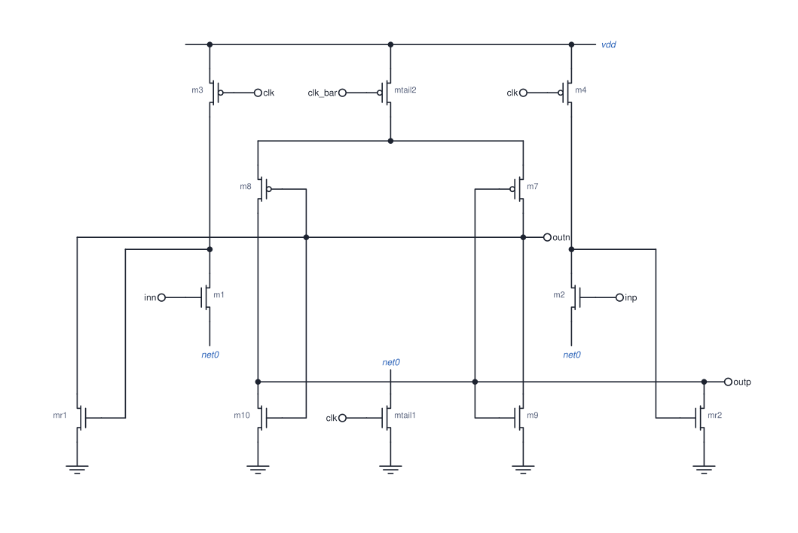 | 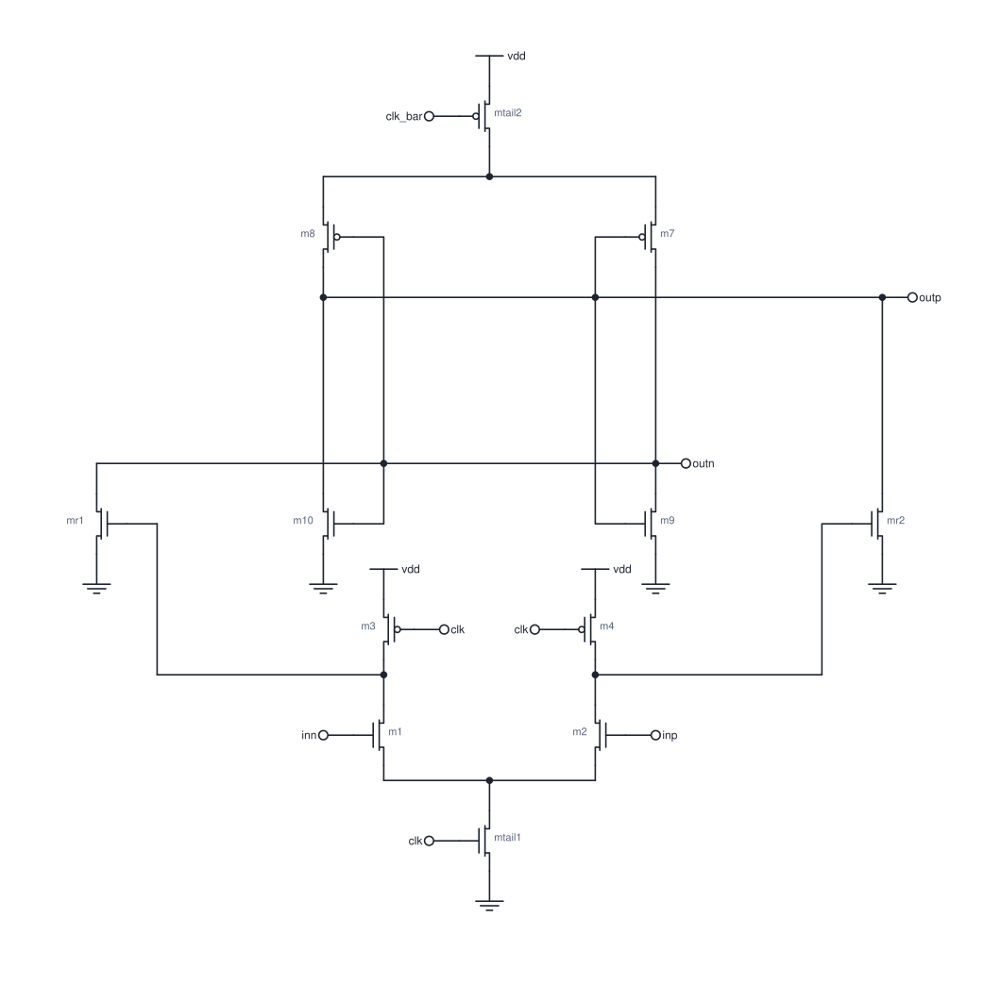 |
| AG1046 Schemify | 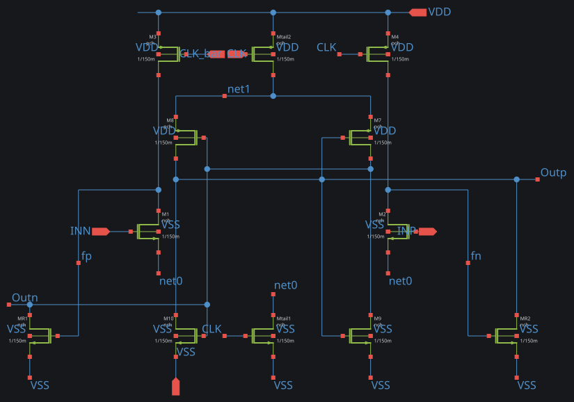 | 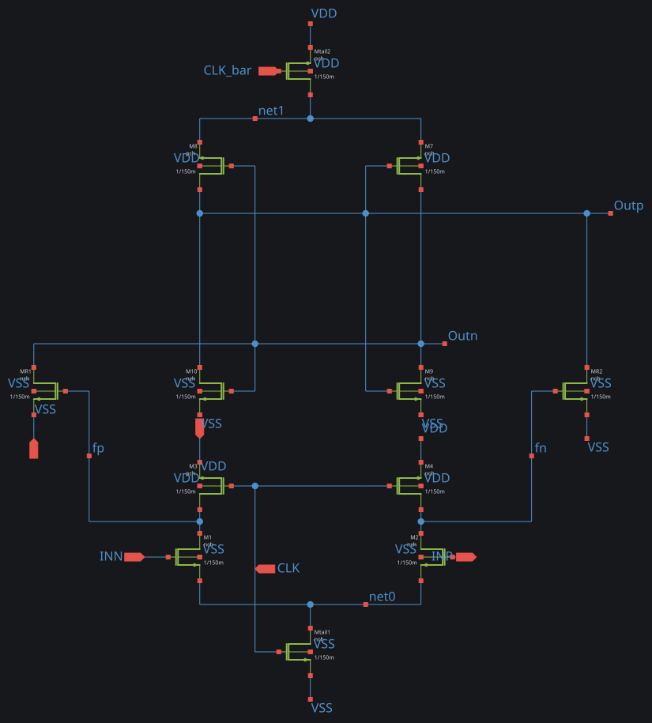 |
| AG1071 native · [Original](https://raw.githubusercontent.com/xz-group/AnalogGenie/efc25358939c6bedd247f28d3df61066964f3a90/Dataset/1071/Book1071.png) | 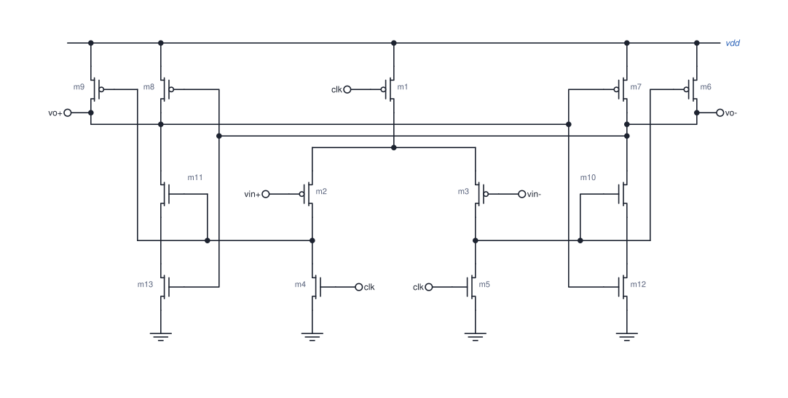 | 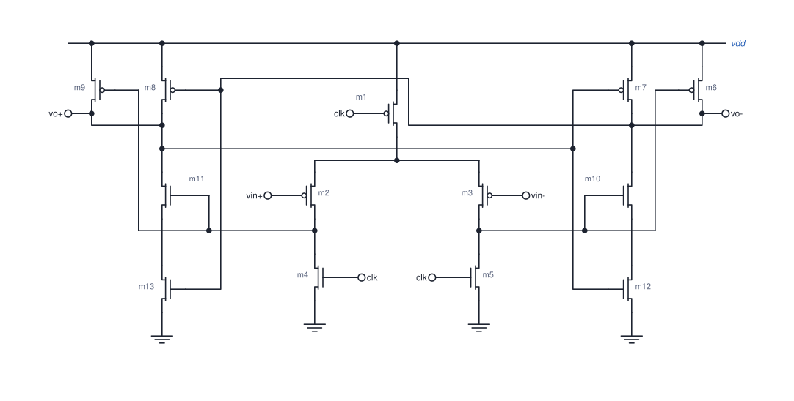 |
| AG1071 Schemify | 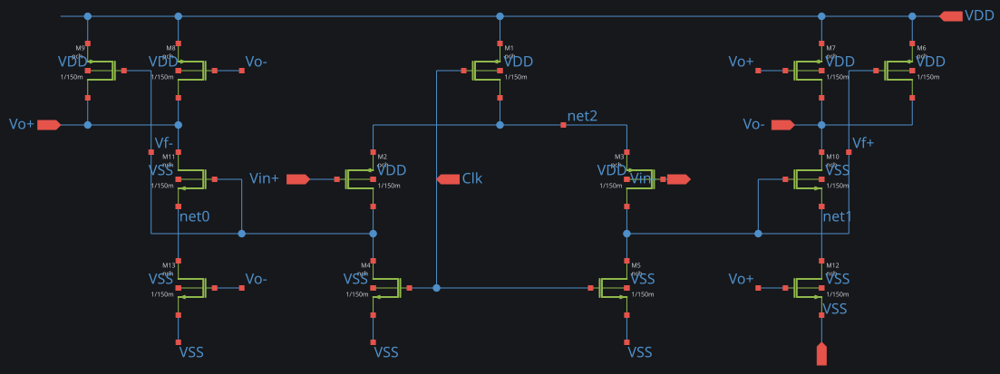 | 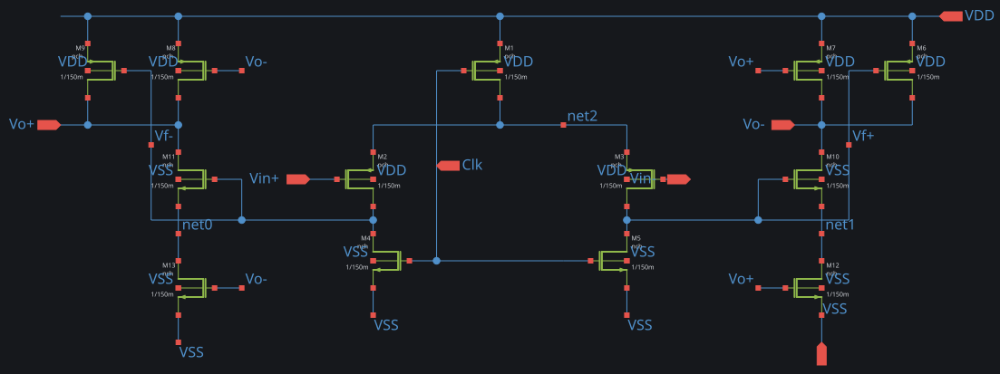 |
| AG1079 native · [Original](https://raw.githubusercontent.com/xz-group/AnalogGenie/efc25358939c6bedd247f28d3df61066964f3a90/Dataset/1079/Book1079.png) | 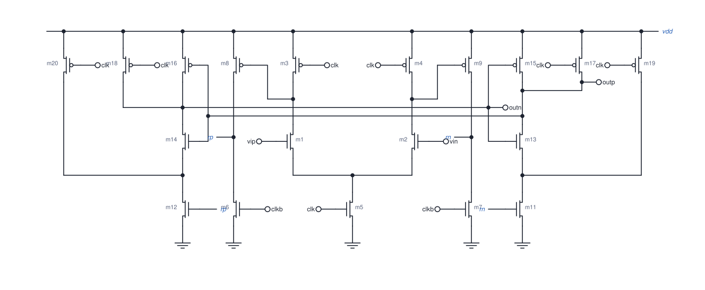 | 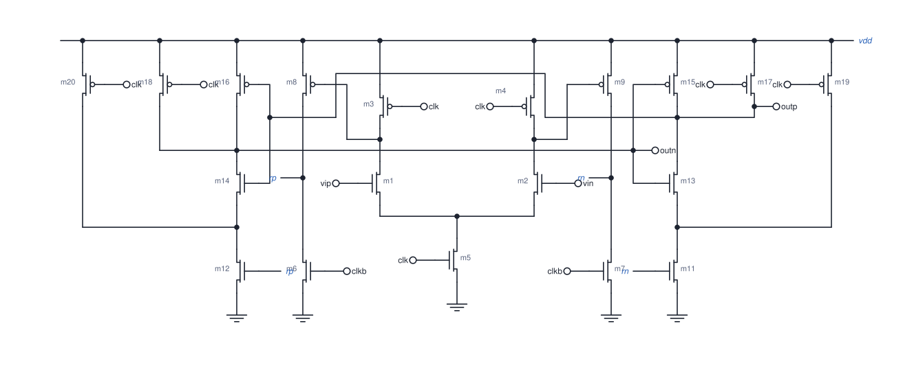 |
| AG1079 Schemify | 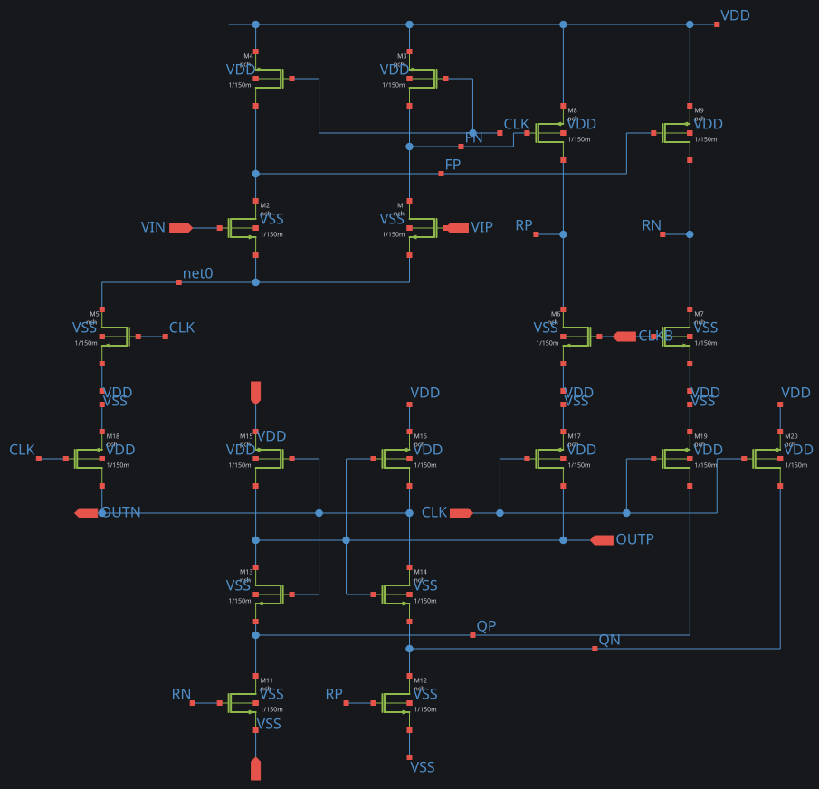 | 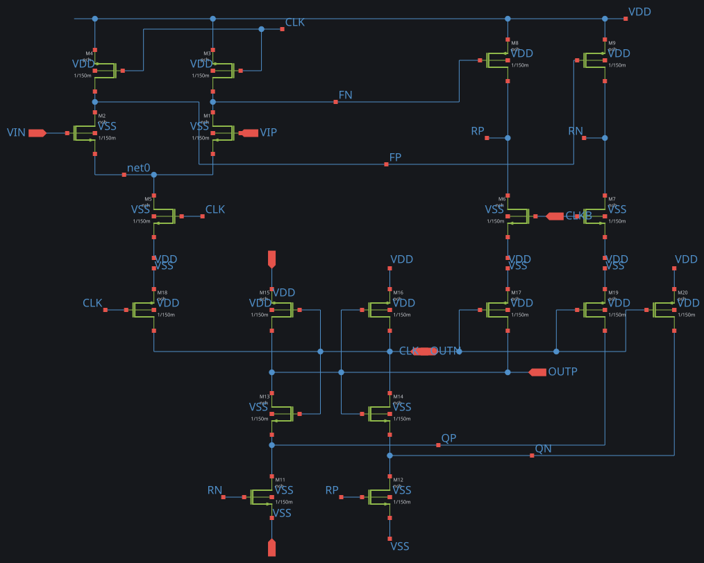 |
| AG1080 native · [Original](https://raw.githubusercontent.com/xz-group/AnalogGenie/efc25358939c6bedd247f28d3df61066964f3a90/Dataset/1080/Book1080.png) | 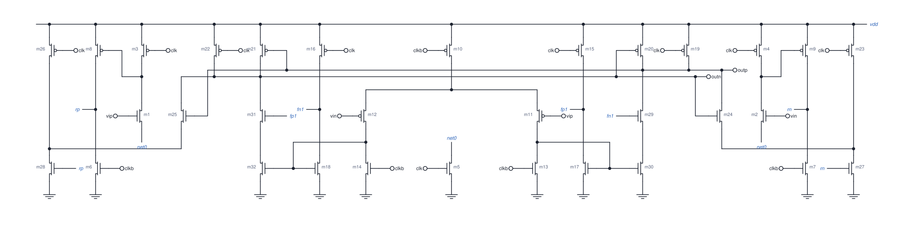 | 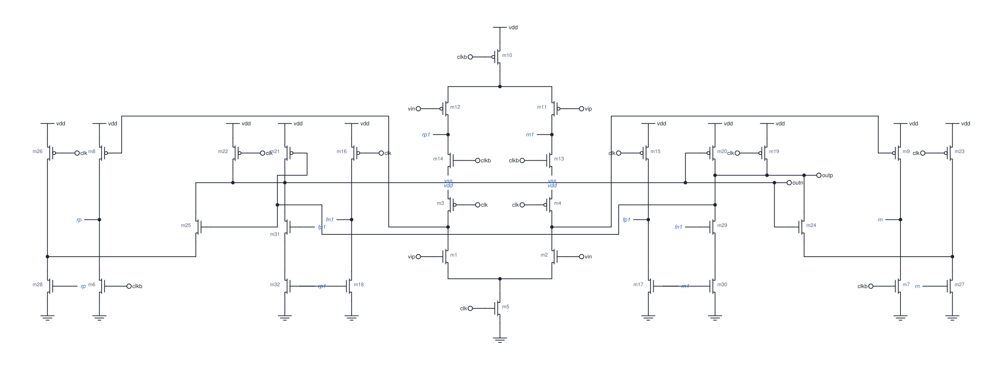 |
| AG1080 Schemify | 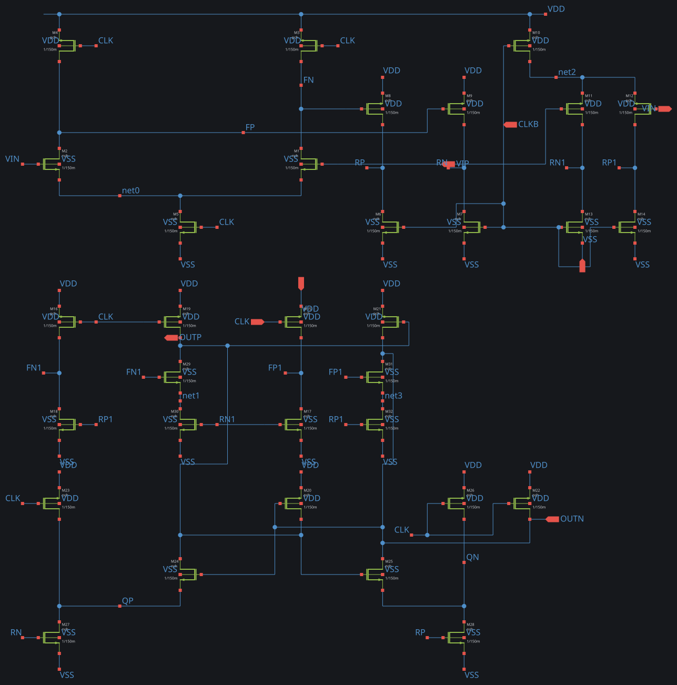 | 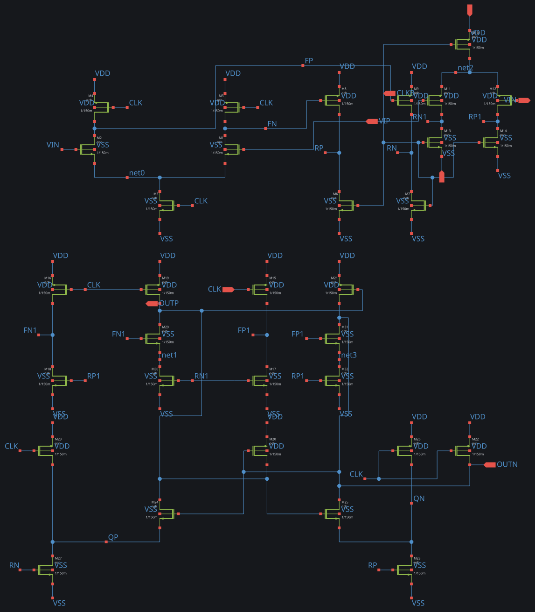 |
