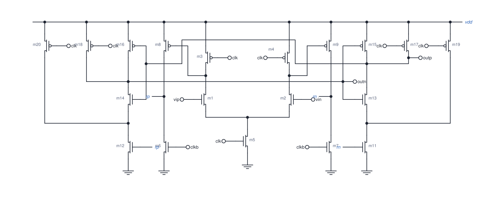
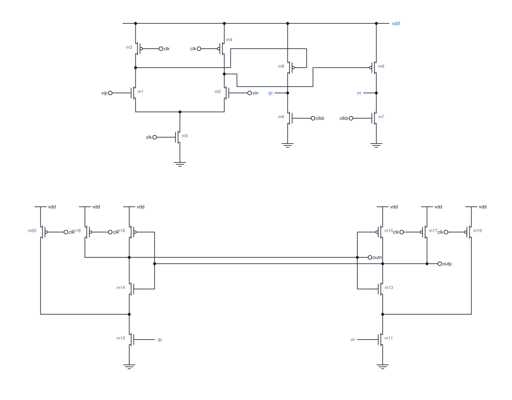
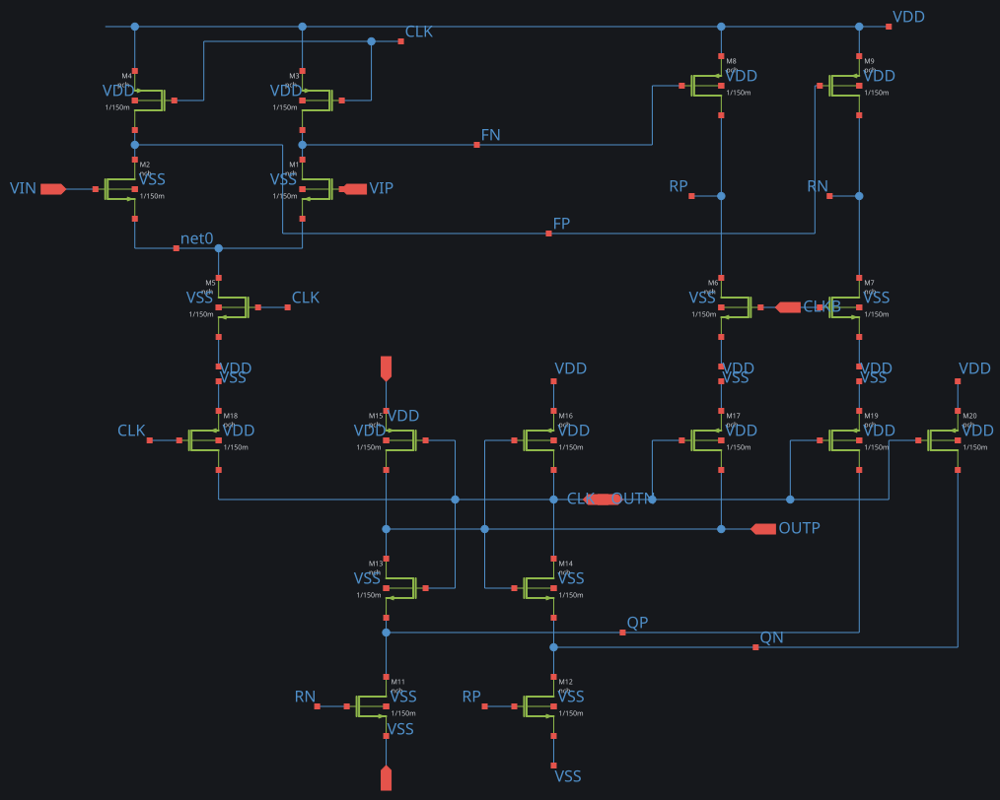
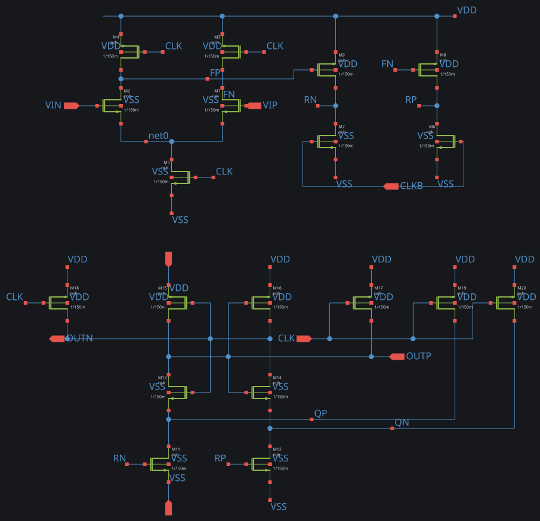
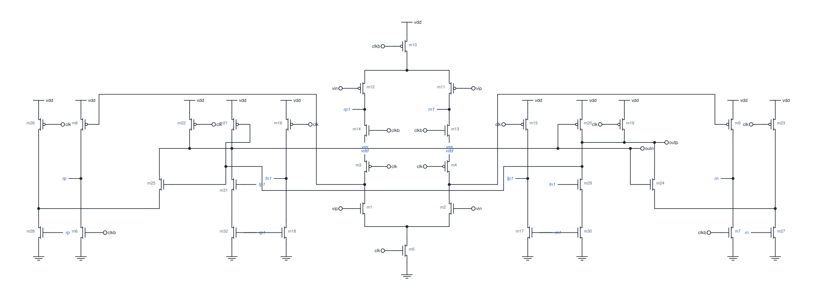
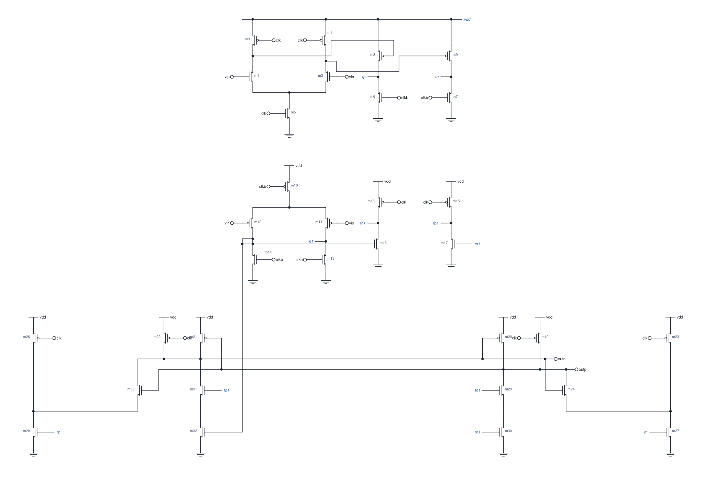
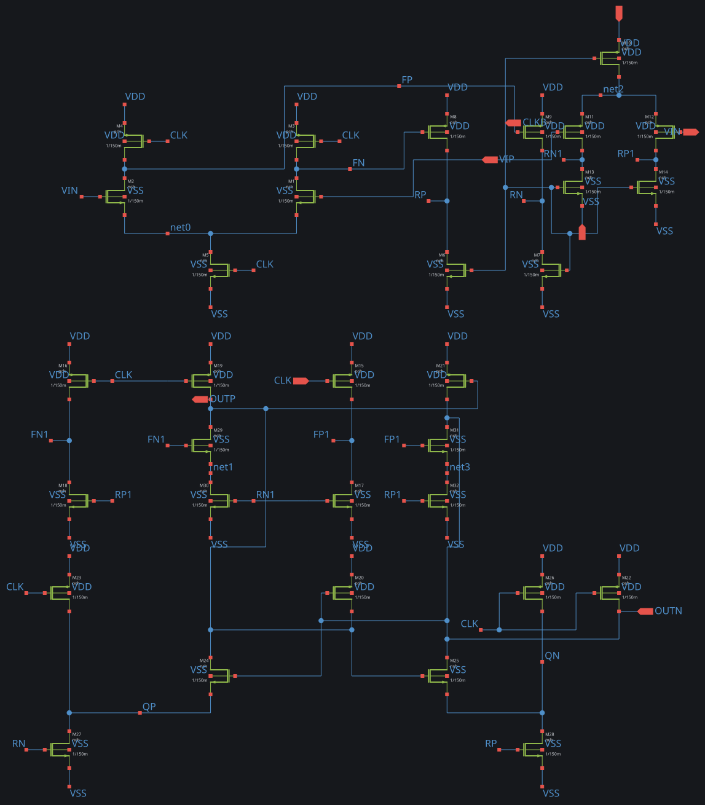
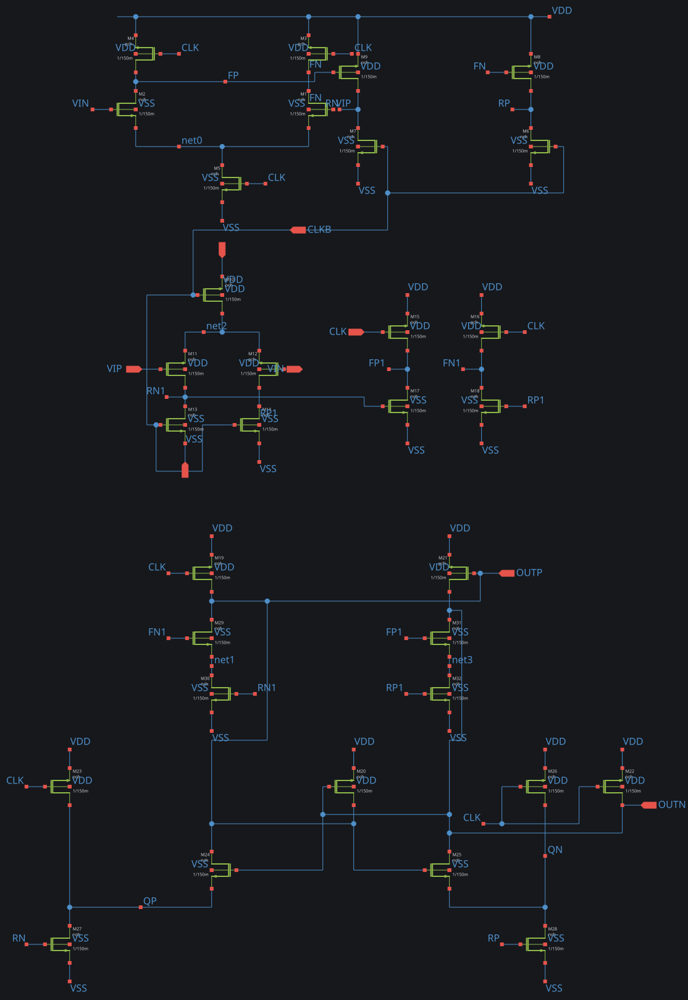

# Comparator pre-amplifier rows

In both originals, the differential input and its two receiving columns share a row. The five-device input stage sits to the left. AG1079 puts this row above its regenerative latch. AG1080 draws two such rows, first the NMOS input stage, then its complementary PMOS counterpart, with the regenerative stage below. Production now preserves these relations in a single-sheet rendering of the complete circuit. The source drawings use separate panels and named inter-panel connections. [AG1079 original](https://raw.githubusercontent.com/xz-group/AnalogGenie/efc25358939c6bedd247f28d3df61066964f3a90/Dataset/1079/Book1079.png) · [AG1080 original](https://raw.githubusercontent.com/xz-group/AnalogGenie/efc25358939c6bedd247f28d3df61066964f3a90/Dataset/1080/Book1080.png)

The selected-cell graph must already establish the paired outputs and the five-device common-control input stages. Each branch of the five-device stage must drive the expected gate in a separate complementary receiving stack. Each receiving stack has a single channel column, with its PMOS above its NMOS. Distinct rows require opposite input polarities. Body clearance and explicit placement requests are checked on the complete routed candidate. AG1046 and AG1071 still use their five-device arrangements. AG1028 has separate control gates, and AG1053 has a cycle at its output boundary. Neither supplies this complete comparator-row pattern. [Five-device evidence](../common-control/README.md) · [Pin and row regression](../../../../tests/parent_stages.py)

| Circuit | Native crossings / bends | Schemify crossings / corners | Native sheet width × height | Schemify sheet width × height |
| --- | --- | --- | --- | --- |
| AG1079 | 12 / 18 → 5 / 17 | 10 / 22 → 8 / 18 | 1328 × 548 → 1293 × 1012 | 1015 × 812 → 906 × 872 |
| AG1080 | 14 / 25 → 11 / 22 | 12 / 36 → 8 / 33 | 2157 × 820 → 2157 × 1476 | 1148 × 1310 → 1114 × 1617 |

Native values come from the public layout report. Schemify crossings are strict interior wire intersections, and its corners exclude junctions and actual symbol pins. Sheet dimensions are the export view boxes, rounded to the nearest unit. Giving each row its own vertical space makes the sheets taller. AG1080's native drawing labels six nets, down from eight. AG1079 retains three. All six required comparator output nets retain two separately labelled physical pieces. Independent Schemify export and netlist comparison preserve the ordered transistor contacts, models and parameters for all 19 and 32 devices. Exactly these two drawings and reports changed among 5,274 decks. [Output and round-trip regression](../../../../tests/parent_output_routes.py)

| Source and renderer | Before | After |
| --- | --- | --- |
| AG1079 native |  |  |
| AG1079 Schemify |  |  |
| AG1080 native |  |  |
| AG1080 Schemify |  |  |
