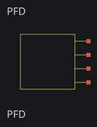
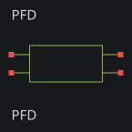
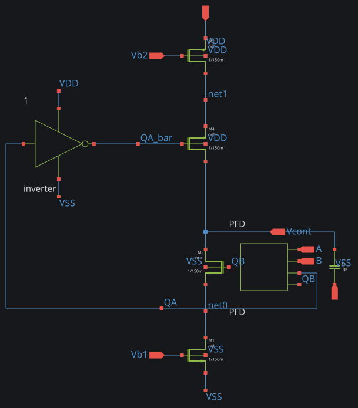
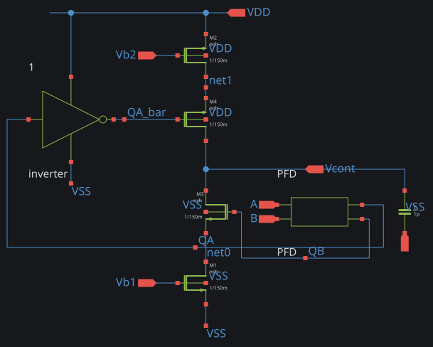
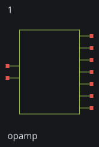
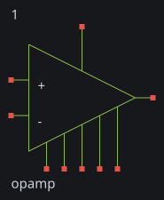
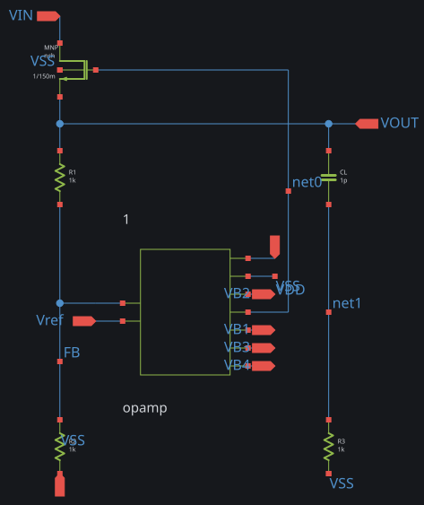
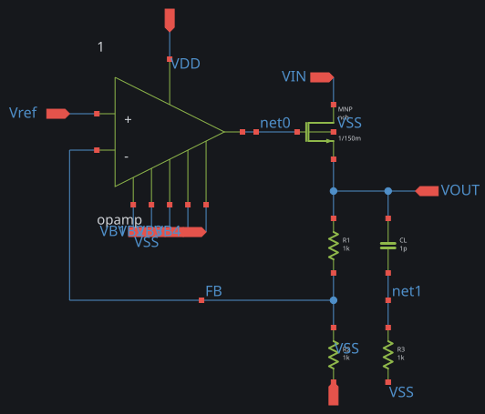

# PFD and regulator amplifier in the actual editor

Schemify imported the unmodified AG439 and AG2212 decks with the pre-symbol guest at `fe56ba45` and with the integrated guest whose SHA-256 starts with `3b5db244d874dc5c`. The DUT rows show the complete imported drawing. To isolate the glyph, the editor rendered a separate one-instance cell pointing to the exact imported definition. Every image was exported by the editor using `file.image_export.svg_export`.

| Source and view | Earlier guest | Integrated guest |
|---|---|---|
| [AG439 published phase/frequency detector](https://raw.githubusercontent.com/xz-group/AnalogGenie/efc25358939c6bedd247f28d3df61066964f3a90/Dataset/439/Book439.png) · isolated symbol |  |  |
| [AG439 published phase/frequency detector](https://raw.githubusercontent.com/xz-group/AnalogGenie/efc25358939c6bedd247f28d3df61066964f3a90/Dataset/439/Book439.png) · complete DUT |  |  |
| [AG2212 published regulator amplifier](https://raw.githubusercontent.com/xz-group/AnalogGenie/efc25358939c6bedd247f28d3df61066964f3a90/Dataset/2212/Book2212.png) · isolated symbol |  |  |
| [AG2212 published regulator amplifier](https://raw.githubusercontent.com/xz-group/AnalogGenie/efc25358939c6bedd247f28d3df61066964f3a90/Dataset/2212/Book2212.png) · complete DUT |  |  |

AG439 previously placed all four PFD contacts on the right in Schemify. A and B now enter from the left and QA and QB leave on the right. The unannotated formals retain their `inout` directions. An explicit opposite-direction PININFO for A and QB keeps the caller’s directions and corresponding sides. Giving QA an explicit top side moves it to the top.

AG2212 previously used a generic nine-contact box. Its signed amplifier triangle puts the reference above feedback in its canonical frame. All nine formals remain separate, including the four bias controls. Opening each implementation schematic produced byte-identical SVGs. The stored PFD and amplifier component records changed at their external pins and glyphs. [AG439 native comparison](../README.md#named-contacts-on-pfd-and-dac-boxes) · [AG2212 native comparison](../README.md#four-bias-amplifiers-and-clocked-comparators)
