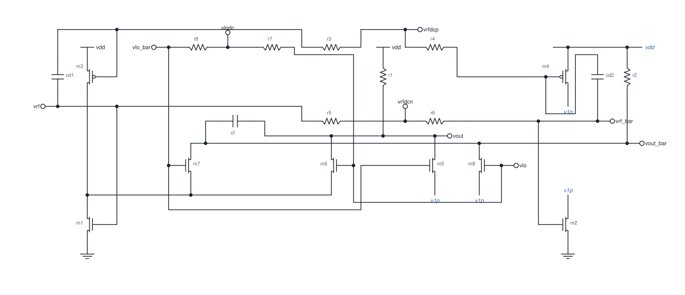
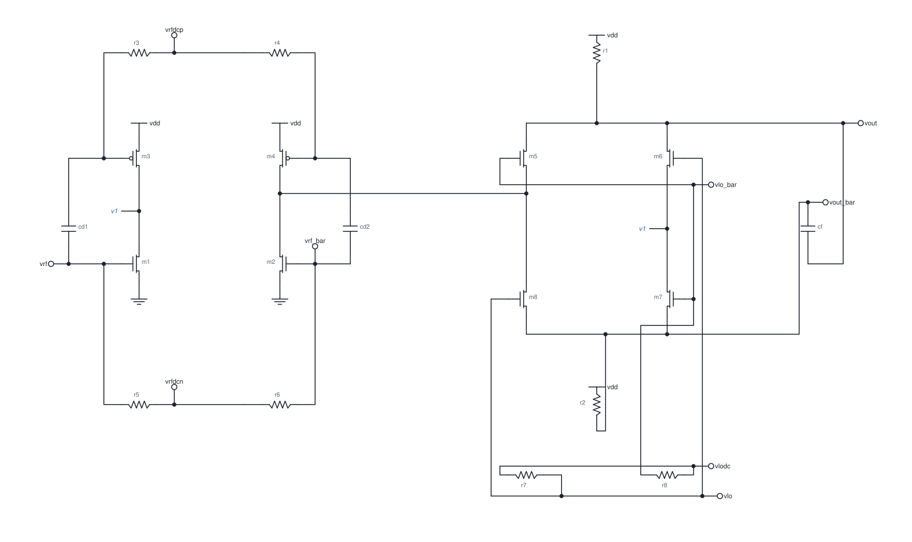
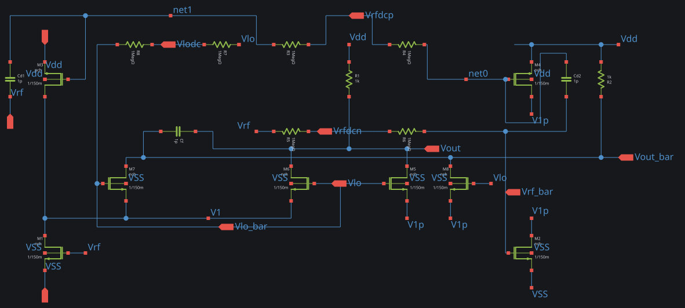
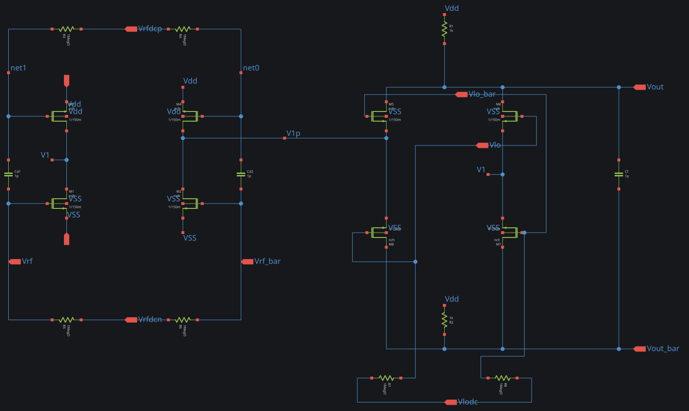

# A two-dimensional folded switching bank

AG1093's published schematic has a complementary transconductor on the left and a four-transistor switching stage on the right. The upper two switches share the upper output. The lower two share the lower output. A resistor connects each output to the supply, and a capacitor joins the two outputs at the far right. Earlier native and editor drawings placed all four switches on one row between the transconductor columns. [Published AG1093, Figure 3](https://raw.githubusercontent.com/xz-group/AnalogGenie/efc25358939c6bedd247f28d3df61066964f3a90/Dataset/1093/Book1093.png)

| Renderer | Before | After |
| --- | --- | --- |
| Native |  |  |
| Schemify |  |  |

The complete nineteen-device circuit establishes the two differential transconductor branches, two input coupling capacitors, three distinct resistor-fed bias formals, four crossed-control switches, both output loads and the output capacitor. Within this family, the declaration order of equivalent formals breaks the remaining reflection tie. The upper switches face their common drain upward, and the lower switches face theirs downward. The left and right inputs retain their complementary partners. The paper inclines the switch glyphs at approximately 45 degrees. Both production symbol libraries use cardinal rotations here. The AG517 source, by comparison, places four switches in one row. [AG517 arrangement](../nested-switch-bank/README.md) · [Independent terminal geometry checks](../../../../tests/folded_bank.py)

Native proper crossings decrease from twelve to nine and bends from thirty to twenty-seven. Schemify strict interior wire crossings increase from five to seven and pin-free corners decrease from twenty-five to twenty-three. The native sheet grows from 1482 × 639 to 1658 × 986. The native drawing labels one net, down from two. Actual Schemify re-export retains the ordered terminal bindings and values, and its circuit comparator matches nineteen devices on fifteen nets. Among 5,274 native examples, AG1093 alone changes when this second switching layout is enabled. The same geometry checks pass after card reversal and renaming. Altering one switch source, input coupling capacitor, bias parent, or output capacitor withdraws this arrangement.
