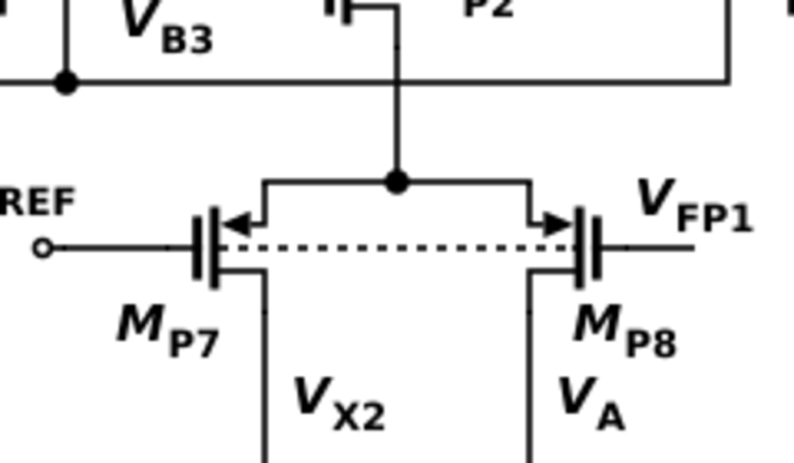
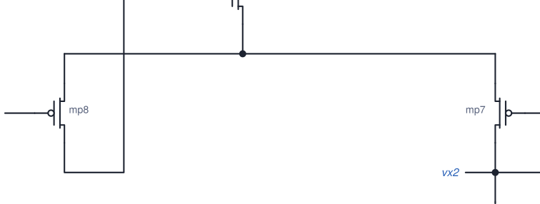
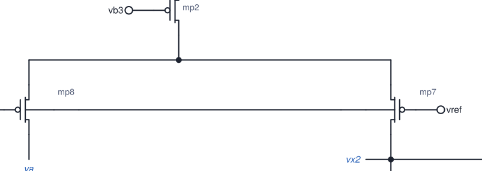
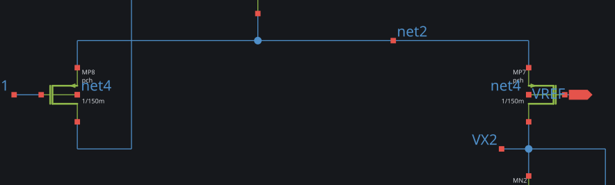
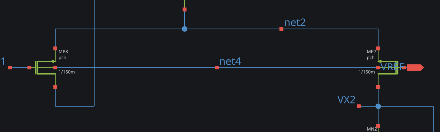

# Ordered MOS bodies and private wells

AG1294's source redraw shows MP7 and MP8 sharing two independent nets. Their sources share net2. A separate dashed line joins their bodies on net4. AG1236 has the same electrical relationship on different named nodes, but its source redraw omits the body line. In the 23 named private wells, 22 redraws show the dashed line and one omits it. The redraws document two ways to present the same electrical relationship. [AG1294 source redraw](../../../../external/examples/analoggenie/ag-1294.svg) · [AG1236 source redraw](../../../../external/examples/analoggenie/ag-1236.svg)

| AG1294 | Before | After |
| --- | --- | --- |
| Native SVG |  |  |
| Schemify editor |  |  |

The figures crop the emitted native SVG and the editor's own SVG export. The host positions for MP7.B and MP8.B are (630,450) and (130,450) in both versions. The original pair of same-net labels was already electrically valid. The new drawing has one physically continuous body wire. The host's SPICE export retains all 28 original MOS cards in their ordered D/G/S/B roles.

The default uses an explicitly registered four-contact variant when the fourth MOS net differs from that occurrence's source and has a non-rail role. Stock native PMOS and NMOS variants have their own body lead. The Schemify core primitive already supplies one. A caller-provided three-terminal class, hidden fourth terminal, or compact-only target manifest retains its own geometry. The native decision report names each distinct non-rail body that such a class omits, by device, terminal, net and reason. It emits the extra report member only when needed. A requested fully visible class also shows source ties and rails. On Schemify, selecting the compact class still puts the actual fourth node on the core B coordinate as a named contact.

| Scope | Measured result |
| --- | --- |
| 39 named native DUTs | All 780 MOS cards retained all 3,120 ordered D/G/S/B incidences. The automatic stock variant exposes 103 B contacts. It keeps the remaining 677 instances compact. Actual crosses stayed at four, on the same DUTs. Aggregate reported crossings changed from 160 to 166 and bends from 672 to 730. |
| 23 private two-body wells | The 46 B landing points all exist on selected glyphs. In 22 cases a connected physical component contains both true B tips. AG2287 has two pieces with net4 names. Its explicit `*@ wire net4` makes one continuous native conductor. The private name never becomes a formal. |
| Source-style controls | AG1236's `*@ class mp2 pmos` and `*@ class mp3 pmos` suppress native B routing and name both omitted occurrences in the report. Its default shows the separate physical body net. AG1181 exposes M1/M2.B on Vb and keeps M3/M4 compact on that same net where B=S. |
| Full native comparison | Of 5,274 converted decks, 50/2,202 AnalogGenie and 14/734 AMS-Net schematics changed. All 2,238 AnalogRetriever and 100 CircuitThink diagrams were unchanged. No deck acquired a gate finding. The 64 changed diagrams gained 13 reported crossings and 87 reported bends in total. |

Original and revised native views use the same raw DUT and the public `cktimg-json --svg <drawing.svg> --report <report.json> <deck> <drawing.json>` entry. The project fixture gate checks physical reachability by net and exact ordered raw pins. The target-manifest check uses different D/G/S/B permutations for three- and four-terminal symbols. [MOS fixture oracle](../../../../tests/mos_bodies.py)

With the Schemify debug host, import the same source using `schemify -u init.lua cmd <project> netlist.import n2s/ag-1294.cir`. Export its actual editor drawing with `schemify --clean cmd <project>/n2s/dut.shcomp file.image_export.svg_export <drawing.svg>`. The host probes independently compare the emitted DUT with Schemify's `spicecmp` and read the actual transformed B contacts from the core symbols, including their orientations. The remaining probes cover the distinct input bodies in AG1014, repeated drain/body in AG1021, rail-body convention in AG1102, four true drain/source no-connects in AG1130, connected resistor bodies in AG1167, triple source/drain/body ties in AG1177, mixed occurrences in AG1181 and the private wells in AG1236, AG1294 and AG2287.

For the isolated feature comparison on the initial PR tree, the native binaries were `2440f15abe4a7d053d3603d8f1202480acd250cee9396dabee908885a6a5b10e` and `f77a8157fc6236a1f1bbc0562eb28759e59e30c945794f07c15c2136b3ccd722`. Its guest was 561,831 bytes, SHA-256 `f39fa52f6fc2be797ccf4b2520f35ea835e13d3aafcfd54639e2b5e9b61885c9`. Geometry and provenance are specific to this checkpoint. Further combined release code can have a different size or hash.
