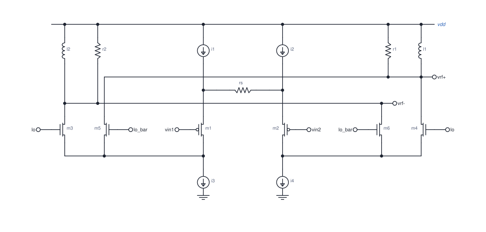
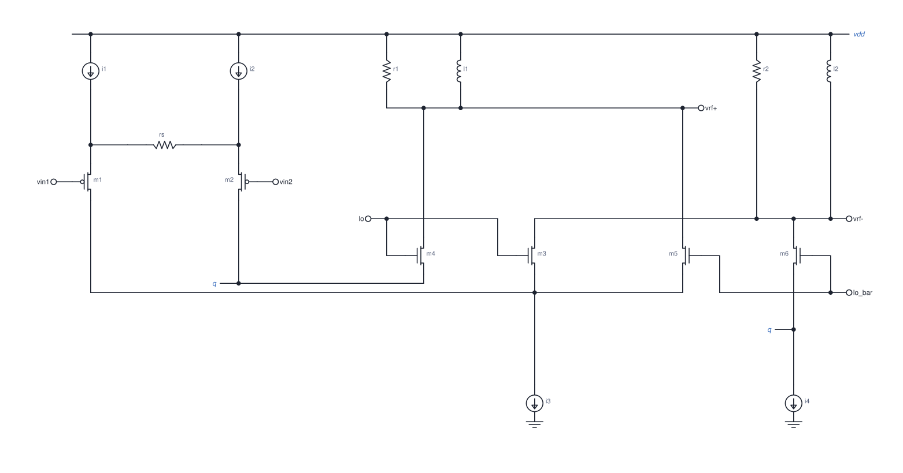
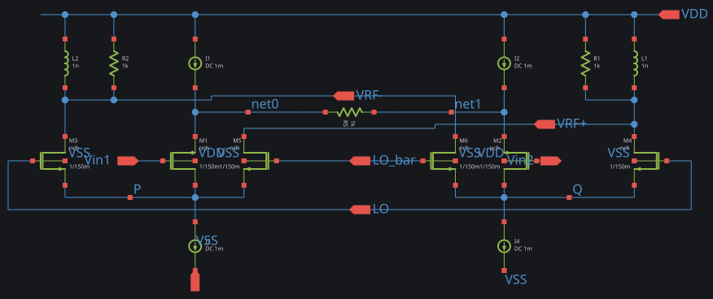
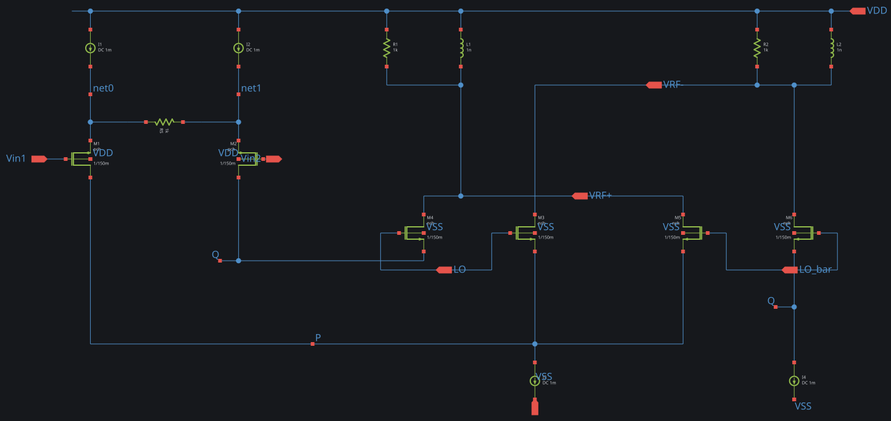

# A nested switching bank beside its transconductance stage

The AG517 original places the two PMOS inputs on the left and four NMOS switches on the right. M3 and M5 share the inner source. M4 and M6 share the outer source. Their memberships are disjoint, but the outer pair's horizontal interval contains the inner pair. Earlier native and editor drawings put each NMOS source pair together, with the PMOS inputs between the two pairs. [Original published figure](https://raw.githubusercontent.com/xz-group/AnalogGenie/efc25358939c6bedd247f28d3df61066964f3a90/Dataset/517/Book517.png)

The layout admits the whole 15-device cell. It binds two independently supplied PMOS sources and their bridging resistor, both ordered downstream current sinks, all four crossed-control NMOS devices and the two equal resistive and inductive loads. Formal declaration order breaks the electrical reflection tie. The inner and outer memberships survive renaming and card reversal. Changing one sink current, load value or gate connection, adding a switch in an existing slot, or explicitly placing an input invalidates the automatic room. AG80 and AG82 provide an important boundary: their nine-card circuits match under a terminal-by-terminal renaming, but the originals choose adjacent and nested pairs respectively. [AG80](https://raw.githubusercontent.com/xz-group/AnalogGenie/efc25358939c6bedd247f28d3df61066964f3a90/Dataset/80/Book80.png) · [AG82](https://raw.githubusercontent.com/xz-group/AnalogGenie/efc25358939c6bedd247f28d3df61066964f3a90/Dataset/82/Book82.png)

| Renderer | Before | After |
| --- | --- | --- |
| Native |  |  |
| Schemify |  |  |

Native switch channel columns are now 400, 520, 680 and 800 in published role order M4/M3/M5/M6. The input columns are 40 and 200. Actual Schemify switch columns are 600, 780, 1020 and 1200, with input columns 60 and 300. Both renderers also place the two branches' bias sources above the inputs, draw the source resistor horizontally, place both load pairs above the outer channels, and put both sinks below the switches. The two sides' gates point outwards. The source has an oblique drain crossover. The current drawing uses the orthogonal router. [Independent geometry check](../../../../tests/mixer_stage.py)

Native crossings decrease from five to three, bends increase from three to eleven, and the internal Q connection gains a label. Actual Schemify strict interior crossings decrease from six to three, and pin-free wire corners increase from fifteen to sixteen. The native SVG grows from 1178 × 564 to 1562 × 820. The editor SVG grows from 877 × 368 to 1443 × 683 (rounded). All 15 ordered devices and their values survived actual editor import/export, and Schemify's netlist comparator matched all 15 devices and 12 nets. Among 5,274 native decks exactly AG517's drawing and report changed.
