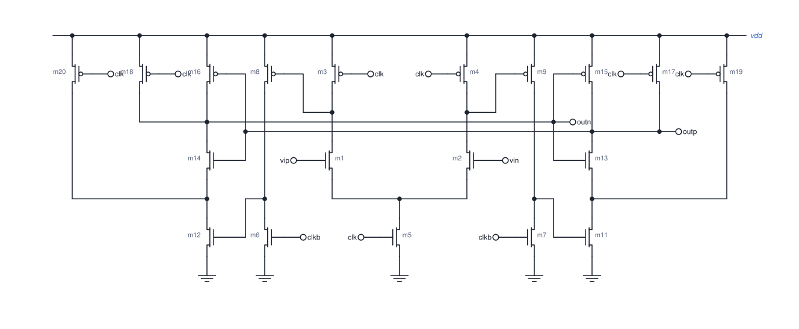
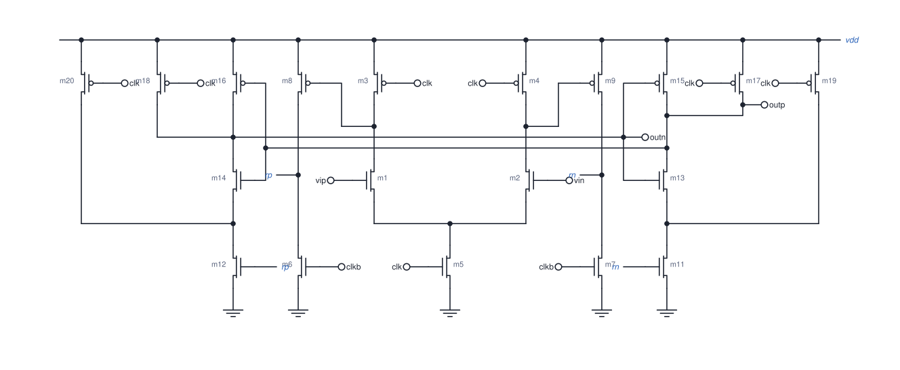
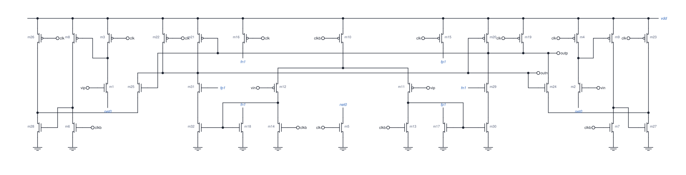
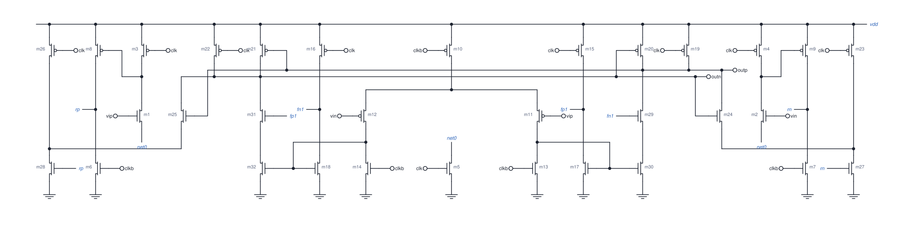

# Comparator outputs shared by two drains and a distant gate

In AG1079, panel (a) joins one PMOS drain and one NMOS drain at RN and another pair at RP. Panel (b) repeats the two names at the gates of M11 and M12. AG1080 uses the same convention for RN/RP between panels (a) and (c), and for FN1/FP1 between panels (b) and (c). Each net has two pieces of wire. Its two drain pins share one piece, and the gate in the later stage has its own named connection. [AG1079 published figure][book1079] · [AG1080 published figure][book1080]

| Production before | Production after | Published figure |
|---|---|---|
| [](ag-1079.before.svg) | [](ag-1079.after.svg) | [![AG1079 stage partition][book1079]][book1079] |
| [](ag-1080.before.svg) | [](ag-1080.after.svg) | [![AG1080 stage partition][book1080]][book1080] |

| Schematic and net | Locally joined drain pins | Gate carrying the other copy of the name |
|---|---|---|
| AG1079 RN | M9 and M7 | M11 |
| AG1079 RP | M8 and M6 | M12 |
| AG1080 RN | M9 and M7 | M27 |
| AG1080 RP | M8 and M6 | M28 |
| AG1080 FN1 | M16 and M18 | M29 |
| AG1080 FP1 | M15 and M17 | M31 |

The native SVG frontend went from zero matching nets to all six. Previously, RN/RP appeared as continuous wires in both circuits, while AG1080 FN1/FP1 had three detached pins apiece. The Schemify import already matched four nets. Its AG1080 FN1/FP1 were continuous. All six imported nets now have exactly two named components. These counts trace the actual terminal coordinates, wires and attached names for each frontend. A drawing with two labels on the same wire fails the check.

The selection requires a complete reflected pair of complementary stacks inside a circuit with acyclic dependencies between its transistor groups. The routing step keeps existing device poses. AG1053 has a cycle and keeps both continuous three-pin wires. An explicit `*@ wire fn1` in AG1080 keeps all three FN1 terminals together. An explicit `*@ label fn1` draws three separate names. Either instruction returns the sibling FP1 to ordinary routing. Both siblings must pass the automatic route trial before either is published. [AG1053 deck](../../../external/examples/analoggenie/ag-1053.cir) · [AG1080 deck](../../../external/examples/analoggenie/ag-1080.cir)

The full parent census also checks all 2,202 decks for the exact four raw sibling pairs, including the pair in the cyclic control. Seven AG1080 variants change an output formal, gate, source, model, substrate or passive incidence. The unrelated RN/RP pair survives three of them. Run `nix develop -c python3 tests/parent_corpus.py` to repeat these comparisons.

The regression runs the public CLI or the actual plugin on both circuits, the cycle and both caller variants. The target check reads Schemify's core MOS glyphs and generated component records, netlists each imported DUT, compares all four ordered MOS terminals, the model and every parameter by name, and runs `spicecmp`. Native SVG label text is checked separately. Use a fresh artifact directory for each run. [Regression](../../../tests/parent_output_routes.py)

```sh
python3 tests/parent_output_routes.py native zig-out/bin/cktimg-json /tmp/parent-output-native
python3 tests/parent_output_routes.py target /path/to/schemify/bin /path/to/Schemify/crates/model/doc/devices /tmp/parent-output-target
```

For AG1080 with `axis missing`, the previous CLI reproduced the [pre-N0 drawing](ag-1080.before.svg) byte for byte. The cumulative corrected CLI reproduces the [unhinted G1 drawing](common-control/ag-1080.native.after.svg) byte for byte. Rejected directives that name a real endpoint leave the six published partitions intact. An accepted `first VDD` claims its routing priority and also preserves them. A compatible explicit pose on a gate, or `role FN1 internal`, returns only its sibling pair to ordinary routing. A weak rotation that the final drawing rejects cannot reserve the pair. These checks examine the actual wire components, ordered member pins and attached labels for each output.

At the N0-only checkpoint `337509a5`, the sibling FP1 had three components in native and one in Schemify under either FN1 override. Once G1 retains the admitted stage positions, the native ordinary router produces one FP1 component for `wire FN1` and two for `label FN1`. The explicit FN1 still has one and three respectively. The regression repeats the same staged drawing with the FN1/FP1 candidate omitted and compares every device pose, pin, wire point, junction and label. [Ordinary-routing comparison](../../../tests/parent_parts.zig)

An explicit symbol file is checked against its selected MOS terminals and ink. Renaming the drain terminal in that file loses physical authority and reproduces ordinary routing. A CLI `--target` manifest describes a permutation of the pins in the same drawing and leaves its wires intact. The host check separately uses Schemify's real core glyphs. [Caller and mapping regression](../../../tests/parent_output_intent.py)

```sh
python3 tests/parent_output_intent.py zig-out/bin/cktimg-json /tmp/parent-output-intent
python3 tests/parent_output_intent.py zig-out/bin/cktimg-json /tmp/parent-output-host-intent --host /path/to/schemify/bin /path/to/Schemify/crates/model/doc/devices .
```

[book1079]: https://raw.githubusercontent.com/xz-group/AnalogGenie/efc25358939c6bedd247f28d3df61066964f3a90/Dataset/1079/Book1079.png
[book1080]: https://raw.githubusercontent.com/xz-group/AnalogGenie/efc25358939c6bedd247f28d3df61066964f3a90/Dataset/1080/Book1080.png
