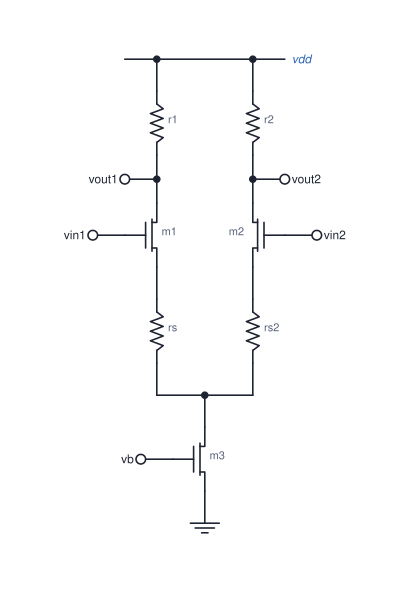
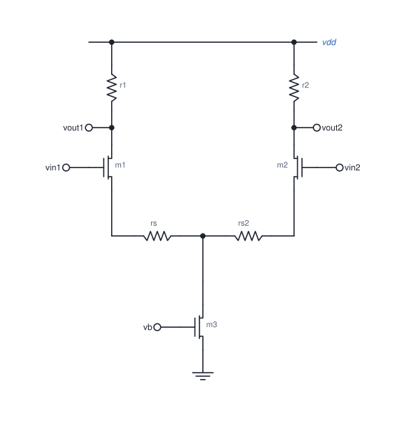
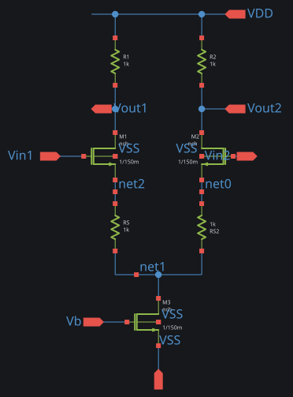
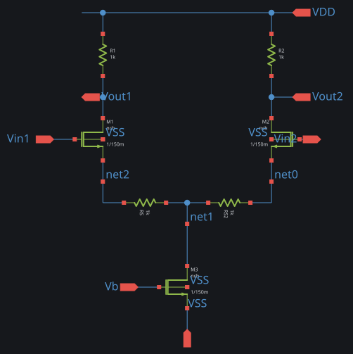

# Two equal source resistors meet above the tail

In AG220 the original draws two equal degeneration resistors on one horizontal line. Their inner ends meet at a three-way junction directly above the shared tail transistor. Each outer end connects to one input source. The previous production drawings put both resistors upright under the inputs. The new native and Schemify drawings recover all three visible paths. The ordinary one-resistor bridge already present in AG396 supplies a separate example of horizontal source degeneration. [Original AG220](https://raw.githubusercontent.com/xz-group/AnalogGenie/efc25358939c6bedd247f28d3df61066964f3a90/Dataset/220/Book220.png) · [Original AG396](https://raw.githubusercontent.com/xz-group/AnalogGenie/efc25358939c6bedd247f28d3df61066964f3a90/Dataset/396/Book396.png)

| Renderer | Before | After |
| --- | --- | --- |
| Native |  |  |
| Schemify |  |  |

The rule requires one certified equal-arm owner and two equal drain loads reaching the same opposite rail. Those seven devices must account for the complete original cell. Each resistor’s source-side terminal determines which way it faces. The original input and bias gates, output formals, rail and bulk bindings remain authoritative. One of the 2,202 inspected AnalogGenie decks has this complete certified owner. On a synthetic PMOS complement, the same signed roles put the tail above the inputs and the drain loads below. Both actual host circuits returned equivalent seven-device netlists. [Attachment census and scope](../source-regions/README.md)

| Full drawing | Native before → after | Schemify before → after |
| --- | ---: | ---: |
| Horizontal arms on the same row | 0/2 → 2/2 | 0/2 → 2/2 |
| Input channel span | 60 → 160 | 110 → 240 |
| Wire crossings | 0 → 0 | 0 → 0 |
| Native bends or Schemify pin-free wire corners | 2 → 2 | 2 → 2 |

The wider branch spacing leaves a short horizontal approach outside each resistor. A native pose trial that aligned the outer resistor tips directly with the MOS sources needed six bends. Reversing the signs of both resistor approaches at the chosen branch spacing needed ten. The published result checks the actual rendered wire from each source to its assigned resistor and from both inner contacts to the tail drain. The required three-way junction sits on the tail’s actual drain column. A routing failure restores the previous layout.

The regression reverses resistor terminals, renames devices while reversing all cards, exchanges supply/return roles in the complementary circuit, and checks unequal arms, independently rail-ended arms, unequal drain loads, a caller-specified upright resistor and the ordinary one-resistor bridge. The before drawings fail the horizontal-bridge test. Both after drawings pass from final output contacts. The Schemify SVGs came from the editor’s SVG exporter after actual plugin import. [Native and target regression](../../../../tests/source_bridge.py)

Across all 5,274 gallery decks, the native rule changed exactly AG220 and AMS-Net 530. The other 5,272 drawings remained byte-identical. Neither the before nor the after reports found an electrical gate violation. AMS-Net 530 has the same seven-device topology with different internal net names, different load names and both resistor cards stored in the opposite order. Its gallery redrawing puts the two arms at y=360 with the tail drain at x=360. Both final native and Schemify outputs pass the contact-and-wire test. The input-channel spans change from 60 to 160 in native and from 110 to 240 in Schemify. The two actual Schemify exports, before and after, round-trip all seven ordered cards.

The two upstream images reproduce the same composition, including the right input’s detour across the tail-drain line. They give one human example and two runnable gallery decks. AMS-Net’s source pair is `amsnet_1.0/530/530.jpg` and `530.cir` in its published archive. The source image SHA-256 is `76c8ed5786b36c12d4fc3cb562e4063e560a9d86696d4da816eacdd128a3087c`. The original netlist ties the two input bulks to their sources. Its converted gallery deck ties both to VSS. The production check uses the actual converted deck’s bulk bindings. [AMS-Net 1.0 source archive](https://github.com/AMS-Net/ams-net.github.io/blob/8dccd9adee9a04961e00a255d3a3d82124a2737e/amsnet_1.0-20240412T024532Z-001.zip) · [AMS-Net 530 gallery drawing](../../../../external/examples/amsnet/amsnet-530.svg) · [AMS-Net 530 drawing coordinates](../../../../external/examples/amsnet/amsnet-530.human.json)

The native target-manifest control reverses both indexed pins for all four resistors and compares the complete drawing with the default. A separately supplied stock symbol library and a change to an unused capacitor produce identical coordinates. Moving the MOS gate alone, hiding a resistor terminal or adding a long resistor stroke each restores the ordinary drawing for that library. Each comparison reads the emitted JSON through the public command. [Symbol and projection controls](../../../../tests/source_bridge.py)
